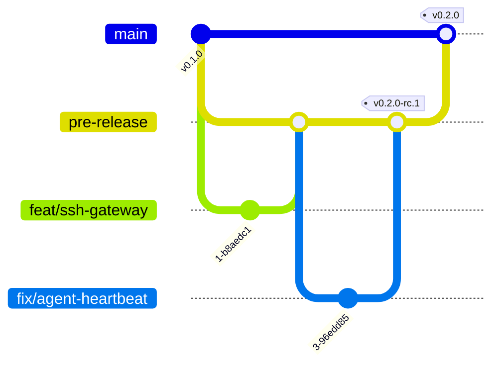

# Contributing to Differently

Thanks for helping. Differently is Apache-2.0 and developed in the open.

## Branch model



| Branch | Purpose | Who merges | Protection |
|---|---|---|---|
| `pre-release` (default) | Integration line. Every change lands here first, behind green CI. | Any contributor or coding agent with write access, once CI passes | No force pushes or deletion; PRs with passing CI required |
| `main` | Released code only. Moves when a release is cut. | Maintainers, via a release PR from `pre-release` (or a `hotfix/*` branch) | No direct pushes, force pushes or deletion; PRs only from `pre-release` or `hotfix/*` |
| `<type>/<outcome>` | One focused change, e.g. `feat/ssh-gateway`, `fix/agent-heartbeat`, `docs/aws-guide` | Author | — |
| `hotfix/<outcome>` | Urgent fix for a released version, branched from `main`, merged to `main` and back into `pre-release` | Maintainers | — |

Why: `main` stays a clean record of releases, while `pre-release` lets people
and agents iterate and merge quickly without each change being a release.

### Day to day

```bash
git fetch origin
git switch -c feat/my-change origin/pre-release
# ... change, test ...
make verify
git commit -s -m "feat(scheduler): requeue waiting sandboxes when capacity frees"
gh pr create --base pre-release
```

- Branch from the latest `origin/pre-release`; rebase on it before merging.
- One outcome per PR. Titles use [Conventional Commits](https://www.conventionalcommits.org/)
  (`feat`, `fix`, `docs`, `refactor`, `test`, `ci`, `chore`, optional scope).
- Squash-merge into `pre-release`; the PR title becomes the commit message.

### Releases

1. Release candidates are tagged on `pre-release`: `vX.Y.Z-rc.N`. The release
   workflow publishes them as GitHub pre-releases with binaries, images, SBOMs
   and signatures.
2. When an RC is accepted, open a PR from `pre-release` to `main` titled
   `release: vX.Y.Z`, update `CHANGELOG.md`, merge with a merge commit, and tag
   `vX.Y.Z` on `main`.
3. Hotfixes branch from `main` as `hotfix/<outcome>`, release as `vX.Y.Z+1`,
   and are merged back into `pre-release`.

## Developer Certificate of Origin

Every commit needs a `Signed-off-by` line (`git commit -s`) certifying the
[DCO](https://developercertificate.org/). CI checks it.

## Development setup

| Tool | Version |
|---|---|
| Go | 1.26 or newer |
| Node.js | 20 or newer (TypeScript SDK) |
| Python | 3.9 or newer (Python SDK) |
| Helm | 3.14 or newer (chart lint) |
| Docker | optional, for images and the Postgres conformance suite |

```bash
make build            # bin/differently-server, differently-agent, differently-guest, differently
make test             # Go unit and integration tests with -race
make test-postgres    # store conformance suite against a throwaway Postgres container
make sdk-test         # TypeScript and Python SDK tests
make helm-lint        # chart lint and template against ci/ value sets
make verify           # everything CI runs
make dev              # run the server in dev mode (no isolation!)
```

## Expectations for changes

- **Tests:** add or update a focused test for behaviour you change. The
  acceptance scenarios in `internal/server/server_test.go` must keep passing.
- **API changes:** update `api/openapi.yaml` (a test fails if a route is
  missing), both SDKs, and `docs/feature-parity.md`.
- **Adapters:** implement only the optional interfaces you really support and
  declare matching features; see `docs/adapters/specification.md`.
- **Security-sensitive code** (auth, policy, store transactions, agent
  networking): explain the threat you considered in the PR.
- **Docs:** user-visible behaviour needs docs in the same PR. Say what is
  verified and what is not.
- **Dependencies:** prefer the standard library; justify new modules.

## Reporting bugs and proposing features

Use the issue templates. For substantial designs, open a PR adding an ADR under
`docs/adr/` first.

## Security issues

Do not open public issues for vulnerabilities. See [SECURITY.md](SECURITY.md).
