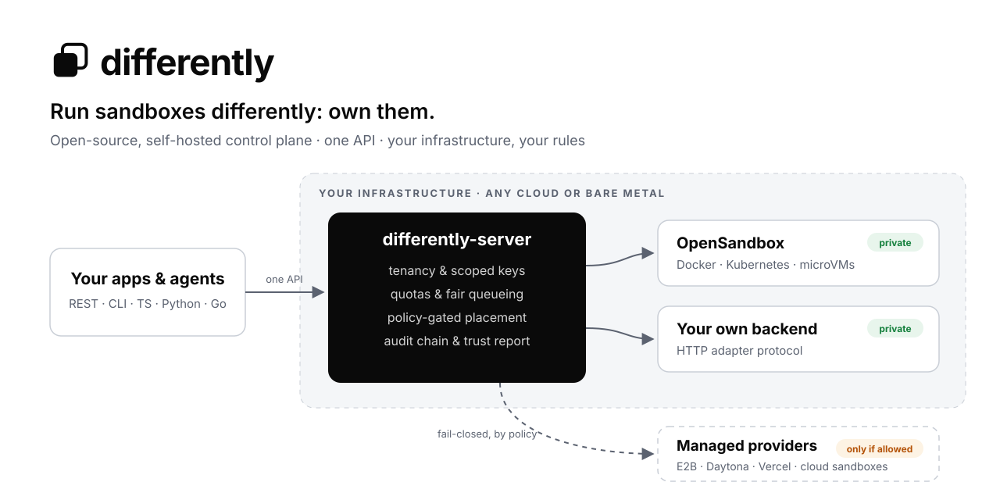
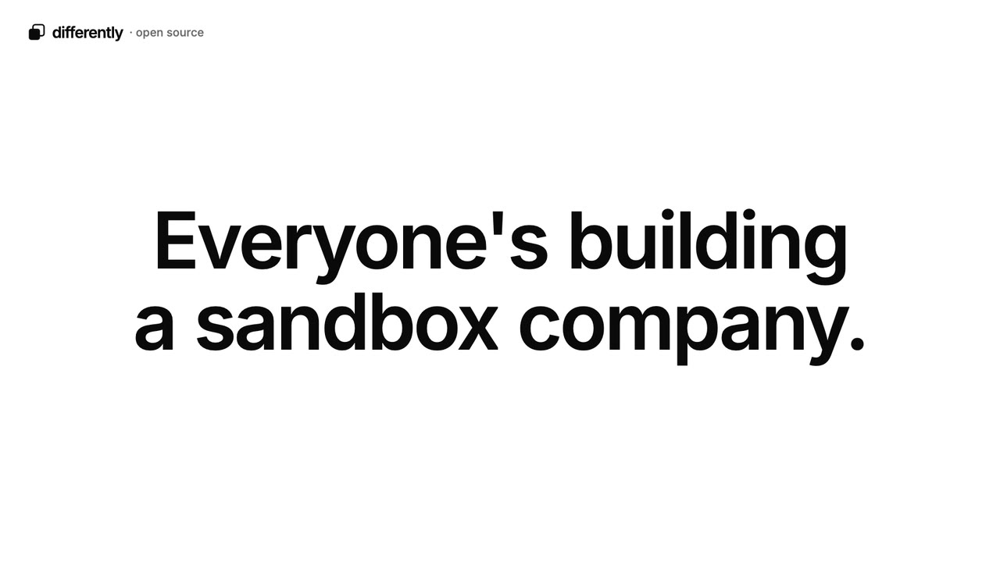

<p align="center">
  <picture>
    <source media="(prefers-color-scheme: dark)" srcset="docs/assets/differently-splash-dark.svg">
    
  </picture>
</p>

<p align="center">
  <a href="https://github.com/different-ai/differently/releases"></a>
  <a href="https://github.com/different-ai/differently/actions/workflows/ci.yml?query=branch%3Apre-release"></a>
  <a href="LICENSE"></a>
  
  <a href="https://different-ai.github.io/differently/"></a>
</p>

<p align="center">
  <b><a href="https://different-ai.github.io/differently/">Website</a></b> ·
  <b><a href="https://different-ai.github.io/differently/docs/guides/quickstart/">Get started</a></b> ·
  <b><a href="docs/deploy/README.md">Deploy anywhere</a></b> ·
  <b><a href="https://different-ai.github.io/differently/docs/">Docs</a></b> ·
  <b><a href="https://github.com/different-ai/differently/releases">Releases</a></b> ·
  <b><a href="CONTRIBUTING.md">Contribute</a></b>
</p>

**Differently is the open-source control plane for sandboxes.** Install it on
infrastructure you already run (any cloud, your own Kubernetes or bare
metal), and your developers and agents get one sandbox API: create, exec,
files, snapshots, fork. Differently decides where each sandbox runs and keeps
account of it:

- by default on [OpenSandbox](https://github.com/opensandbox-group/OpenSandbox)
  on your own Docker hosts, Kubernetes clusters or microVM nodes;
- on [15 other built-in provider adapters](docs/providers/README.md), from
  E2B, Daytona and Vercel to the AWS, Azure and Google Cloud sandbox
  services, or a plugin for any other backend, only where your policies
  allow it.

Apache-2.0, fully self-hosted, no telemetry. Built by the
[OpenWork](https://github.com/different-ai) team.

<p align="center">
  <a href="https://different-ai.github.io/differently/#video"></a>
  <br><sub>▶ <a href="https://different-ai.github.io/differently/#video">Watch the 36-second intro</a></sub>
</p>

> **Pre-release ([`v0.1.0-alpha.1`](https://github.com/different-ai/differently/releases)).**
> The whole platform is implemented and tested end to end against real
> OpenSandbox servers (Docker and Kubernetes runtimes). It isn't ready for
> production workloads yet: see [what is verified](#status).

## Why

Teams adopting AI agents and automated code execution already run serious
infrastructure, with their own IAM, networking and observability. Most sandbox
products still ask them to add another vendor-run environment: another trust
boundary, another API, another place where code, credentials and data end up.

Good open-source sandbox *runtimes* exist. Turning them into a multi-tenant
platform is the hard part: quotas, fair queueing, deciding which runtime or
provider each sandbox may use, and proving where work ran. Differently is
that layer.

| | |
|---|---|
| **One API, any backend** | REST, CLI and SDKs for TypeScript, Python and Go. Applications never name a backend; operators change placement, code doesn't. |
| **Policy decides where work runs** | Private-first placement, data classifications, and external providers that are opt-in and fail-closed. |
| **Multi-tenant from day one** | Organizations, projects, scoped API keys with rotation, quotas and fair queueing. |
| **Provable** | A tamper-evident audit chain, a placement explanation for every sandbox, and an operator trust report. |
| **Keys stay with you** | Provider keys are stored sealed or by reference. Switch where new sandboxes go with one command. |
| **Self-hosted, all of it** | API, dashboard, scheduler, queue, audit and metrics run on your infrastructure. No phone-home. |

## Get started

**1. Try it on your laptop (2 minutes).** Needs Go 1.26+. Dev mode keeps
state in memory and runs commands **on your machine with no isolation**, to
explore the API, CLI and SDKs:

```bash
make build
./bin/differently-server --dev                      # writes an operator token to ~/.differently/dev/token
./bin/differently sandbox create --profile small --wait   # in another terminal
./bin/differently sandbox exec <sandbox-id> -- 'echo hello from $(uname -s)'
./bin/differently sandbox placement <sandbox-id>    # why it ran where it ran
```

The dashboard is at <http://localhost:8080/dashboard/>.

**2. Run the real stack on any Docker host (10 minutes).** Postgres,
Differently and a real OpenSandbox server, as the end-to-end suite runs it:

```bash
make e2e-prepare e2e-up    # API on :18090, OpenSandbox on :18091
make e2e                   # optional: the 12 end-to-end tests
```

**3. Deploy it for your team.** On [one Linux VM on any cloud](docs/deploy/single-vm.md)
(k3s, OpenSandbox and Differently, about 30 minutes), or with Helm on
[your Kubernetes cluster](docs/deploy/kubernetes.md) using the chart and
images from the [latest release](https://github.com/different-ai/differently/releases).

Then call it from code ([TypeScript](sdk/typescript), [Python](sdk/python),
[Go](pkg/client)):

```ts
import { Differently } from "@differently/sdk";

const differently = new Differently({ apiKey: process.env.DIFFERENTLY_API_KEY });
const sandbox = await differently.sandboxes.create({
  profile: "small",
  placement: { strategy: "private-first", external: "never" },
});
console.log((await sandbox.exec("uname -sm")).stdout);
await sandbox.delete();
```

## Deploy anywhere

| Where | How | Status |
|---|---|---|
| Laptop | `differently-server --dev` | Verified (no isolation; for trying it) |
| Any Docker host | [`test/e2e`](test/e2e/README.md) Compose stack | Verified: end-to-end suite 14/14 |
| One Linux VM: Azure, AWS, Google Cloud, bare metal | [k3s + Helm](docs/deploy/single-vm.md) | Verified on Azure; same steps elsewhere, not yet run |
| Existing Kubernetes: EKS, GKE, AKS, k3s, RKE2 | [Helm chart](docs/deploy/kubernetes.md) | Helm install verified on k3s; managed clusters documented |
| Cloud notes | [AWS](docs/deploy/aws.md) · [Google Cloud](docs/deploy/gcp.md) · [Azure](docs/deploy/azure.md) · [Bare metal](docs/deploy/bare-metal.md) | Documented |
| No internet | [Air-gapped](docs/deploy/air-gapped.md) | Documented |

The [deployment overview](docs/deploy/README.md) has the support matrix,
prerequisites, [day-2 operations](docs/deploy/day-2.md) and the
[hardening checklist](docs/security/hardening-checklist.md).

## Status

**Verified** (2026-10-28 and 29):
- the end-to-end suite passes 14/14 on OpenSandbox's Docker runtime and on its
  Kubernetes runtime (k3s on Azure, both installed with Helm);
- on the Kubernetes runtime: stop/start keeping the disk, snapshots and fork
  through a snapshot registry, signed port URLs (including WebSockets) and
  egress policy;
- idle sandboxes stop (Kubernetes) or pause (Docker) and wake on the next
  call;
- the published `v0.1.0-alpha.1` chart and images install from public
  artifacts alone;
- real OpenSandbox responses are recorded and replayed in every `go test`;
- the `agent-sandbox` adapter against a Kubernetes cluster (kind);
- [OpenWork](https://github.com/different-ai/openwork)'s Workbot computers run
  through Differently as a sandbox gateway, behind a flag;
- Fast Sandbox microVMs on one node: the adapter scenario (recorded), and
  Workbot's desktop streamed over a port URL, paused and resumed with its
  memory, idled and woken by a request (pause takes minutes).

**Not verified yet:**
- the end-to-end suite on Fast Sandbox microVMs;
- multi-node clusters;
- managed EKS, GKE and AKS;
- live accounts on the managed providers: their adapters are tested
  against fakes of each provider's published API.

Each of the 26 providers has a page with its tested status, capabilities and
configuration in the [provider catalog](docs/providers/README.md). The
[roadmap](docs/roadmap.md) and [feature parity](docs/feature-parity.md)
pages track the details. Releases follow [semantic versioning](https://semver.org/):
pre-releases are tagged `vX.Y.Z-alpha.N` or `-rc.N`, and images are
`ghcr.io/different-ai/differently-{server,cli}:X.Y.Z`.

## How it works

`differently-server` runs as stateless API replicas plus one elected scheduler
leader, with Postgres as its only dependency. Each request is admitted against
quota, queued fairly, then placed: the scheduler filters every registered pool
against global, organization and project policy, ranks what is left, and
records why. Adapters talk to the backends:

- `opensandbox`, the default private runtime;
- 15 more provider adapters, from `agent-sandbox` and `cubesandbox` you run
  to `e2b`, `daytona`, `vercel` and the cloud providers' sandbox services
  ([provider catalog](docs/providers/README.md));
- `remote`, any service speaking the [adapter protocol](docs/adapters/specification.md).

Isolation and egress belong to each backend's runtime. Differently records
what each pool declares and says so in the trust report.

Read the [architecture](docs/architecture/README.md), the
[decision records](docs/adr/) and the [security model](docs/security/trust-model.md).

## How it compares

Self-hosted sandbox runtimes exist (OpenSandbox, CubeSandbox, E2B's runtime).
Differently builds on them rather than competing with them. What it adds is
policy-driven placement across your own runtimes *and* external providers,
under a control plane you run. See the
[feature parity matrix](docs/feature-parity.md) and the
[competitive landscape](docs/competitive-landscape.md).

## Community

- **Contribute:** [CONTRIBUTING.md](CONTRIBUTING.md) covers the branch model
  (PRs target `pre-release`), DCO sign-off and releases.
  [AGENTS.md](AGENTS.md) is the entry point for coding agents and
  maintainers.
- **Get help:** [SUPPORT.md](SUPPORT.md).
- **Report a vulnerability:** [SECURITY.md](SECURITY.md), privately.
- **Conduct and decisions:** [CODE_OF_CONDUCT.md](CODE_OF_CONDUCT.md),
  [GOVERNANCE.md](GOVERNANCE.md).

<details>
<summary>Repository layout</summary>

| Path | What |
|---|---|
| `cmd/` | `differently-server` and the `differently` CLI |
| `pkg/api`, `pkg/adapter`, `pkg/client` | Wire types, the versioned adapter contract and plugin protocol, the Go SDK |
| `internal/` | Server, scheduler, reconciler, policy, store (memory and Postgres), auth, audit, secrets, adapters |
| `api/openapi.yaml` | The HTTP API contract (a test keeps it in sync with the router) |
| `sdk/typescript`, `sdk/python` | Official SDKs |
| `deploy/` | Helm chart (control plane only), Terraform (AWS) |
| `docs/` | Guides, deployment, architecture, ADRs, security, roadmap |
| `site/` | The website and docs site |
| `test/e2e`, `test/opensandbox` | The real-stack end-to-end suite and the live OpenSandbox checks |

</details>

## License

[Apache License 2.0](LICENSE).
