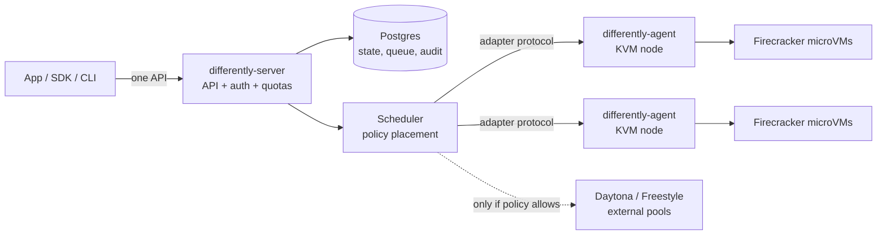

# Differently

**Run VMs differently: own them.** Your infrastructure. Your rules. One API.

Differently is an open-source, fully self-hosted control plane for sandboxes and
microVMs. Install it in a Kubernetes cluster you already run, point it at
KVM-capable nodes, and your developers get a simple sandbox API (create, exec,
files, snapshots) backed by Firecracker microVMs on hardware you control. When
you choose to, the same API can also place work on external providers such as
Daytona or Freestyle, but only where your policies explicitly allow it.

Built by the [OpenWork](https://github.com/different-ai) team, Apache-2.0.

> **Status: pre-release (`0.1.0-dev`).** The control plane, scheduler, policy
> engine, node agent, adapters, CLI, SDKs, Helm chart and docs are implemented
> and covered by fast unit and in-process integration tests. Nothing has run on
> real KVM infrastructure or live provider accounts yet; that is the next phase
> ("solidification", see [docs/roadmap.md](docs/roadmap.md)). Do not run
> production workloads on it yet.

## Why it exists

Organizations adopting AI agents and automated code execution often already run
serious infrastructure: Kubernetes clusters, cloud accounts, bare metal, their
own IAM, networking and observability. Most sandbox products still ask them to
add another vendor-run environment, with another trust boundary, another API
and another place where code, credentials and data end up.

The pieces to do this yourself exist (Firecracker, Kubernetes, Postgres), but
assembling them into a multi-tenant, quota-enforcing, auditable platform is a
project in itself. Differently is that assembly, packaged so that:

- **Everything is self-hostable**: API, dashboard, auth, keys, scheduler,
  queue, quotas, audit, metering. No OpenWork-hosted service, license server or
  telemetry. There is no phone-home code path.
- **External providers are opt-in and fail-closed.** Registering a provider
  authorizes nothing. Work leaves your private pools only when the global
  policy, the tenant's policy, the data classification and the request all
  allow it, and the provider is explicitly approved.
- **Applications never name a backend.** Operators change placement policy;
  application code keeps calling the same API.
- **Operators can see and prove where work ran**: every placement records the
  pools considered and why; the trust report lists external endpoints,
  credentials (by reference), external placements, admin actions, the audit
  chain status and the limits of what Differently can prove.

## How it works



- `differently-server` — stateless API replicas plus one elected scheduler
  leader. Postgres is the only production dependency.
- `differently-agent` — a DaemonSet on nodes labelled `differently.dev/kvm=true`
  that runs Firecracker microVMs, isolates their networks and reports capacity.
- `differently-guest` — a tiny in-VM agent reached over vsock for exec and files.
- Adapters — `firecracker` (node agents), `daytona`, `freestyle`, `remote`
  (any service speaking the [adapter protocol](docs/adapters/specification.md)),
  and `devhost` for local development only.

Read the [architecture RFC](docs/architecture/README.md) and the
[decision records](docs/adr/).

## Try it locally in two minutes

Requires Go 1.26+. Dev mode uses an in-memory store and a `devhost` pool that
runs commands **directly on your machine with no isolation** — it exists so you
can exercise the whole API, CLI and SDKs on a laptop.

```bash
make build
./bin/differently-server --dev
```

In another terminal (the dev server writes an operator token to
`~/.differently/dev/token`, which the CLI picks up for localhost):

```bash
./bin/differently doctor
./bin/differently sandbox create --profile small --wait
./bin/differently sandbox exec <sandbox-id> -- 'echo hello from $(uname -s)'
./bin/differently sandbox files put <sandbox-id> ./README.md /work/README.md
./bin/differently sandbox placement <sandbox-id>
./bin/differently sandbox delete <sandbox-id>
```

The dashboard is at <http://localhost:8080/dashboard/> (sign in with the token).

From TypeScript ([`sdk/typescript`](sdk/typescript)):

```ts
import { Differently } from "@differently/sdk";

const differently = new Differently({ apiKey: process.env.DIFFERENTLY_API_KEY });
const sandbox = await differently.sandboxes.create({
  profile: "small",
  placement: { strategy: "private-first", external: "never" },
});
const result = await sandbox.exec("node --version");
console.log(result.stdout);
await sandbox.delete();
```

Python ([`sdk/python`](sdk/python)) and Go ([`pkg/client`](pkg/client)) SDKs
follow the same shape. The HTTP contract is [api/openapi.yaml](api/openapi.yaml).

## Deploy into your organization

- [Deployment overview and support matrix](docs/deploy/README.md)
- [Existing Kubernetes cluster with Helm](docs/deploy/kubernetes.md) —
  `helm install differently deploy/helm/differently`
- [AWS](docs/deploy/aws.md), [GCP](docs/deploy/gcp.md), [Azure](docs/deploy/azure.md),
  [bare metal](docs/deploy/bare-metal.md), [air-gapped](docs/deploy/air-gapped.md)
- [Onboarding organizations, projects and keys](docs/guides/organization-onboarding.md)
- [Hybrid overflow to Daytona or Freestyle](docs/guides/hybrid-overflow.md)
- [Day-2 operations](docs/deploy/day-2.md)

## How it compares

[docs/feature-parity.md](docs/feature-parity.md) is the feature-by-feature
matrix against Boat, Daytona, Freestyle and others, including what each
backend supports and what Differently does not do yet.
[docs/competitive-landscape.md](docs/competitive-landscape.md) explains where
Differently fits. In short: self-hosted Firecracker on Kubernetes is not unique
(OpenSandbox, CubeSandbox and E2B's runtime exist); policy-driven placement
across your own microVMs *and* external providers, under a control plane you
run, is the gap Differently targets.

## Repository layout

| Path | What |
|---|---|
| `cmd/` | `differently-server`, `differently-agent`, `differently-guest`, `differently` (CLI) |
| `pkg/api`, `pkg/adapter`, `pkg/client` | Public wire types, the versioned adapter contract and plugin protocol, the Go SDK |
| `internal/` | Server, scheduler, policy, store (memory + Postgres), auth, audit, node agent, adapters |
| `api/openapi.yaml` | The HTTP API contract (a test keeps it in sync with the router) |
| `sdk/typescript`, `sdk/python` | Official SDKs |
| `deploy/` | Helm chart, Terraform (AWS), systemd units, guest image build scripts |
| `docs/` | Architecture, ADRs, security model, guides, roadmap, backlog |

## Development and branches

```bash
make verify   # gofmt, go vet, unit + integration tests with -race, SDK tests, helm lint
```

All work merges into **`pre-release`**; open PRs with
`gh pr create --base pre-release`. `main` is the default branch and holds
released code only: it moves when a release is cut from `pre-release`. See [CONTRIBUTING.md](CONTRIBUTING.md)
for the branch model, DCO sign-off and release process, [AGENTS.md](AGENTS.md)
for coding-agent guidance, and [SECURITY.md](SECURITY.md) to report a
vulnerability.

## License

[Apache License 2.0](LICENSE).
