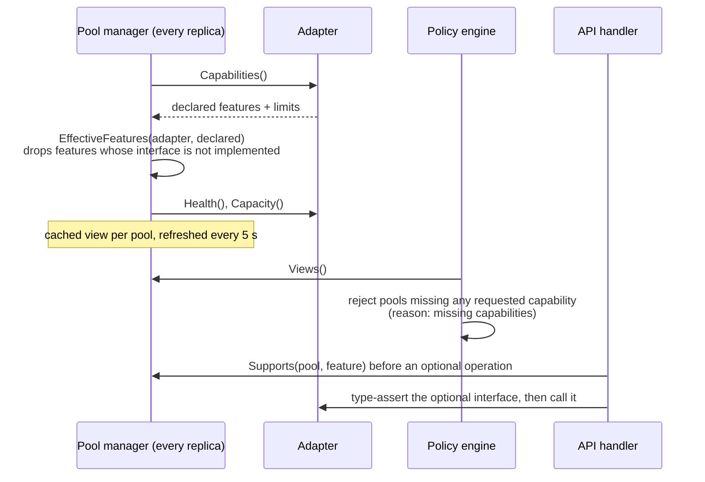

# Adapter specification

| | |
|---|---|
| Contract version | `adapter.ProtocolVersion = "1"` (`pkg/adapter/adapter.go`) |
| Status | Describes the code as of 2026-10-28 |
| Decision record | [ADR 0007](../adr/0007-adapter-contract-optional-interfaces-http-protocol.md) |

An **execution adapter** creates and manages sandbox instances on one backend.
The control plane holds one adapter per [pool](../architecture/README.md#4-the-three-layers).
Adapters run in-process (built in) or out of process behind the HTTP protocol
in `pkg/adapter/adapterhttp`. The Differently node agent is itself an
out-of-process adapter.

## 1. Concepts

| Term | Meaning |
|---|---|
| Sandbox ID | The Differently ID (`sbx_<ulid>`). It is the idempotency key for `Create`. |
| Instance | The backend resource that backs one sandbox (`adapter.Instance`: `ref`, `sandboxId`, `state`, `region`, `message`). |
| Ref | The adapter's own identifier for an instance. Opaque to the control plane, which stores it as `backendRef`. |
| Installation | A stable ID created once per Differently database (`inst_<ulid>`, `meta` table). `List` filters by it so two installations sharing a provider account never touch each other's instances. |
| Ownership labels | `adapter.OwnershipLabels` adds `differently.dev/sandbox-id` and `differently.dev/installation` to the request labels. The scheduler also passes `differently.dev/org` and `differently.dev/project`. Tenants cannot set labels with this prefix. |
| Instance states | `pending`, `running`, `stopped`, `paused`, `error` |

## 2. Required interface

```go
type ExecutionAdapter interface {
    Info() Info
    Capabilities(ctx context.Context) (Capabilities, error)
    Capacity(ctx context.Context) (Capacity, error)
    Health(ctx context.Context) error
    Create(ctx context.Context, req CreateRequest) (Instance, error)
    Get(ctx context.Context, ref string) (Instance, error)
    List(ctx context.Context, installation string) ([]Instance, error)
    Delete(ctx context.Context, ref string) error
    Exec(ctx context.Context, ref string, req api.ExecRequest) (api.ExecResult, error)
}
```

| Method | Semantics an adapter must provide | Called by |
|---|---|---|
| `Info` | Kind, version, trust claim, isolation description, protocol. The **operator's** pool `trust` setting is authoritative; for `remote` pools the declared trust overrides the plugin's claim (`internal/wiring/wiring.go`). | Trust report, diagnostics |
| `Capabilities` | Declared feature names plus limits: `maxCPU`, `maxMemoryMiB`, `maxDiskGiB` (0 = no limit), `templates` (empty = any), `regions`. | Pool refresh every 5 s on every replica |
| `Capacity` | Free capacity now. `bounded: false` means "no meaningful limit" (most external providers); the pool's `maxConcurrency` then governs. Bounded adapters should fill `largestFreeCPU`/`largestFreeMemoryMiB` for the roomiest single node so fragmented capacity is not mistaken for room (`Capacity.Fits`). | Pool refresh |
| `Health` | `nil` when the backend can accept work. An error marks the pool unhealthy until the next successful probe; eligible work then waits. | Pool refresh |
| `Create` | **Idempotent on `req.ID`.** Creating the same sandbox ID twice must return the existing instance, never a second one, including after a lost response or a control-plane crash. Should return once the instance is ready for exec. Stamp ownership labels where the backend supports them. Honour `fromSnapshot` (a snapshot ref from this same adapter), `template`, `resources`, `env`, `ttlSeconds`. | Scheduler provisioning, with timeout `scheduler.provisionTimeoutSeconds` (default 120 s) |
| `Get` | The instance for a ref, or `not_found`. | Adapters internally; diagnostics |
| `List` | Every instance owned by `installation`, in any non-deleted state. **Must fail rather than return a partial list**: the reconciler treats a missing instance as lost and an unknown instance as an orphan. | Reconciler every `scheduler.reconcileIntervalSeconds` (default 30 s) |
| `Delete` | **Idempotent.** Deleting a missing instance succeeds. | Scheduler termination (60 s timeout, retried every tick until it succeeds); reconciler orphan cleanup |
| `Exec` | Run `command` with `/bin/sh -c`, or `args` directly without a shell; honour `env`, `cwd`, `stdin`, `timeoutSeconds`. Return exit code, stdout, stderr, duration and `truncated`. A non-zero exit is a result, not an error. | API replica (`POST /v1/sandboxes/{id}/exec`) |

## 3. Optional interfaces

| Interface | Methods | Feature names it backs |
|---|---|---|
| `Streamer` | `ExecStream(ctx, ref, req, emit) (exitCode, error)`; `emit` receives `{stream: stdout|stderr, data}` events | `exec.stream` |
| `FileSystem` | `ReadFile`, `WriteFile` (create parents), `ListFiles` | `files` |
| `Lifecycle` | `Stop` (keep disk), `Start` | `lifecycle.stop-start`, `persistence.disk` |
| `Pauser` | `Pause` (memory kept), `Resume` | `lifecycle.pause-resume` |
| `Snapshotter` | `Snapshot(ctx, ref, kind)` with kind `disk` or `memory`, `DeleteSnapshot`. Restore happens through `CreateRequest.FromSnapshot` on the **same** adapter. | `snapshots.disk`, `snapshots.memory`, `fork` |
| `PortExposer` | `ExposePort(ctx, ref, port) (url, error)` | `ports.expose` |

When a sandbox's pool lacks a feature, the API answers
`501 unsupported_operation` with `operation`, `pool` and `adapter` details
(`internal/server/sandboxes.go` `unsupported`). Without the `exec.stream`
feature, a streamed exec falls back to one buffered `stdout` and `stderr`
event followed by `exit`.

## 4. Features and negotiation

Feature names (`pkg/adapter/adapter.go`):

| Feature | Meaning | Backed by |
|---|---|---|
| `exec` | Synchronous commands | required interface |
| `exec.stream` | Output streamed as produced | `Streamer` |
| `files` | Read, write, list files | `FileSystem` |
| `lifecycle.stop-start` | Stop keeping disk; start again | `Lifecycle` |
| `persistence.disk` | Disk survives stop | `Lifecycle` |
| `lifecycle.pause-resume` | Freeze with memory resident | `Pauser` |
| `snapshots.disk` | Disk snapshot, restore through `fromSnapshot` | `Snapshotter` |
| `snapshots.memory` | Memory-and-disk snapshot | `Snapshotter` |
| `fork` | Snapshot plus new sandbox from it | `Snapshotter` |
| `ports.expose` | Reachable URL for a guest port | `PortExposer` |
| `ssh`, `pty`, `gpu` | Reserved names; no adapter offers them, so requests for them are rejected with `unsupported_capability` | declaration only |
| `network.egress-control` | The backend can restrict sandbox egress (node-level on Firecracker today) | declaration only |
| `arch.amd64`, `arch.arm64` | Guest architecture | declaration only |
| `isolation.microvm`, `isolation.container`, `isolation.none` | Isolation class (`isolation.none` cannot be requested) | declaration only |

Negotiation, end to end:



- A request asks for features in `capabilities` (validated against the known
  names; `isolation.none` and unknown names are `400 invalid_request`).
  Profiles can add capabilities.
- Placement keeps only pools that advertise every requested feature. If
  capabilities are the only reason no permitted pool qualifies, the request is
  rejected with `422 unsupported_capability`.
- Optional operations are double-checked at call time: the adapter must
  implement the interface **and** the pool must advertise the feature.
- For `remote` pools the HTTP client implements every optional interface, so
  the effective list is what the remote declares; the remote's own handler
  applies `EffectiveFeatures` before answering `/info`.
- The Firecracker pool advertises the **intersection** of its live agents'
  features and the union of their templates.

## 5. Error codes

Adapters return `*api.Error` values (`pkg/api/errors.go`). Helpers:
`adapter.NotFound`, `adapter.Unsupported`, `adapter.Unavailable`,
`adapter.InsufficientCapacity`.

| Code | Use it for | Control-plane reaction |
|---|---|---|
| `insufficient_capacity` | No room right now: node full, provider plan cap, provider 429 | Provisioning: requeue after 2 s, the attempt is not counted, pool health untouched. Activation: try the next ranked pool. Public API: shown as `503 provider_unavailable`. HTTP protocol status: 503. |
| `provider_unavailable` | Backend unreachable, timed out, credentials rejected, 5xx | Provisioning: pool marked unhealthy until its next probe; requeue with backoff `2 s × 2^min(attempts, 5)`; failed after `scheduler.maxAttempts` (default 3). Probes: pool unhealthy. Public API: `503`. |
| `not_found` | Instance or snapshot does not exist | `Delete` must not return it. Elsewhere passed through as `404`. |
| `unsupported_operation` | The backend cannot do this at all | Passed through as `501`. |
| `invalid_request` | The request cannot succeed (bad path, missing image) | Passed through as `400`. In `Create` it fails the sandbox without retrying or marking the pool unhealthy. |
| `invalid_state` | Wrong instance state (exec on a paused VM), conflicts | Passed through as `409`. |
| anything else | | `500 internal` to clients; in `Create`, treated like `provider_unavailable`. |

`internal/adapters/httpx` maps provider HTTP statuses for HTTP-based adapters:
404 → `not_found`, 429 → `insufficient_capacity`, 409 → `invalid_state`,
400/422 → `invalid_request`, 401/403 → `provider_unavailable` (with a
"credentials were rejected" message that never echoes the key), other
statuses and transport errors → `provider_unavailable`.

## 6. Reconciliation contract

The leader's reconciler (`internal/scheduler/scheduler.go` `Reconcile`) calls
`List(installation)` on every pool with a built adapter and:

1. deletes **orphans**: instances whose sandbox is unknown, terminal, or
   recorded on a different pool and not queued;
2. **adopts** instances for sandboxes stuck in `provisioning` longer than the
   provision timeout (created before a crash), marking them `running`;
3. **requeues** stale `provisioning` sandboxes with no instance;
4. **fails** `running`, `paused` or `stopped` sandboxes whose `backendRef` is
   not in the list ("backend instance disappeared").

A failed `List` skips the pool for that pass. Adapters must therefore never
return a partial list; the Firecracker pool fails the whole list if any live
agent fails to answer. The reconciler compares existence only, not state: an
instance that is `stopped` on the backend while the store says `running` is
not corrected.

## 7. HTTP protocol

`adapterhttp.Handler(adapter, token)` serves any adapter; `adapterhttp.Client`
consumes one. The node agent mounts the handler at `/adapter/`.

**Conventions**

- Base path `/adapter/v1`. JSON request and response bodies; request JSON is
  limited to 4 MiB.
- Every response carries `Differently-Adapter-Protocol: 1`; `/info` also
  returns `info.protocol`. A breaking change bumps the number.
- Authentication: when the server has a token, every route (including
  `/info` and `/health`) requires `Authorization: Bearer <token>`, compared in
  constant time; failures are `401 unauthenticated`.
- Errors: `{"error": {"code", "message", "details"}}` with the status from
  `api.Error.HTTPStatus`, except `insufficient_capacity`, which is 503.
- File content is raw bytes (`application/octet-stream`), at most
  `MaxFileBytes` = 100 MiB.

**Routes**

| Method and path | Body | Success |
|---|---|---|
| `GET /adapter/v1/info` | | `200 {info, capabilities}` (features already filtered by `EffectiveFeatures`) |
| `GET /adapter/v1/capacity` | | `200 Capacity` |
| `GET /adapter/v1/health` | | `200 {"status":"ok"}`, or `503 provider_unavailable` |
| `POST /adapter/v1/instances` | `CreateRequest` | `200 Instance` |
| `GET /adapter/v1/instances?installation=ID` | | `200 [Instance]` (`[]` when empty) |
| `GET /adapter/v1/instances/{ref}` | | `200 Instance` |
| `DELETE /adapter/v1/instances/{ref}` | | `204` |
| `POST /adapter/v1/instances/{ref}/exec` | `ExecRequest` | `200 ExecResult` |
| `POST /adapter/v1/instances/{ref}/exec?stream=1` | `ExecRequest` | `200 application/x-ndjson` (below) |
| `GET /adapter/v1/instances/{ref}/files?path=P` | | `200 [FileInfo]` |
| `GET /adapter/v1/instances/{ref}/files/content?path=P` | | `200` bytes |
| `PUT /adapter/v1/instances/{ref}/files/content?path=P` | bytes | `204` |
| `POST /adapter/v1/instances/{ref}/stop` · `start` · `pause` · `resume` | | `204` (other action names: `404 not_found`) |
| `POST /adapter/v1/instances/{ref}/snapshots` | `{"kind": "disk"\|"memory"}` | `200 Snapshot {ref, kind, sizeBytes}` |
| `DELETE /adapter/v1/snapshots/{ref}` | | `204` |
| `POST /adapter/v1/instances/{ref}/ports` | `{"port": N}` | `200 {"url": "..."}` |

Optional routes on an adapter that lacks the interface answer
`501 unsupported_operation`.

**Streaming.** With `?stream=1` the response is newline-delimited JSON, one
`api.ExecEvent` per line, flushed as produced:

```
{"stream":"stdout","data":"building...\n"}
{"stream":"stderr","data":"warning: ...\n"}
{"exitCode":0}
```

The stream ends with exactly one `{"exitCode": N}` or `{"error": "message"}`.
Because the status line is already sent, errors after the stream starts are
plain strings and lose their error code. The client rejects lines over 8 MiB
and treats a stream without a final event as an error.

**Client behaviour** (`adapterhttp.Client`): a transport error or a non-2xx
response without an error envelope becomes `provider_unavailable`; `Delete`
maps `not_found` to success; the HTTP client timeout is 5 minutes per request,
which also bounds exec duration and stream length through this protocol (see
known issues). The client does not yet verify the protocol header.

## 8. InfrastructureAdapter (design, not implemented)

The three-layer model has a layer below execution backends: the
infrastructure that hosts them. Today Differently does not manage it:

- **Node agents self-register.** An agent started with `--pool NAME` and the
  agent token heartbeats every 10 s to `/internal/v1/agents/heartbeat` with its
  ID (the node name), endpoint, capacity, features and templates, plus its own
  secret in the `Differently-Agent-Secret` header. The secret is pinned when
  the ID first registers; the control plane then calls that agent's adapter
  API with it, and refuses heartbeats for that ID with any other secret or
  pool. The pool
  must already exist with `adapter: firecracker`. An agent missing heartbeats
  for `scheduler.agentTimeoutSeconds` (default 30 s) drops out of placement.
  Agents stay in the store until an operator removes one with
  `DELETE /v1/admin/agents/{id}`.
- **Existing VM pools** are covered by `remote` pools: a plugin that speaks the
  HTTP protocol in front of a fleet (libvirt hosts, Proxmox, a cloud account)
  allocates an instance per `Create`.
- **Capacity is static.** Adding nodes is the operator's job (Karpenter, node
  groups, bare-metal provisioning).

Proposed contract for a later phase, for scaling private capacity from queue
pressure:

```go
// InfrastructureAdapter manages the nodes behind a private pool.
type InfrastructureAdapter interface {
    Info() InfraInfo
    // Nodes lists nodes this adapter manages for the pool, with lifecycle state.
    Nodes(ctx context.Context, pool string) ([]Node, error)
    // Scale requests a target node count; it returns once the request is accepted.
    Scale(ctx context.Context, pool string, target int) error
    // Retire removes a node after the control plane has drained it.
    Retire(ctx context.Context, pool, node string) error
}
```

Open design questions: a per-agent drain (today only whole pools drain);
which signal drives scaling (count of `waiting` decisions whose reason is
capacity, queue age); cost guards so scaling never exceeds a budget; how
newly provisioned nodes prove their identity (ties into
[backlog E3](../backlog.md#e3-authenticated-agent-channel)).

## 9. Built-in adapters

Verification level: **unit** = tested in-process with fakes; **spec** =
written against the provider's published OpenAPI and tested with a fake HTTP
server; none has run on real infrastructure or live accounts.

| | `firecracker` | `daytona` | `freestyle` | `devhost` | `fake` |
|---|---|---|---|---|---|
| Code | `internal/adapters/firecracker/pool.go` + `internal/agent` | `internal/adapters/daytona` | `internal/adapters/freestyle` | `internal/adapters/devhost` | `internal/adapters/fake` |
| Trust | private | external (forced) | external (forced) | private | as configured |
| Isolation | Firecracker microVM (KVM) | Container (`class: container`, default) or VM (`class: linux-vm`) | Hardware-virtualized microVM (provider-managed) | **None** (host directories) | None (simulated) |
| Allowed | always (needs agent token) | always | always | dev mode only | dev mode only |
| Ref | `<agent-id>:<sandbox-id>` | Daytona sandbox ID | Freestyle VM ID | sandbox ID | `fake_<ulid>` |
| Idempotent `Create` | `Get(sandbox ID)` on each live agent, then the agent's own map keyed by sandbox ID | List by `differently.dev/sandbox-id` label first; `name` is the sandbox ID | Slug derived from the sandbox ID; `409` on create resolves to the existing VM | Directory per sandbox ID | Map by sandbox ID |
| `List` | Union over live agents; fails if any agent fails | Label filter on installation, cursor paging; skips `destroyed`/`destroying` | Metadata filter `dly-installation:<id>`, offset paging | Every directory with matching installation | In memory |
| `Health` | At least one agent heartbeat within the agent timeout. The agent's own `/healthz` and `/adapter/v1/health` check the kernel and that a template exists, but the pool does not call them | `GET /sandbox?limit=1` | `GET /v5/vms?limit=1` | Root directory exists | Always healthy |
| `Capacity` | Bounded: sums of live agents' last heartbeat; largest node by free memory | Unbounded | Unbounded | Unbounded | Bounded if `TotalCPU` set |
| Limits | `maxCPU`/`maxMemoryMiB` of the largest node's allocatable capacity; templates = union of node images | 4 vCPU / 8 GiB / 10 GiB (provider default maximum); region = `target` | 32 vCPU / 64 GiB / 256 GiB (plan-dependent) | none | configurable |
| Resources applied | vCPU and memory in Firecracker machine config; disk grown with `truncate` + `resize2fs` when `diskGiB` exceeds the image | **Not sent**: the sandbox gets the snapshot's size; quota and cost still use the requested size | Grown with `/resize` after boot (grow only; never shrinks below the snapshot's size) | not applied | recorded |
| Env | Stored in the node's `vm.json`; merged into every exec | Sent in the create body (stored by Daytona) | Written to `/etc/differently/env` (0600) in the VM and sourced by every exec | Stored in `meta.json`; base env for every exec | ignored |
| Provider TTL backstop | none | `ttlMinutes`; `autoStopInterval: 0` so Differently owns stop | `ttlSeconds` | none | none |
| `exec` | Through vsock to the guest: separate stdout/stderr, stdin, cwd, env; guest caps 10 MiB per stream, default timeout 10 min, max 2 h | Toolbox `process/execute`: **stdout and stderr combined** into `stdout`; **stdin unsupported** (`501`); timeout sent as 600 s if unset | `exec-await`: separate streams; stdin (base64); timeout capped at 300 s; exit code 124 when the provider reports a timeout | Host process under the sandbox directory | Echo, or `ExecFunc` |
| `exec.stream` | yes (NDJSON from the guest) | no (buffered fallback) | no (buffered fallback) | yes | yes |
| `files` | yes (guest) | yes (toolbox; upload via `upload-v2`) | yes (`fs/read`, `fs/write` mode 0600 with `fs/mkdir`; listings carry name and dir flag only) | yes | yes |
| Stop / start | Ctrl-Alt-Del, wait 10 s, then `SIGKILL`; disk kept. Start re-checks node capacity and boots from the retained disk | `POST /sandbox/{id}/stop` / `start` | No stop API: runs `poweroff` in the guest and polls for `stopped`; start via `/start` | State flag only | State flag |
| Pause / resume | Firecracker `PATCH /vm` Paused/Resumed; memory stays resident | Only with `class: linux-vm`; resume uses `/start` | `/pause`, resume uses `/start` | no | yes |
| Snapshots | **Disk only**: pause if running, copy `rootfs.ext4`, resume. Ref `<agent-id>:snap_<ulid>`; restore lands on the same agent | `POST /sandbox/{id}/snapshot` (`includeMemory` for memory), async; ref is the snapshot name | Always memory and disk, reported as `kind: memory` even when `disk` is requested | `cp -a` of the directory | Copies files |
| `fork` | yes (disk) | not advertised | yes (memory) | yes (disk) | yes |
| `ports.expose` | no (no inbound path) | Signed preview URL, valid 1 h | TLS rule on `<port>-<slug>.<domain>` (default `style.dev`); **public**, anyone with the URL can connect | no | Dummy URL |
| `network.egress-control` | yes (node-level allow/deny plus deny list) | no | yes (firewall: deny-all unless `config.egress: public`) | no | no |
| Pool config keys | none (agents register) | `apiURL`, `target`, `snapshot`, `class` | `apiURL`, `snapshot`, `egress`, `domain` | `root` | none |
| Verification | unit | spec | spec | unit | n/a |

The `remote` kind is a thin wrapper around `adapterhttp.Client`
(`internal/wiring/wiring.go`); its semantics are those of the plugin behind it.
Its trust defaults to `private` unless the operator sets `trust: external`.

## 10. Writing a community adapter

### Option A: Go, using the provided handler

```go
package main

import (
    "context"
    "log"
    "net/http"
    "os"

    "github.com/different-ai/differently/pkg/adapter"
    "github.com/different-ai/differently/pkg/adapter/adapterhttp"
    "github.com/different-ai/differently/pkg/api"
)

type labFleet struct{ /* client for your VM fleet */ }

func (l *labFleet) Info() adapter.Info {
    return adapter.Info{Kind: "lab-fleet", Version: "0.1", Trust: api.TrustPrivate,
        Isolation: "KVM virtual machine", Protocol: adapter.ProtocolVersion}
}
func (l *labFleet) Capabilities(context.Context) (adapter.Capabilities, error) {
    return adapter.Capabilities{Features: []string{adapter.FeatureExec, adapter.FeatureFiles,
        adapter.FeatureMicroVM, adapter.FeatureArchAMD64}, MaxCPU: 8, MaxMemoryMiB: 16384}, nil
}
// Capacity, Health, Create, Get, List, Delete, Exec, and the FileSystem
// methods (ReadFile, WriteFile, ListFiles) follow the semantics in sections 2-3.

func main() {
    h := adapterhttp.Handler(&labFleet{}, os.Getenv("LAB_ADAPTER_TOKEN"))
    log.Fatal(http.ListenAndServeTLS(":8443", "tls.crt", "tls.key", h))
}
```

`Handler` provides routing, authentication, the protocol header, NDJSON
framing and feature filtering. Declaring `files` without implementing
`adapter.FileSystem` is harmless: the feature is dropped.

### Option B: any language

Implement the routes in [section 7](#7-http-protocol). The minimum useful set
is `info`, `capacity`, `health`, the four `instances` routes and `exec`.
Declare only features whose routes you implement, answer `501` with the error
envelope for anything else, and set the protocol header.

### Make `Create`, `Delete` and `List` safe

1. Key every instance by the sandbox ID from `CreateRequest.id`. Before
   creating, look up an existing instance for that ID and return it.
2. Store `installation` and the sandbox ID with the instance (labels,
   metadata, tags, a naming convention). `List` filters on installation and
   reports `sandboxId` for each instance.
3. Treat a missing instance in `Delete` as success.
4. Never return a partial `List`; return an error if any part of the
   backend could not be read.
5. Return `insufficient_capacity` for "full right now" and
   `provider_unavailable` for outages; the scheduler treats them differently.

### Register the pool

In the server config file:

```yaml
pools:
  - name: lab-fleet
    adapter: remote
    trust: private          # set external if the plugin fronts third-party infrastructure
    region: lab-1
    maxConcurrency: 20      # important if Capacity reports bounded: false
    costModel: {cpuHour: 0.01, memoryGiBHour: 0.002}
    config:
      endpoint: https://lab-adapter.internal:8443
    credentials:
      env: LAB_ADAPTER_TOKEN
```

or at runtime with `POST /v1/admin/pools` and the same fields as JSON. Run
`differently-server preflight` to check that the credential reference
resolves. If the pool is `external`, it receives work only after the global
policy allows external placement and names it in `externalPools`.

Check it with `GET /v1/admin/pools/lab-fleet` (health, capabilities,
capacity), create a sandbox pinned to it with
`"placement": {"allowedPools": ["lab-fleet"]}`, and run
`POST /v1/admin/reconcile` to confirm nothing is reported as orphaned or lost.

### In-process Go adapters

A custom build can call `pools.Register(kind, factory)` before the server
starts. The config validator only accepts kinds listed in
`config.KnownAdapters`, so a new in-process kind also has to be added there;
the HTTP route avoids both steps.

## 11. Adapter conformance checklist

Until a shared conformance suite for adapters exists (backlog E0), check by
hand:

- [ ] `Create` twice with the same ID returns the same ref, including when the
      first call's response is dropped.
- [ ] `Create` from `fromSnapshot` returns an instance with the snapshot's
      data, on the same adapter.
- [ ] `Delete` of a missing ref returns success; `Get` of it returns
      `not_found`.
- [ ] `List(installation)` returns exactly the instances created with that
      installation, each with `sandboxId`, and fails instead of returning a
      partial result.
- [ ] `Exec` returns non-zero exit codes as results and honours `cwd`, `env`
      and timeouts; documented deviations (combined output, no stdin) are
      returned as `unsupported_operation` or documented in `Info.Description`.
- [ ] Every declared feature works; undeclared operations answer
      `unsupported_operation`.
- [ ] Capacity errors are `insufficient_capacity`; outages and bad credentials
      are `provider_unavailable`; credentials never appear in messages.
- [ ] `Health` fails when the backend cannot accept work.

## 12. Known issues in the contract implementation

Tracked in [backlog E0](../backlog.md#e0-correctness-and-security-fixes-from-the-code-review).
Fixed before the initial import: the short HTTP client timeouts that cut off
long execs (now 2 h 15 min, bounded by the caller's context), `invalid_request`
from `Create` being retried as an outage (it now fails the sandbox), and
agent-crash `pending` VMs holding capacity (now recovered as stopped). Open:

- The client does not check `Differently-Adapter-Protocol` or `info.protocol`.
- The Firecracker pool's idempotency check only asks live agents; if the
  agent holding an earlier instance is temporarily stale, a second instance
  can be created on another agent, and the reconciler does not detect two
  instances for one sandbox on the same pool.
- `Delete` on a Firecracker ref whose agent is gone returns
  `provider_unavailable` forever, so the sandbox stays `terminating`.
