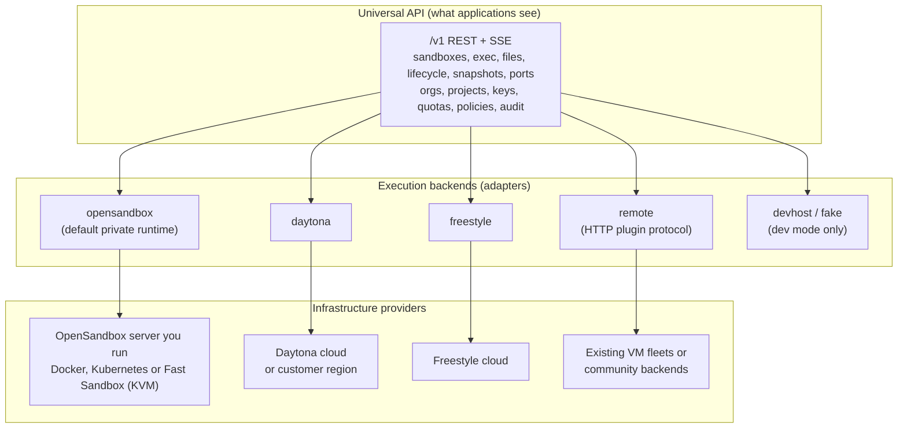
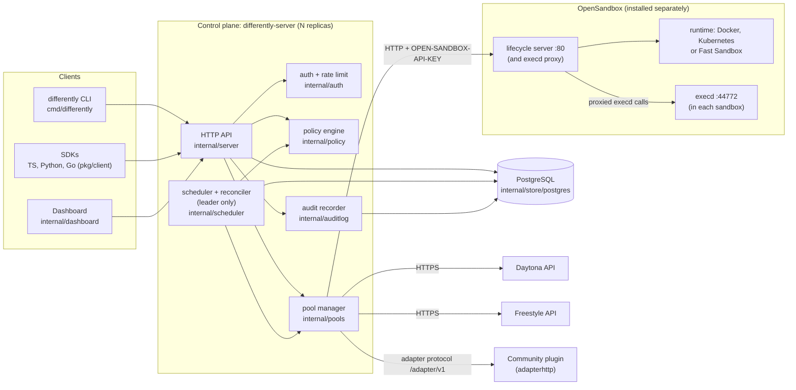
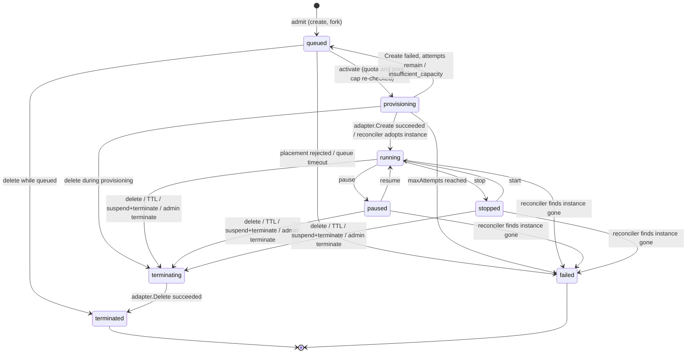
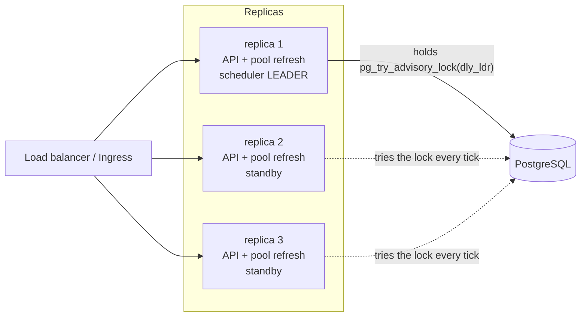

# Differently architecture (RFC)

| | |
|---|---|
| Status | As built, documented from the code on 2026-10-28, after [ADR 0020](../adr/0020-opensandbox-replaces-node-agent.md) removed Differently's own Firecracker node agent |
| Scope | Control plane (`differently-server`), CLI, built-in adapters (`opensandbox`, `daytona`, `freestyle`, `remote`, and the development-only `devhost` and `fake`), storage, HA, networking |
| Related | [ADRs](../adr/README.md) · [Trust model](../security/trust-model.md) · [Adapter specification](../adapters/specification.md) · [Placement policy](../scheduling/placement-policy.md) · [Storage and lifecycle](../storage-and-lifecycle.md) · [OpenSandbox pools](../guides/opensandbox-pools.md) |

## 1. Summary

Differently is a self-hosted control plane that gives applications one API
(`/v1`) for isolated sandboxes and decides, under operator policy, which
backend runs each one. It does not run sandboxes itself. A private
installation runs an [OpenSandbox](https://github.com/opensandbox-group/OpenSandbox)
server with the runtime that fits (Docker or Kubernetes containers, or
Firecracker microVMs with Fast Sandbox) and registers it as a pool. When
policy explicitly allows it, work can also go to an external provider such as
Daytona or Freestyle, or to any backend behind a `remote` plugin.
Applications never name a backend. They ask for resources, capabilities and
a data classification; the policy engine picks a pool.

What Differently itself provides:

- one vendor-neutral API, with CLI and SDKs;
- tenancy (organizations and projects) and scoped API keys;
- quotas and fair queueing;
- policy-gated placement across providers, failing closed for external ones;
- the adapter contract and the HTTP plugin protocol;
- a tamper-evident audit chain;
- placement explanations and the operator trust report.

Isolation, sandbox networking, images and host management belong to the
backend runtime. Differently reports what each pool declares about them; it
does not enforce or check it.

## 2. Status and evidence

Read every statement below as "this is what the code does", not "this has been
proven in production".

| Area | Evidence today | Not yet done |
|---|---|---|
| API, auth, quotas, policy, scheduler, reconciler | In-process integration tests against the real server, scheduler and memory store with fake pools (`internal/server/server_test.go`); audit fail-closed and metrics-listener tests (`internal/server/hardening_test.go`) | Multi-replica run against Postgres |
| Postgres store | Shared conformance suite `internal/store/storetest`; the `postgres conformance` CI job runs it against Postgres 17 and passed on `pre-release` on 2026-10-28 | That run predates migration `0002_drop_agents.sql`. Locally the suite runs only when `DIFFERENTLY_TEST_POSTGRES_URL` is set |
| `opensandbox` adapter | Fake-server tests that cover the differences found between OpenSandbox's spec and its images (`internal/adapters/opensandbox/opensandbox_test.go`). `TestLiveOpenSandbox` (build tag `live`) passes against OpenSandbox release 1.2.0 with the Docker runtime and `execd` v1.1.0 (Colima, arm64). A manual run through `differently-server` checked placement, exec, pause and resume, the refused stop, the trust report and delete ([spike](../research/opensandbox-spike.md)) | Kubernetes runtime. Fast Sandbox, so microVM isolation through Differently is unverified ([backlog E18](../backlog.md#e18-fast-sandbox-spike)). Restore from snapshot, fork and port endpoints against a real server |
| End-to-end suite (`test/e2e`) | Postgres, `differently-server` and a real OpenSandbox 1.2.0 server (Docker runtime) in Docker: 10/10 on arm64 Colima, 2026-10-28 ([results](../../test/e2e/README.md)) | OpenSandbox's Kubernetes and Fast Sandbox runtimes; x86_64; a real cluster |
| Helm chart (0.2.0) | `helm lint` and `helm template` pass; the server's config parser accepts the rendered config | Not installed on a real cluster against a real OpenSandbox server |
| Daytona and Freestyle adapters | Written against the published OpenAPI specs, tested with fake HTTP servers (`internal/adapters/{daytona,freestyle}/*_test.go`) | No live-account verification ([POC 7](../proof-of-concepts.md#poc-7-external-provider-live-account-verification)) |
| `remote` plugin protocol (`pkg/adapter/adapterhttp`) | Round-trip tests of client and handler against the fake adapter (`pkg/adapter/adapterhttp/adapterhttp_test.go`) | A conformance suite for third-party plugins ([backlog E0](../backlog.md#e0-correctness-and-security-fixes-from-the-code-review), E0.34) |

## 3. Goals and non-goals

**Goals**

1. One vendor-neutral sandbox API across very different backends.
2. Self-hosted end to end: no hosted service, licence server or telemetry
   (`internal/server/admin.go` reports `telemetry: none`).
3. Security and residency constraints always beat cost and speed in placement.
4. External providers receive work only when every policy level permits it
   and the operator names the pool explicitly.
5. One production dependency of its own: PostgreSQL. The backend runtime
   (OpenSandbox, a provider account) is the operator's choice.
6. Honest capability reporting: an unsupported operation fails with a precise
   error instead of degrading silently, and the trust report says what
   Differently does not enforce.

**Non-goals for the MVP**

- Running sandboxes, building images or managing hosts. That is the backend
  runtime's job ([ADR 0020](../adr/0020-opensandbox-replaces-node-agent.md)).
- A Kubernetes-native sandbox API (CRDs, operators). See [ADR 0003](../adr/0003-kubernetes-as-substrate-not-api.md).
- Live migration or moving running state between backends.
- GPU sandboxes. No built-in adapter offers `gpu`.
- A Boat-compatible facade. See [ADR 0013](../adr/0013-no-boat-compatible-facade-in-mvp.md).

## 4. The three layers



| Layer | Responsibility | Where in code |
|---|---|---|
| Universal API | Wire types, error codes, routes. Contains no Kubernetes, OpenSandbox or provider fields. | `pkg/api/types.go`, `pkg/api/errors.go`, `internal/server/*.go`, `api/openapi.yaml` |
| Execution backends | One `ExecutionAdapter` per pool. Required methods plus optional interfaces; features are advertised only when implemented. | `pkg/adapter/adapter.go`, `internal/adapters/*`, `internal/wiring/wiring.go` |
| Infrastructure providers | Where compute physically lives. Differently does not provision or manage it: the operator installs OpenSandbox and the hosts its runtime needs, configures provider accounts, or runs plugins. | Pool `config` and `credentials` |

A **pool** is one registered backend instance (`api.Pool`): an adapter kind, a
trust level (`private` or `external`), a region, a cost model, an optional
concurrency cap and adapter configuration. Pools come from the config file
(`source: config`) or the admin API (`source: api`). Trust is set by
`internal/config/config.go`:

- `daytona` and `freestyle` always run on third-party infrastructure and are
  forced to `trust: external`;
- `opensandbox` can be self-hosted or not, so the operator must declare
  `trust`; a pool without it is rejected;
- every other kind (`remote`, `devhost`, `fake`) defaults to `private`, and
  the operator's declaration is authoritative. A `remote` plugin that fronts
  a third-party service must be declared `trust: external`.

An OpenSandbox server has one API key and no tenant model, so it is one trust
domain. Prefer one pool per server. Two pools pointing at the same server
work (the reconciler leaves each other's live sandboxes alone, §6 of the
[adapter specification](../adapters/specification.md#6-reconciliation-contract)),
but add no isolation.

An "infrastructure adapter" that provisions or retires nodes is a design
concept only; see [adapters/specification.md §8](../adapters/specification.md#8-infrastructureadapter-design-not-implemented).

## 5. Control plane and data plane

| | Control plane | Data plane |
|---|---|---|
| Processes | `differently-server` replicas (API, scheduler, reconciler, pool manager, dashboard, `/metrics`); PostgreSQL | The OpenSandbox server and its runtime, with OpenSandbox's `execd` inside each sandbox; external providers' sandboxes; remote plugins and whatever they front |
| State | All durable Differently state in Postgres (or memory in dev) | Backend-side: OpenSandbox's sandboxes and snapshots, provider resources. Differently tags each instance with its sandbox and installation IDs (OpenSandbox metadata, provider labels) and stores only the backend's ref |
| Talks to | Postgres; the OpenSandbox lifecycle API (header `OPEN-SANDBOX-API-KEY`) and, through the server's proxy by default, `execd`; provider APIs over HTTPS; remote plugins over `/adapter/v1` | Nothing in the data plane calls the control plane |

The control plane **is in the data path** for exec, file transfer and streamed
output. A client never talks to a backend directly: the API replica that
receives `POST /v1/sandboxes/{id}/exec` calls the pool adapter. For an
OpenSandbox pool the adapter resolves `execd`'s endpoint for port 44772,
through the OpenSandbox server's proxy unless `useServerProxy` is `false`,
and sends `POST /command` (`internal/server/sandboxes.go` `exec`,
`internal/adapters/opensandbox/opensandbox.go` `run`). This keeps
authentication, tenancy checks and audit in one place, and keeps backend
credentials out of tenants' hands, at the cost of control-plane bandwidth.
See [ADR 0017](../adr/0017-exec-and-files-proxied-through-control-plane.md).

Lifecycle operations (stop, start, pause, resume), snapshots and port exposure
are also performed synchronously by the API replica that receives the request.
Only create, terminate, TTL expiry and reconciliation go through the scheduler.

## 6. Components



| Binary | Package entry | Role |
|---|---|---|
| `differently-server` | `cmd/differently-server/main.go` | `serve` (API + scheduler loop), `migrate`, `preflight`, `token`, `version` |
| `differently` | `cmd/differently/main.go` | CLI over the public API |

There are no node or guest binaries any more. OpenSandbox ships its own
server, `execd` and, for Fast Sandbox, its own per-node runtime agent.

## 7. Request lifecycle

The sequence below follows one sandbox on an OpenSandbox pool from create to
terminate.

```mermaid
sequenceDiagram
  autonumber
  participant C as Client
  participant A as API replica
  participant DB as Postgres
  participant L as Scheduler (leader)
  participant P as opensandbox adapter
  participant O as OpenSandbox server
  participant X as execd (in sandbox)

  C->>A: POST /v1/sandboxes (Bearer dly_..., Idempotency-Key)
  A->>DB: GetKey, verify hash, scopes, tenancy
  A->>A: buildSandbox: profile, defaults, validation
  A->>A: policy.Decide (fail fast: no_eligible_pool / unsupported_capability)
  A->>DB: AdmitSandbox (lock org row, check queue and size limits, insert queued)
  A-->>C: 202 {status: queued}
  A->>A: Scheduler.Wake() (local process only)
  loop every scheduler.intervalMs (250 ms)
    L->>DB: QueuedCandidates (fair order)
    L->>L: policy.Decide (filter, then rank)
    L->>DB: ActivateSandbox (lock org, pool, sandbox, re-check quota and pool cap)
  end
  Note over L,DB: status provisioning
  L->>P: Create(ID = sandbox ID, installation, resources, env, ttl)
  P->>O: GET /v1/sandboxes?metadata=differently-sandbox-id=<id> (idempotency)
  P->>O: POST /v1/sandboxes (image, templateId or snapshotId; resourceLimits; env; metadata; timeout)
  O-->>P: 202 Pending
  loop until Running
    P->>O: GET /v1/sandboxes/{ref}
  end
  P->>O: GET /v1/sandboxes/{ref}/endpoints/44772?use_server_proxy=true
  P->>X: GET /ping through the proxy until it answers
  P-->>L: Instance{ref = OpenSandbox sandbox ID, state: running}
  L->>DB: status running, startedAt, expiresAt = now + ttl
  C->>A: GET /v1/sandboxes/{id}/wait?status=running
  A-->>C: 200 {status: running}
  C->>A: POST /v1/sandboxes/{id}/exec
  A->>DB: audit sandbox.exec (program name only)
  A->>P: Exec(ref, request)
  P->>X: POST /command through the proxy
  X-->>C: events, then exit code (via P and A as stdout, stderr, exitCode)
  C->>A: DELETE /v1/sandboxes/{id}
  A->>DB: status terminating
  A-->>C: 202
  L->>P: Delete(ref)
  P->>O: DELETE /v1/sandboxes/{ref}
  L->>DB: status terminated, endedAt, then nudge waiting sandboxes
```

Step notes, with code locations:

1. **Authenticate** (`internal/server/server.go` `authenticate`): parse
   `dly_<keyid>_<secret>`, compare the SHA-256 hash in constant time, check
   revocation and expiry, apply the per-key token bucket, refuse non-GET calls
   for suspended organizations.
2. **Build** (`internal/server/sandboxes.go` `buildSandbox`): resolve the
   project the key may use, apply the profile or explicit resources
   (1–256 CPU, 128 MiB–1 TiB memory, 0–16384 GiB disk), validate capability
   names, classification, strategy and external mode, reject labels with the
   reserved `differently.dev/` prefix, default the TTL (3600 s), and pin to the
   source snapshot's pool if `fromSnapshot` is set.
3. **Fail fast**: `policy.Decide` runs once at admission. A request that no
   permitted pool could ever take is rejected now (`422 no_eligible_pool` or
   `422 unsupported_capability`) instead of queueing forever.
4. **Admit** (`store.AdmitSandbox`): one transaction locks the organization
   row, replays an existing `Idempotency-Key` within the project, checks
   admission limits and inserts the row as `queued`. Concurrency limits are
   deliberately not checked here; a tenant at its limit queues.
5. **Dispatch** (`internal/scheduler/scheduler.go` `dispatch`): only the
   leader runs it. Up to 100 runnable candidates per tick are evaluated in fair
   order. A `waiting` decision updates `statusReason` and retries after 2 s; a
   `rejected` decision fails the sandbox; `MaxQueueSeconds` turns a long wait
   into a failure.
6. **Activate** (`store.ActivateSandbox`): one transaction locks organization,
   then pool (if it has a concurrency cap), then sandbox, re-checks tenant
   quota and pool concurrency, and moves the row to `provisioning`. If a
   ranked pool filled concurrently (`insufficient_capacity`), the next ranked
   pool is tried.
7. **Provision** (`provision`): a goroutine calls `adapter.Create` with the
   sandbox ID as the idempotency key and a timeout of
   `provisionTimeoutSeconds` (default 120). Failures requeue with exponential
   backoff or fail after `maxAttempts` (default 3). The OpenSandbox adapter
   waits up to 3 minutes for `Running` and for `execd`, so the scheduler's
   timeout is the one that applies by default. The adapter sends CPU and
   memory as `resourceLimits`; it does not send `diskGiB`, although quota and
   cost count it.
8. **Use**: exec, files, lifecycle, snapshots and ports go straight from the
   API replica to the adapter and require `status = running` (or the relevant
   source state for lifecycle calls).
9. **Terminate**: `DELETE` marks the row `terminating` (a queued sandbox goes
   straight to `terminated`). The leader's terminate pass calls
   `adapter.Delete` and retries on every tick until it succeeds.
10. **Expire**: every tick, running, paused and stopped sandboxes past
    `expiresAt` are marked `terminating` with reason `ttl expired`. The
    OpenSandbox adapter also sets OpenSandbox's own `timeout` (at least 60 s)
    from the TTL at creation, as a backstop if the control plane is down; a
    later TTL change through the API does not update it.

## 8. Sandbox state machine



`stop` and `start` exist only on pools whose adapter implements them
(Daytona, Freestyle, `remote` plugins that declare them). OpenSandbox has
pause, resume and delete but no stop, so on an OpenSandbox pool `stop`
answers `501 unsupported_operation` and the `stopped` state is never reached.

| Status | Counts as active sandbox | Reserves CPU and memory | Counts disk | Holds a pool concurrency slot |
|---|---|---|---|---|
| `queued` | no (counts toward `maxQueued`) | no | no | no |
| `provisioning` | yes | yes | yes | yes |
| `running` | yes | yes | yes | yes |
| `paused` | yes | yes (accounted as resident) | yes | yes |
| `stopped` | yes | no | yes | yes |
| `terminating` | yes | yes | yes | yes |
| `terminated`, `failed` | no | no | no | no |

Source: `store.Tally` and `store.HoldsPoolSlot` in `internal/store/store.go`.
`api.SandboxStatus.ReservesCompute` also lists `queued`, but `Tally` counts
queued sandboxes only toward `maxQueued`. These are Differently's accounting
rules; what a paused sandbox actually holds depends on the backend runtime.

Lifecycle transitions are driven by the API replica (`internal/server/sandboxes.go`
`lifecycle`); the adapter call happens first and the row changes only if the
status has not moved concurrently (`409 conflict` otherwise). Repeating a
transition into the current state returns `200` with no backend call.

## 9. Storage and queue design

PostgreSQL is the only production dependency ([ADR 0004](../adr/0004-postgres-only-production-dependency.md)).
The memory store (`internal/store/memory.go`) implements the same contract with
one mutex and is used for `--dev` and tests. Both run the same conformance
suite (`internal/store/storetest/storetest.go`).

**Schema** (`internal/store/postgres/migrations/`). Each resource is a JSONB
`doc` with the columns needed for locking, filtering and ordering promoted:

| Table | Key | Promoted columns and indexes |
|---|---|---|
| `meta` | `key` | Installation ID (`inst_...`), created once |
| `organizations` | `id` | Row lock target for admission and activation |
| `projects` | `id` | `org_id` (FK, indexed) |
| `api_keys` | `id` | `org_id`, `project_id`; `doc` holds the SHA-256 hash, never the secret |
| `pools` | `name` | Row lock target for concurrency-capped activation |
| `policies` | `scope` | `global`, `org:<id>`, `project:<id>` |
| `sandboxes` | `id` | `org_id`, `project_id`, `pool`, `status`, `idempotency_key`, `next_attempt_at`; partial index on queued rows by `next_attempt_at`; unique `(project_id, idempotency_key)` where the key is set |
| `snapshots` | `id` | `org_id`, `project_id` |
| `audit_events` | `seq` | `org_id`, `resource`, `action` |
| `schema_migrations` | `version` | Applied migration files |

`0001_init.sql` creates the schema; `0002_drop_agents.sql` drops the
`agents` table that node agents used. Migrations are embedded in the binary
and applied under a session advisory lock (`dly_mig`) by
`differently-server serve` at start-up and by `differently-server migrate`
(the Helm chart's migrate Job).

**The queue is the `sandboxes` table.** There is no separate broker. A queued
sandbox is a row with `status = 'queued'` and a `next_attempt_at`. The leader
reads up to 1000 runnable rows in ID order (IDs are time-sortable ULIDs from
`internal/id`), orders them with `store.FairOrder` and dispatches at most 100
per tick:

1. organizations with less active CPU go first;
2. organizations are interleaved round-robin;
3. inside an organization, higher `priority` first, then older first.

**Quota usage is derived, never counted.** Every admission and activation
recomputes usage from the sandbox rows inside the same transaction, so a crash
cannot leave a counter out of step ([ADR 0005](../adr/0005-quota-derived-from-state-atomic-activation.md)).

**Lock order is fixed**: organization row, then pool row, then sandbox row
(`ActivateSandbox`). `AdmitSandbox` and `DeleteProject` lock the organization;
`DeletePool` locks the pool; every other sandbox update locks only the sandbox
row. Paths that release usage do not need the organization lock.

**Advisory locks** (`internal/store/postgres/postgres.go`):

| Lock | Kind | Purpose |
|---|---|---|
| `dly_mig` | session | Serialize migrations across replicas |
| `dly_ldr` | session, on a dedicated pooled connection | Scheduler leadership |
| `dly_aud` | transaction | Serialize audit appends so `seq` and `prevHash` stay contiguous |

## 10. High availability



- **API replicas are stateless** apart from per-process caches: the rate
  limiter's token buckets (limits are per replica), the pool manager's view of
  health, capabilities and capacity (refreshed every 5 s on every replica),
  the scheduler's in-flight set, and the OpenSandbox adapter's cache of
  resolved `execd` endpoints (re-resolved once when a GET fails). Any replica
  can serve any request.
- **One scheduler leader.** Every replica runs `scheduler.Run`, but only the
  holder of the `dly_ldr` session advisory lock runs dispatch, provisioning,
  termination, expiry and reconciliation (`TryLeader`). The lock lives on a
  dedicated connection that is pinged on every check; if the ping fails the
  replica stops acting as leader, and when the session ends Postgres releases
  the lock so another replica takes it on its next tick.
- **Wake-ups are local.** `Scheduler.Wake()` only signals the scheduler in the
  same process. On a non-leader replica it does nothing useful, so with
  several replicas new work is picked up on the leader's next tick (250 ms by
  default).
- **Failover safety** rests on two properties rather than on exclusive
  leadership: activation is an atomic, status-checked transaction, and
  `adapter.Create` is idempotent on the sandbox ID (the OpenSandbox adapter
  looks the ID up in OpenSandbox metadata before creating). Two schedulers
  that briefly overlap can both call `Create`; they are expected to converge
  on one instance. A race between two concurrent lookups and creates is not
  excluded by OpenSandbox's API, and the reconciler does not detect two
  instances for one sandbox ([backlog E0](../backlog.md#e0-correctness-and-security-fixes-from-the-code-review), E0.21).
- **Interrupted provisioning** is recovered by the reconciler: a
  `provisioning` row older than `provisionTimeoutSeconds` is adopted if the
  backend already has an instance for it, and requeued otherwise.
- **Backend availability is the backend's.** The OpenSandbox server is a
  single dependency per pool; its own high availability is configured in
  OpenSandbox. While it is down, its pool is unhealthy, new work waits or
  goes elsewhere under policy, and exec and file calls fail with
  `provider_unavailable` ([POC 13](../proof-of-concepts.md#poc-13-opensandbox-outage-and-recovery)).
- **Detection time is a Postgres property.** If the leader host disappears
  without closing its TCP connection, the lock is held until the server side
  notices the dead session. Configure server-side TCP keepalives (see the
  [hardening checklist](../security/hardening-checklist.md)); this is a
  [POC item](../proof-of-concepts.md#poc-6-postgres-failover-and-leader-handover).
- **Memory store**: `TryLeader` always returns true and state is per process,
  so run exactly one replica (the Helm chart switches the Deployment to
  `Recreate` for the memory driver).

[ADR 0016](../adr/0016-single-leader-scheduler-advisory-lock.md) records the
decision.

## 11. Networking and egress

Differently configures no sandbox networking. Before
[ADR 0020](../adr/0020-opensandbox-replaces-node-agent.md) its node agent
created a tap device and iptables chain per microVM; that code was removed
and its design remains only in git history.

**Paths the control plane needs**

| From | To | Notes |
|---|---|---|
| Clients | API listener (`:8080`) | Through your ingress; TLS is terminated there, the server speaks plain HTTP |
| Scrapers | `/metrics` (`metrics.listen`, chart default `:9091`) | Unauthenticated; keep it off the ingress |
| Server | PostgreSQL | TLS as set in the DSN |
| Server | OpenSandbox lifecycle API (port 80 with OpenSandbox's chart, 8090 standalone) | Carries the server's API key in `OPEN-SANDBOX-API-KEY`. With `useServerProxy` (the default) `execd` traffic goes through the same server, so this is the only OpenSandbox port needed; without it the server connects to each sandbox's endpoint directly. The chart's default URL is plain HTTP inside the cluster |
| Server | Provider APIs, remote plugins | HTTPS for Daytona and Freestyle; whatever URL a plugin is given |

The Helm chart's NetworkPolicy restricts server egress to DNS, the
database, OpenSandbox (`networkPolicy.server.egress.opensandbox`, port 80)
and enabled providers.

**Sandbox networking is the runtime's.** Egress, inbound access, DNS and
isolation between sandboxes are whatever the OpenSandbox runtime (or the
provider) provides and the operator configures:

- With the Docker runtime, sandboxes are containers on the Docker host's
  networks. The live test's configuration (`test/opensandbox/config.toml`)
  uses bridge networking, drops capabilities such as `NET_ADMIN`, `NET_RAW`
  and `SYS_ADMIN`, sets `no_new_privileges` and a PID limit. That is a test
  configuration, not a recommendation or a default.
- With the Kubernetes runtime, sandboxes are pods that OpenSandbox manages;
  NetworkPolicy in their namespace applies if the CNI enforces it.
  Unverified.
- With Fast Sandbox, networking is set up by OpenSandbox's per-node runtime.
  Unverified ([backlog E18](../backlog.md#e18-fast-sandbox-spike)).

OpenSandbox has its own egress component and network-policy API.
Differently does not configure them yet, and OpenSandbox pools do not
advertise `network.egress-control`
([backlog E19](../backlog.md#e19-opensandbox-network-policy-and-egress)).
Until then, block cloud metadata endpoints, private ranges and the control
plane from sandboxes at the runtime, host or VPC level. Freestyle pools do
advertise `network.egress-control`: Freestyle's firewall denies all egress
unless `config.egress: public`.

**Ports.** `ports.expose` on an OpenSandbox pool returns OpenSandbox's direct
endpoint for the port, and only when that endpoint needs no request headers.
Endpoints that need headers are refused, because the only header a proxied
endpoint takes is the server's API key, which must never reach tenants. This
has not been checked against a real server.

## 12. What Kubernetes is and is not used for

Kubernetes is a **substrate** for deploying Differently, not the sandbox API
([ADR 0003](../adr/0003-kubernetes-as-substrate-not-api.md)).

**Used for** (the Helm chart in `deploy/helm/differently`, version 0.2.0,
which deploys the control plane only):

- the control-plane `Deployment` (rolling updates with Postgres, `Recreate`
  with the memory store), its `Service`, optional `Ingress`,
  `PodDisruptionBudget` and `ServiceMonitor`;
- a migration `Job` and an optional embedded PostgreSQL;
- the default `opensandbox` pool, rendered from the `opensandbox:` values
  block (enabled by default; `apiURL`, `trust`, `isolation`, the API key
  from `existingSecret` or `apiKey`);
- a `NetworkPolicy` for the server, including egress to OpenSandbox on port
  80;
- `Secret` objects for the bootstrap token, database DSN, OpenSandbox API key
  and provider keys, referenced from the config by environment variable name.

**OpenSandbox is installed separately**, with its own chart or manifests,
and referenced by URL and API key. Its runtime decides what runs where: with
the Kubernetes runtime, sandboxes are pods it creates; with Fast Sandbox, it
runs its own per-node agent on KVM nodes. Those nodes, their labels and
taints, privileged pods and image storage are OpenSandbox's requirements,
not Differently's.

**Not used for:**

- **The sandbox API.** There are no CRDs and no operator. Sandboxes are rows in
  Postgres, and the API is `/v1`.
- **Placing sandboxes on hosts.** Differently chooses a pool; the backend
  chooses the host.
- **Quota or admission.** Differently's own store enforces quotas.
- **Being required at all.** `differently-server` is a plain binary, and
  OpenSandbox's Docker runtime runs on a single Docker host.

## 13. Why Kueue and Kubernetes Jobs are not the MVP sandbox abstraction

[Kueue](https://kueue.sigs.k8s.io/docs/overview/) is a quota and admission
controller for Kubernetes workloads (wait, admit, preempt); scheduling and
lifecycle stay with kube-scheduler and controllers. It was considered as the
admission path and rejected for the MVP:

1. **Wrong object.** Kueue admits pod-based workloads (Job, JobSet, plain Pods,
   Deployments and others). Differently's sandboxes live in whichever backend
   runs them: an OpenSandbox server (Docker containers, its own pods, or
   Fast Sandbox microVMs) or a provider. Most of those are not pods in the
   cluster's workload model, so Kueue cannot see them unless each sandbox is
   modelled as a Workload.
2. **Wrong lifetime.** A Differently sandbox is interactive and long-lived:
   created in a second, used for exec and files, paused, resumed, forked.
   Jobs model run-to-completion work. Kueue preempting a plain pod terminates
   and deletes it, which would discard a sandbox's state.
3. **Placement must cross providers.** Policy must choose between private
   pools and external providers under classification rules. Kueue admits into
   cluster quotas; it does not route to Daytona or Freestyle.
4. **Latency.** Each admission passes through Workload reconciliation and
   kube-scheduler. The interactive path wants one transaction.
5. **Dependency budget.** Kueue would make Kubernetes mandatory and add a
   second source of quota truth next to Postgres.

**Where Kueue could fit later:** an optional batch lane for ephemeral,
run-to-completion jobs such as eval fleets. A future `jobs` API (or a
`kueue` adapter kind) would submit suspended Kubernetes Jobs into a Kueue
`LocalQueue`, let Kueue apply cluster quota and fair sharing, and report the
results back through Differently's audit and usage. Interactive sandboxes keep
Differently's own admission. This is [backlog E8](../backlog.md#e8-kueue-batch-lane).

## 14. Security architecture in one paragraph

Tenancy is enforced in the API layer (`internal/auth`, `loadSandbox`
`CanAccess` checks that return 404 across tenants). Placement security is
enforced in the policy engine before any ranking, and external pools fail
closed. Differently does not isolate sandboxes: isolation and egress come
from each pool's runtime (OpenSandbox's Docker, Kubernetes or Fast Sandbox
runtime, or the provider), and the trust report lists each pool's declared
isolation without checking it. Containers from the Docker and Kubernetes
runtimes share the host kernel; microVM isolation through Differently is
unverified until the Fast Sandbox spike. Control-plane and backend secrets
are referenced, not stored; backend credentials such as the OpenSandbox API
key stay in the control plane. The audit log is a hash chain. Sandbox
environment values are stored in plaintext. Details, residual risks and known
issues: [trust model](../security/trust-model.md).

## 15. Code map

| Concern | Files |
|---|---|
| Wire types and error codes | `pkg/api/types.go`, `pkg/api/errors.go` |
| Adapter contract | `pkg/adapter/adapter.go` |
| Out-of-process adapter protocol (`remote` pools) | `pkg/adapter/adapterhttp/adapterhttp.go` |
| Placement | `internal/policy/policy.go` |
| Store contract, tally, fairness | `internal/store/store.go` |
| Stores | `internal/store/memory.go`, `internal/store/postgres/postgres.go` |
| Scheduler and reconciler | `internal/scheduler/scheduler.go` |
| Pool manager and adapter factories | `internal/pools/pools.go`, `internal/wiring/wiring.go` (also the `remote` wrapper) |
| HTTP API | `internal/server/server.go`, `sandboxes.go`, `tenancy.go`, `admin.go` |
| Auth | `internal/auth/auth.go` |
| Audit | `internal/audit/audit.go`, `internal/auditlog/auditlog.go` |
| Config | `internal/config/config.go` |
| Adapters | `internal/adapters/{opensandbox,daytona,freestyle,devhost,fake,httpx}` |
| Local command runner (`devhost` only) | `internal/localexec` |
| Metrics | `internal/metrics/metrics.go` |
