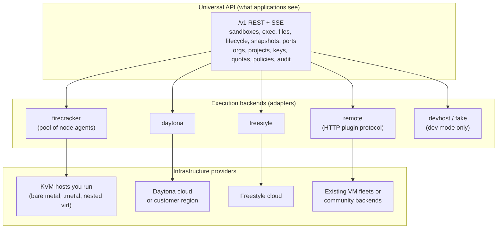
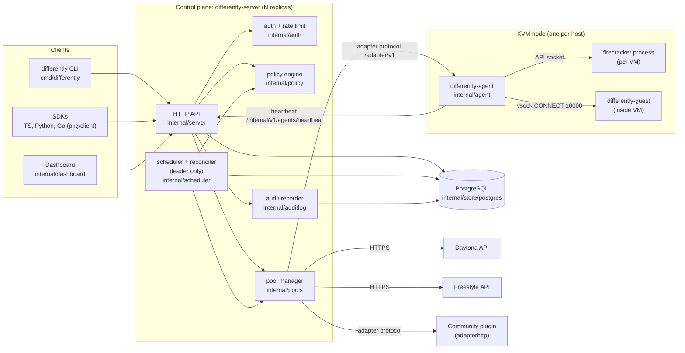
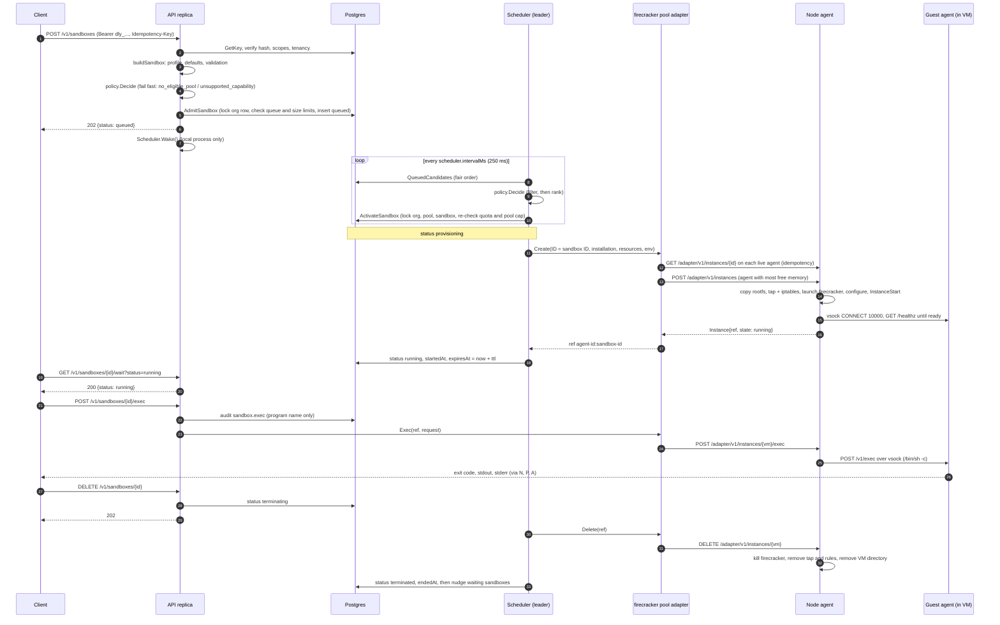
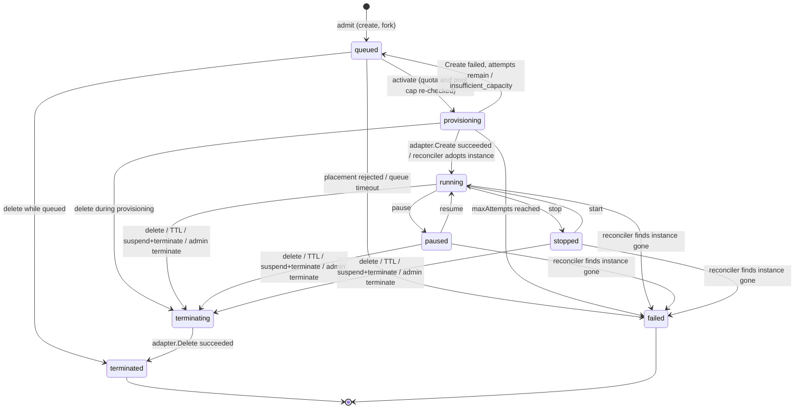
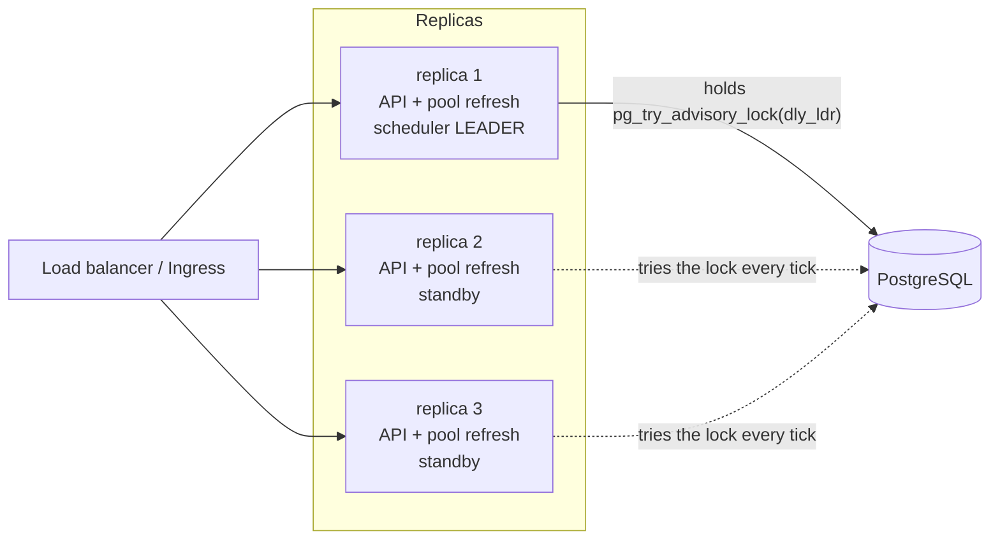
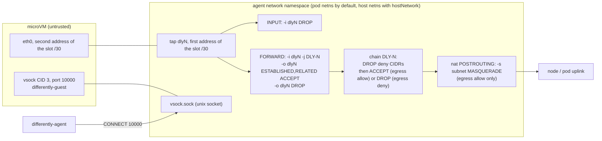

# Differently architecture (RFC)

| | |
|---|---|
| Status | As built, documented from the code on 2026-10-28 |
| Scope | Control plane (`differently-server`), node agent (`differently-agent`), guest agent (`differently-guest`), built-in adapters, storage, HA, networking |
| Related | [ADRs](../adr/README.md) · [Trust model](../security/trust-model.md) · [Adapter specification](../adapters/specification.md) · [Placement policy](../scheduling/placement-policy.md) · [Storage and lifecycle](../storage-and-lifecycle.md) |

## 1. Summary

Differently is a self-hosted control plane that gives applications one API
(`/v1`) for isolated sandboxes. Operators decide where those sandboxes may run:
on Firecracker microVMs on KVM hosts they own, or, when policy explicitly
allows it, on an external provider such as Daytona or Freestyle. Applications
never name a backend. They ask for resources, capabilities and a data
classification; the policy engine picks a pool.

## 2. Status and evidence

Read every statement below as "this is what the code does", not "this has been
proven in production".

| Area | Evidence today | Not yet done |
|---|---|---|
| API, auth, quotas, policy, scheduler, reconciler | In-process integration tests against the real server, scheduler and memory store with fake pools (`internal/server/server_test.go`) | Multi-replica run against Postgres |
| Postgres store | Shared conformance suite `internal/store/storetest`; a CI job runs it against Postgres 17 (`.github/workflows/ci.yml`) | The suite only runs when `DIFFERENTLY_TEST_POSTGRES_URL` is set; it was skipped in the local run used for this document, and the CI job has never run (the repository has no remote yet) |
| Firecracker node agent | Tests with a fake VMM and fake guest behind the real adapter protocol (`internal/agent/agent_test.go`) | **Nothing has run on real KVM.** No real Firecracker boot, tap device or iptables rule has been exercised |
| Daytona and Freestyle adapters | Written against the published OpenAPI specs, tested with fake HTTP servers (`internal/adapters/{daytona,freestyle}/*_test.go`) | No live-account verification; open items in [proof-of-concepts.md](../proof-of-concepts.md) |

## 3. Goals and non-goals

**Goals**

1. One vendor-neutral sandbox API across very different backends.
2. Self-hosted end to end: no hosted service, licence server or telemetry
   (`internal/server/admin.go` reports `telemetry: none`).
3. Security and residency constraints always beat cost and speed in placement.
4. External providers receive work only when every policy level permits it
   and the operator names the pool explicitly.
5. One production dependency: PostgreSQL.
6. Honest capability reporting: an unsupported operation fails with a precise
   error instead of degrading silently.

**Non-goals for the MVP**

- A Kubernetes-native sandbox API (CRDs, operators). See [ADR 0003](../adr/0003-kubernetes-as-substrate-not-api.md).
- Live migration or moving running state between backends.
- GPU sandboxes (Firecracker has no VFIO passthrough in any release).
- A Boat-compatible facade. See [ADR 0013](../adr/0013-no-boat-compatible-facade-in-mvp.md).

## 4. The three layers

| Layer | Responsibility | Where in code |
|---|---|---|
| Universal API | Wire types, error codes, routes. Contains no Kubernetes, Firecracker or provider fields. | `pkg/api/types.go`, `pkg/api/errors.go`, `internal/server/*.go`, `api/openapi.yaml` |
| Execution backends | One `ExecutionAdapter` per pool. Required methods plus optional interfaces; features are advertised only when implemented. | `pkg/adapter/adapter.go`, `internal/adapters/*`, `internal/wiring/wiring.go` |
| Infrastructure providers | Where compute physically lives. Today Differently does not provision infrastructure: node agents register themselves, and provider accounts are configured by the operator. | `cmd/differently-agent`, pool `config` and `credentials` |

A **pool** is one registered backend instance (`api.Pool`): an adapter kind, a
trust level (`private` or `external`), a region, a cost model, an optional
concurrency cap and adapter configuration. Pools come from the config file
(`source: config`) or the admin API (`source: api`). Adapter kinds that always
run on third-party infrastructure (`daytona`, `freestyle`) are forced to
`trust: external` by `internal/config/config.go`; every other kind defaults to
`private` and the operator's declaration is authoritative. That includes
`remote`, so a remote plugin that fronts a third-party service must be declared
`trust: external` by the operator.

An "infrastructure adapter" that provisions or retires nodes is a design
concept only; see [adapters/specification.md §8](../adapters/specification.md#8-infrastructureadapter-design-not-implemented).

## 5. Control plane and data plane

| | Control plane | Data plane |
|---|---|---|
| Processes | `differently-server` replicas (API, scheduler, reconciler, pool manager, dashboard, `/metrics`); PostgreSQL | `differently-agent` on each KVM node, one Firecracker process per microVM, `differently-guest` inside each VM; external providers' sandboxes |
| State | All durable state in Postgres (or memory in dev) | Per-VM state directory on the node (`vm.json`, `rootfs.ext4`, sockets); provider-side resources |
| Talks to | Postgres; node agents over HTTP (`/adapter/v1`); provider APIs over HTTPS | Agents receive calls from the control plane and send heartbeats to it |

The control plane **is in the data path** for exec, file transfer and streamed
output. A client never talks to a node agent or a provider directly: the API
replica that receives `POST /v1/sandboxes/{id}/exec` calls the pool adapter,
which calls the agent, which reaches the guest over vsock
(`internal/server/sandboxes.go` `exec`, `internal/adapters/firecracker/pool.go`
`route`, `internal/agent/agent.go` `guest`). This keeps authentication, tenancy
checks and audit in one place, at the cost of control-plane bandwidth. See
[ADR 0017](../adr/0017-exec-and-files-proxied-through-control-plane.md).

Lifecycle operations (stop, start, pause, resume), snapshots and port exposure
are also performed synchronously by the API replica that receives the request.
Only create, terminate, TTL expiry and reconciliation go through the scheduler.

## 6. Components

| Binary | Package entry | Role |
|---|---|---|
| `differently-server` | `cmd/differently-server/main.go` | `serve` (API + scheduler loop), `migrate`, `preflight`, `token`, `version` |
| `differently-agent` | `cmd/differently-agent/main.go` | `serve` on a KVM node (adapter protocol on `:9090`, heartbeat every 10 s), `doctor` |
| `differently-guest` | `cmd/differently-guest/main.go` | In-VM agent on vsock port 10000 (`--tcp` for local tests only) |
| `differently` | `cmd/differently/main.go` | CLI over the public API |

## 7. Request lifecycle

The sequence below follows one sandbox on a Firecracker pool from create to
terminate.

Step notes, with code locations:

1. **Authenticate** (`internal/server/server.go` `authenticate`): parse
   `dly_<keyid>_<secret>`, compare the SHA-256 hash in constant time, check
   revocation and expiry, apply the per-key token bucket, refuse non-GET calls
   for suspended organizations.
2. **Build** (`internal/server/sandboxes.go` `buildSandbox`): resolve the
   project the key may use, apply the profile or explicit resources
   (1–256 CPU, 128 MiB–1 TiB memory, 0–16384 GiB disk), validate capability
   names, classification, strategy and external mode, reject labels with the
   reserved `differently.dev/` prefix, default the TTL (3600 s), and pin to the
   source snapshot's pool if `fromSnapshot` is set.
3. **Fail fast**: `policy.Decide` runs once at admission. A request that no
   permitted pool could ever take is rejected now (`422 no_eligible_pool` or
   `422 unsupported_capability`) instead of queueing forever.
4. **Admit** (`store.AdmitSandbox`): one transaction locks the organization
   row, replays an existing `Idempotency-Key` within the project, checks
   admission limits and inserts the row as `queued`. Concurrency limits are
   deliberately not checked here; a tenant at its limit queues.
5. **Dispatch** (`internal/scheduler/scheduler.go` `dispatch`): only the
   leader runs it. Up to 100 runnable candidates per tick are evaluated in fair
   order. A `waiting` decision updates `statusReason` and retries after 2 s; a
   `rejected` decision fails the sandbox; `MaxQueueSeconds` turns a long wait
   into a failure.
6. **Activate** (`store.ActivateSandbox`): one transaction locks organization,
   then pool (if it has a concurrency cap), then sandbox, re-checks tenant
   quota and pool concurrency, and moves the row to `provisioning`. If a
   ranked pool filled concurrently (`insufficient_capacity`), the next ranked
   pool is tried.
7. **Provision** (`provision`): a goroutine calls `adapter.Create` with the
   sandbox ID as the idempotency key and a timeout of
   `provisionTimeoutSeconds` (default 120). Failures requeue with exponential
   backoff or fail after `maxAttempts` (default 3).
8. **Use**: exec, files, lifecycle, snapshots and ports go straight from the
   API replica to the adapter and require `status = running` (or the relevant
   source state for lifecycle calls).
9. **Terminate**: `DELETE` marks the row `terminating` (a queued sandbox goes
   straight to `terminated`). The leader's terminate pass calls
   `adapter.Delete` and retries on every tick until it succeeds.
10. **Expire**: every tick, running, paused and stopped sandboxes past
    `expiresAt` are marked `terminating` with reason `ttl expired`.

## 8. Sandbox state machine

| Status | Counts as active sandbox | Reserves CPU and memory | Counts disk | Holds a pool concurrency slot |
|---|---|---|---|---|
| `queued` | no (counts toward `maxQueued`) | no | no | no |
| `provisioning` | yes | yes | yes | yes |
| `running` | yes | yes | yes | yes |
| `paused` | yes | yes (memory stays resident) | yes | yes |
| `stopped` | yes | no | yes | yes |
| `terminating` | yes | yes | yes | yes |
| `terminated`, `failed` | no | no | no | no |

Source: `store.Tally` and `store.HoldsPoolSlot` in `internal/store/store.go`.
`api.SandboxStatus.ReservesCompute` also lists `queued`, but `Tally` counts
queued sandboxes only toward `maxQueued`.

Lifecycle transitions are driven by the API replica (`internal/server/sandboxes.go`
`lifecycle`); the adapter call happens first and the row changes only if the
status has not moved concurrently (`409 conflict` otherwise). Repeating a
transition into the current state returns `200` with no backend call.

## 9. Storage and queue design

PostgreSQL is the only production dependency ([ADR 0004](../adr/0004-postgres-only-production-dependency.md)).
The memory store (`internal/store/memory.go`) implements the same contract with
one mutex and is used for `--dev` and tests. Both run the same conformance
suite (`internal/store/storetest/storetest.go`).

**Schema** (`internal/store/postgres/migrations/0001_init.sql`). Each resource
is a JSONB `doc` with the columns needed for locking, filtering and ordering
promoted:

| Table | Key | Promoted columns and indexes |
|---|---|---|
| `meta` | `key` | Installation ID (`inst_...`), created once |
| `organizations` | `id` | Row lock target for admission and activation |
| `projects` | `id` | `org_id` (FK, indexed) |
| `api_keys` | `id` | `org_id`, `project_id`; `doc` holds the SHA-256 hash, never the secret |
| `pools` | `name` | Row lock target for concurrency-capped activation |
| `policies` | `scope` | `global`, `org:<id>`, `project:<id>` |
| `sandboxes` | `id` | `org_id`, `project_id`, `pool`, `status`, `idempotency_key`, `next_attempt_at`; partial index on queued rows by `next_attempt_at`; unique `(project_id, idempotency_key)` where the key is set |
| `snapshots` | `id` | `org_id`, `project_id` |
| `audit_events` | `seq` | `org_id`, `resource`, `action` |
| `agents` | `id` | `pool` |
| `schema_migrations` | `version` | Applied migration files |

Migrations are embedded in the binary and applied under a session advisory
lock (`dly_mig`) by `differently-server serve` at start-up and by
`differently-server migrate` (the Helm chart's migrate Job).

**The queue is the `sandboxes` table.** There is no separate broker. A queued
sandbox is a row with `status = 'queued'` and a `next_attempt_at`. The leader
reads up to 1000 runnable rows in ID order (IDs are time-sortable ULIDs from
`internal/id`), orders them with `store.FairOrder` and dispatches at most 100
per tick:

1. organizations with less active CPU go first;
2. organizations are interleaved round-robin;
3. inside an organization, higher `priority` first, then older first.

**Quota usage is derived, never counted.** Every admission and activation
recomputes usage from the sandbox rows inside the same transaction, so a crash
cannot leave a counter out of step ([ADR 0005](../adr/0005-quota-derived-from-state-atomic-activation.md)).

**Lock order is fixed**: organization row, then pool row, then sandbox row
(`ActivateSandbox`). `AdmitSandbox` and `DeleteProject` lock the organization;
`DeletePool` locks the pool; every other sandbox update locks only the sandbox
row. Paths that release usage do not need the organization lock.

**Advisory locks** (`internal/store/postgres/postgres.go`):

| Lock | Kind | Purpose |
|---|---|---|
| `dly_mig` | session | Serialize migrations across replicas |
| `dly_ldr` | session, on a dedicated pooled connection | Scheduler leadership |
| `dly_aud` | transaction | Serialize audit appends so `seq` and `prevHash` stay contiguous |

## 10. High availability

- **API replicas are stateless** apart from three per-process caches: the rate
  limiter's token buckets (limits are per replica), the pool manager's view of
  health, capabilities and capacity (refreshed every 5 s on every replica), and
  the scheduler's in-flight set. Any replica can serve any request.
- **One scheduler leader.** Every replica runs `scheduler.Run`, but only the
  holder of the `dly_ldr` session advisory lock runs dispatch, provisioning,
  termination, expiry and reconciliation (`TryLeader`). The lock lives on a
  dedicated connection that is pinged on every check; if the ping fails the
  replica stops acting as leader, and when the session ends Postgres releases
  the lock so another replica takes it on its next tick.
- **Wake-ups are local.** `Scheduler.Wake()` only signals the scheduler in the
  same process. On a non-leader replica it does nothing useful, so with
  several replicas new work is picked up on the leader's next tick (250 ms by
  default).
- **Failover safety** rests on two properties rather than on exclusive
  leadership: activation is an atomic, status-checked transaction, and
  `adapter.Create` is idempotent on the sandbox ID. Two schedulers that briefly
  overlap can both call `Create`; they converge on one instance.
- **Interrupted provisioning** is recovered by the reconciler: a
  `provisioning` row older than `provisionTimeoutSeconds` is adopted if the
  backend already has an instance for it, and requeued otherwise.
- **Detection time is a Postgres property.** If the leader host disappears
  without closing its TCP connection, the lock is held until the server side
  notices the dead session. Configure server-side TCP keepalives (see the
  [hardening checklist](../security/hardening-checklist.md)); this is a
  [POC item](../proof-of-concepts.md#poc-6-postgres-failover-and-leader-handover).
- **Memory store**: `TryLeader` always returns true and state is per process,
  so run exactly one replica (the Helm chart switches the Deployment to
  `Recreate` for the memory driver).

[ADR 0016](../adr/0016-single-leader-scheduler-advisory-lock.md) records the
decision.

## 11. Networking design for Firecracker nodes

Each microVM gets a dedicated tap device and a /30 from `172.30.0.0/16`
(16 384 slots per node). Slot `i` uses tap `dly<i>` and the /30 that starts at
offset `4i` in that range: the first host address is the tap's, the second the
guest's, and the MAC is `06:00:ac:1e:` followed by the guest address's last two
octets (`internal/agent/agent.go` `addressing`). The guest
address is passed on the kernel command line
(`ip=<guest>::<host>:255.255.255.252::eth0:off`), so no DHCP runs.

Rules created per VM (`internal/agent/network.go` `networkRules`):

| Rule | Effect |
|---|---|
| `INPUT -i dly<i> -j DROP` | The VM cannot reach any service on the agent's own network namespace (agent API, kubelet if host networking, DNS on the node) |
| `FORWARD -o dly<i> -m conntrack --ctstate RELATED,ESTABLISHED -j ACCEPT` then `FORWARD -o dly<i> -j DROP` | Nothing can open a new connection into the VM, including other VMs |
| `FORWARD -i dly<i> -j DLY-<i>` | All traffic from the VM goes through its own chain |
| `DLY-<i>`: `-d <cidr> -j DROP` for each deny CIDR | Default deny list `169.254.0.0/16, 10.0.0.0/8, 172.16.0.0/12, 192.168.0.0/16, 100.64.0.0/10`: cloud metadata, RFC 1918, CGNAT, and therefore other VMs (`172.30.0.0/16` is inside `172.16.0.0/12`) |
| `DLY-<i>`: `-j ACCEPT` and `nat POSTROUTING -s <subnet> -j MASQUERADE` | `--egress allow` (default): public destinations only |
| `DLY-<i>`: `-j DROP` | `--egress deny`: no network at all |

The control channel to the guest never uses the network: the agent connects to
the VM's vsock unix socket and performs Firecracker's host-initiated
`CONNECT <port>` handshake (`internal/agent/agent.go` `guest`). The guest agent
serves plain HTTP over that connection (`internal/guest/guest.go` `Handler`).

Consequences and limits that operators must know:

- **No inbound service ports.** Nothing can connect into a Firecracker VM, so
  `ports.expose` is not offered on Firecracker pools. An ingress gateway is
  backlog work ([backlog E6](../backlog.md#e6-preview-urls-for-firecracker-pools)).
- **DNS.** The boot arguments configure no resolver, and the VM can reach
  neither the node nor RFC 1918 addresses, so cluster DNS is unreachable.
  `deploy/images/build-rootfs.sh` writes no resolver either (it expects one to
  be written at boot, which nothing does today), so guests built with it have
  no working DNS. The image must configure a reachable public resolver. This
  is untested ([backlog E1.1](../backlog.md#e1-firecracker-on-real-kvm)).
- **The deny list covers private ranges only.** Node or cluster addresses
  outside those ranges (nodes with public IPs, IPv6) are not blocked. No
  `ip6tables` rules are created.
- **The deny list and egress mode are per node**, not per sandbox. The
  `network.egress-control` feature name means node-level control today.
  Per-sandbox allow-lists are [backlog E12](../backlog.md#e12-per-sandbox-egress-allow-lists).
- **Inter-VM isolation depends on the deny list** containing `172.30.0.0/16`
  when egress is allowed: a VM's own chain accepts before another VM's
  `FORWARD -o` drop is reached, depending on rule order. The default list
  covers it; the deny list is not configurable by flag today.
- **Namespace placement.** With the Helm default `agent.hostNetwork: false`,
  taps and rules live in the agent pod's network namespace and egress leaves
  with the pod's IP through the CNI. With `hostNetwork: true` they live in the
  host namespace. Neither mode has been run on a real cluster.
- The agent enables `net.ipv4.ip_forward` at start-up and logs a warning if it
  cannot.

## 12. What Kubernetes is and is not used for

Kubernetes is a **substrate** for deploying Differently, not the sandbox API
([ADR 0003](../adr/0003-kubernetes-as-substrate-not-api.md)).

**Used for** (the Helm chart in `deploy/helm/differently`):

- the control-plane `Deployment` (rolling updates with Postgres, `Recreate`
  with the memory store), its `Service`, optional `Ingress`,
  `PodDisruptionBudget` and `ServiceMonitor`;
- a migration `Job` and an optional embedded PostgreSQL;
- the node agent `DaemonSet` on nodes labelled `differently.dev/kvm=true`,
  privileged by default, with `/dev/kvm` and `/dev/net/tun` mounted from the
  host, a host-path state directory and an `OnDelete` update strategy;
- an init container that copies guest kernel and rootfs images onto the node,
  and an optional `doctor` init container;
- `NetworkPolicy` objects that restrict who may reach the agents and the
  server;
- `Secret` objects for the bootstrap token, agent token, database DSN and
  provider keys, referenced from the config by environment variable name.

**Not used for:**

- **The sandbox API.** There are no CRDs and no operator. Sandboxes are rows in
  Postgres, and the API is `/v1`.
- **Placing microVMs.** kube-scheduler places the agent pods; the agents place
  VMs. Kubernetes does not see VMs, and VM memory is not part of any pod's
  requests (the chart sets no memory limit on the agent because VM memory may
  be charged to its cgroup). Keep KVM nodes tainted for agents and size
  `--reserve-memory-mib` instead.
- **Quota or admission.** Differently's own store enforces quotas.
- **Being required at all.** `differently-server` and `differently-agent` are
  plain binaries and run on bare metal or VMs with systemd.

Caveat to validate: microVMs are started with `setsid`, but that does not take
them out of the agent's supervision. In a container the agent is PID 1 of its
PID namespace, and when it exits Linux kills every process in the namespace;
the shipped systemd unit (`deploy/systemd/differently-agent.service`) uses
`KillMode=control-group`, so stopping or restarting it also stops the VMs (its
own comment says so). In both supported deployments, therefore, an agent
restart is expected to stop the microVMs on that node. Disks survive. Restart
recovery has only been tested in-process (`TestRestartRecoversVMs`). See
[POC 2](../proof-of-concepts.md#poc-2-agent-restart-semantics-in-kubernetes).

## 13. Why Kueue and Kubernetes Jobs are not the MVP sandbox abstraction

[Kueue](https://kueue.sigs.k8s.io/docs/overview/) is a quota and admission
controller for Kubernetes workloads (wait, admit, preempt); scheduling and
lifecycle stay with kube-scheduler and controllers. It was considered as the
admission path and rejected for the MVP:

1. **Wrong object.** Kueue admits pod-based workloads (Job, JobSet, plain Pods,
   Deployments and others). Differently's microVMs run under the node agent,
   outside pods, so Kueue cannot see them unless each VM is modelled as a
   Workload.
2. **Wrong lifetime.** A Differently sandbox is interactive and long-lived:
   created in a second, used for exec and files, stopped, resumed, forked.
   Jobs model run-to-completion work. Kueue preempting a plain pod terminates
   and deletes it, which would discard a VM's memory.
3. **Placement must cross providers.** Policy must choose between private
   pools and external providers under classification rules. Kueue admits into
   cluster quotas; it does not route to Daytona or Freestyle.
4. **Latency.** Each admission passes through Workload reconciliation and
   kube-scheduler. The interactive path wants one transaction.
5. **Dependency budget.** Kueue would make Kubernetes mandatory and add a
   second source of quota truth next to Postgres.

**Where Kueue could fit later:** an optional batch lane for ephemeral,
run-to-completion jobs such as eval fleets. A future `jobs` API (or a
`kueue` adapter kind) would submit suspended Kubernetes Jobs into a Kueue
`LocalQueue`, let Kueue apply cluster quota and fair sharing, and report the
results back through Differently's audit and usage. Interactive sandboxes keep
Differently's own admission. This is [backlog E8](../backlog.md#e8-kueue-batch-lane).

## 14. Security architecture in one paragraph

Tenancy is enforced in the API layer (`internal/auth`, `loadSandbox`
`CanAccess` checks that return 404 across tenants). Placement security is
enforced in the policy engine before any ranking. Isolation between sandboxes
on private pools is Firecracker/KVM plus per-VM network rules; isolation on
external pools is whatever the provider offers. Secrets for the control plane
and providers are referenced, not stored. The audit log is a hash chain. The
agent channel is plain HTTP with one shared bearer token, Firecracker runs
without the jailer, and sandbox environment values are stored in plaintext.
Details, residual risks and known issues: [trust model](../security/trust-model.md).

## 15. Code map

| Concern | Files |
|---|---|
| Wire types and error codes | `pkg/api/types.go`, `pkg/api/errors.go` |
| Adapter contract | `pkg/adapter/adapter.go` |
| Out-of-process adapter protocol (also the agent protocol) | `pkg/adapter/adapterhttp/adapterhttp.go` |
| Placement | `internal/policy/policy.go` |
| Store contract, tally, fairness | `internal/store/store.go` |
| Stores | `internal/store/memory.go`, `internal/store/postgres/postgres.go` |
| Scheduler and reconciler | `internal/scheduler/scheduler.go` |
| Pool manager and adapter factories | `internal/pools/pools.go`, `internal/wiring/wiring.go` |
| HTTP API | `internal/server/server.go`, `sandboxes.go`, `tenancy.go`, `admin.go` |
| Auth | `internal/auth/auth.go` |
| Audit | `internal/audit/audit.go`, `internal/auditlog/auditlog.go` |
| Config | `internal/config/config.go` |
| Node agent | `internal/agent/agent.go`, `internal/agent/network.go`, `internal/firecracker/client.go` |
| Guest agent | `internal/guest/guest.go`, `internal/guest/client.go` |
| Adapters | `internal/adapters/{firecracker,daytona,freestyle,devhost,fake,httpx}` |
| Metrics | `internal/metrics/metrics.go` |
