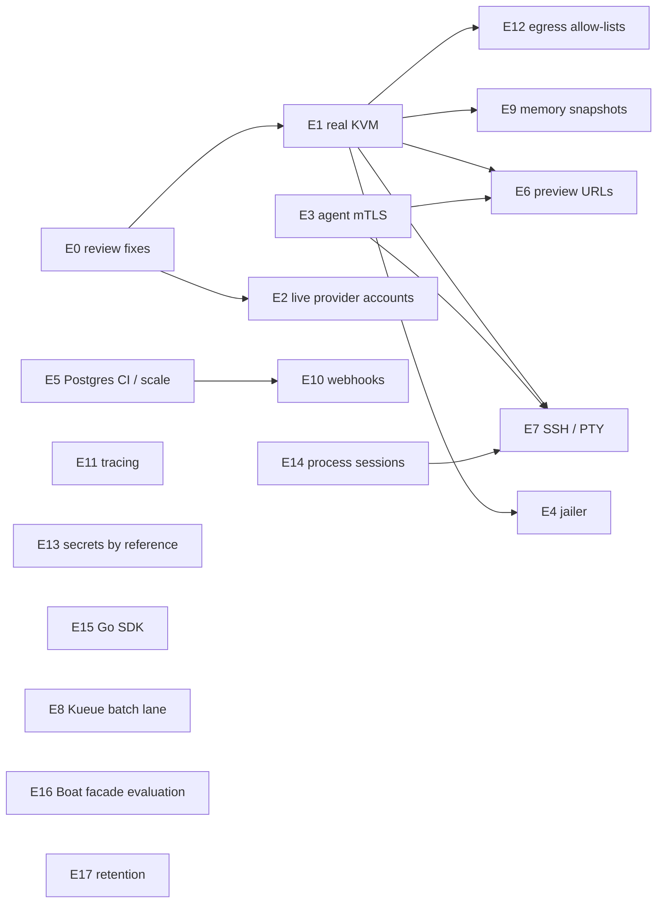

# Backlog

| | |
|---|---|
| Status date | 2026-10-28 |
| Scope | Implementation-ready epics for Phase 3 (solidification) and the P2 items after it. Phase 4 themes are listed in [roadmap.md](roadmap.md). |
| Priorities | **P0** gates any production recommendation · **P1** next, user-facing or operational · **P2** after P0/P1, or needs a decision first |
| Conventions | Branches `<type>/<short-outcome>` into `pre-release` ([ADR 0012](adr/0012-pre-release-integration-branch-model.md)). Every behavioural change ships with a test; changes to the public API update `api/openapi.yaml` and the SDKs. |

## Dependency overview

---

## E0. Correctness and security fixes from the code review

**Status (2026-10-28):** items marked ✅ were fixed before the initial import,
with tests; the rest are open.

**Priority** P0 (security and data-loss items), P1/P2 per task. **Depends on**
nothing. **Why** issues found while documenting the code on 2026-10-28
([trust model §6](security/trust-model.md#6-not-yet-implemented-and-known-issues),
[storage §12](storage-and-lifecycle.md#12-known-issues),
[adapter spec §12](adapters/specification.md#12-known-issues-in-the-contract-implementation)).

### Security

- ✅ **E0.1 Ownership check on policy delete** (P0). `deletePolicy` in
  `internal/server/tenancy.go` must apply the same project-ownership check as
  `putPolicy`. *Acceptance:* an organization key with `policies:write`
  receives `404` for `DELETE /v1/policies/project:<other org's project>`; a
  cross-tenant test covers `PUT` and `DELETE` for `org:` and `project:` scopes.
- **E0.2 Pin agent identity until mTLS lands** (P0). In `agentHeartbeat`,
  refuse a heartbeat that changes the endpoint of an existing agent ID unless
  an operator approves it (`POST /v1/admin/agents/{id}/approve-endpoint`), and
  refuse agent IDs registered to a different pool. *Acceptance:* a heartbeat
  with a new endpoint for a known ID returns `409` and is audited with outcome
  `failure`; existing agents keep heartbeating; documented as interim until
  E3.
- ✅ **E0.3 Bound responses from the guest** (P0). Limit the size the agent
  decodes from the guest for sync exec, listings and streamed exec totals
  (`internal/guest/client.go`). *Acceptance:* a malicious fake guest returning
  1 GiB of JSON makes the agent return an error without exceeding a fixed
  memory budget.
- **E0.4 PID reuse safety** (P1). Before treating a PID as the VM's
  Firecracker process (`recover`, `Kill`, `Alive`), verify its identity (for
  example `/proc/<pid>/cmdline` contains the VM's API socket path, or a
  pidfd). *Acceptance:* a test with a reused PID marks the VM stopped and sends
  no signal to the unrelated process.
- **E0.5 Audit fail-closed option** (P1). Add `audit.failClosed`; when set,
  mutating requests fail with `503` if the audit append fails. Add a metric for
  append failures in both modes. *Acceptance:* with a store that fails appends,
  creates return `503` and nothing is admitted; the metric increments.
- ✅ **E0.6 Complete the trust report limitations** (P1). Add the absent jailer,
  the shared-token plaintext agent channel, plaintext sandbox environment
  values, fail-open audit (unless E0.5 is enabled) and missing IPv6 egress
  rules to `server.Limitations`, each removed automatically when its fix is
  configured. *Acceptance:* `TestHybridOverflowAndPrivateOnly` (or a new test)
  asserts the entries.
- **E0.7 Protect `/metrics`** (P1). Optional separate listen address or bearer
  token for `/metrics`. *Acceptance:* with `metrics.listen` set, `/metrics` is
  absent from the public listener.
- **E0.8 Rate limiting before key lookup** (P2). Add a per-client-IP limiter
  for unauthenticated failures and evict idle per-key buckets. *Acceptance:* a
  flood of invalid keys from one IP is answered `429` without a database read
  per request; bucket memory stays bounded.
- ✅ **E0.9 Bootstrap key revocation sticks** (P2). A revoked bootstrap key is
  not re-activated when the environment value changes unless
  `--rotate-bootstrap` is passed. *Acceptance:* test for both paths; audit
  event `key.rotate` only on explicit rotation.
- **E0.10 Key lifetime controls** (P2). Configurable maximum `ttlHours`;
  record the creating key on each key; optional cascade revocation.
  *Acceptance:* minting above the maximum is `400`; revoking with
  `?cascade=true` revokes descendants.

### Correctness and data safety

- ✅ **E0.11 Quota check on start** (P0). `POST .../start` must re-reserve CPU and
  memory through an atomic store operation that locks the organization and
  runs `CheckActivation`, the same way `ActivateSandbox` does. *Acceptance:* a
  tenant at its CPU limit cannot start a stopped sandbox (`429
  quota_exceeded`, sandbox stays `stopped`); a store conformance test runs
  concurrent starts against a CPU quota.
- **E0.12 Tolerate agent partitions** (P0). *Status: partly done: the Firecracker pool refuses to list while an agent is within a 10-minute partition grace, so the reconciler neither fails nor orphans its VMs; per-sandbox status reasons remain.* Separate "agent unreachable" from
  "instance gone": exclude instances on agents past the heartbeat timeout from
  the lost-instance check, mark their sandboxes with a status reason, fail them
  only after a configurable grace period, and never delete a returning agent's
  instances without re-checking their sandboxes. *Acceptance:* POC 8 success
  criteria; chaos test C4 passes.
- **E0.13 Reconcile instance state** (P1). When `List` reports an instance as
  `stopped` or `error` while the sandbox is `running` or `paused`, move the
  sandbox to `stopped` (or `failed` with the backend message). *Acceptance:*
  killing a VM's Firecracker process moves its sandbox out of `running` within
  one reconcile pass (chaos test C12).
- ✅ **E0.14 Recreate networking on start** (P1). `Manager.Start` runs
  `setupNetwork` before booting. *Acceptance:* unit test with the recording
  runner; chaos test C6 (host reboot, then start) passes.
- ✅ **E0.15 Clean up `pending` VMs after an agent crash** (P1). On recovery,
  destroy or mark `error` any VM left `pending` and release its capacity; pool
  and agent `Create` return success only for `running` instances. *Acceptance:*
  test that crashes during build and retries `Create`.
- ✅ **E0.16 Set TTL on adoption** (P1). The reconciler's adoption path sets
  `expiresAt` like the provisioning path. *Acceptance:* adopted sandboxes
  expire.
- ✅ **E0.17 Exclude failed pools on retry** (P1). `retry` appends the pool to
  `ExcludedPools` (except when the sandbox is pinned to it); clear the list when
  no other pool is eligible. *Acceptance:* with two pools and one failing
  `Create`, the retry lands on the other pool.
- ✅ **E0.18 Fail fast on non-transient `Create` errors** (P1). `invalid_request`
  and `not_found` from `Create` fail the sandbox (or retry a bounded number of
  times) without marking the pool unhealthy. *Acceptance:* a missing template
  on a node fails the sandbox with the adapter's message and leaves the pool
  healthy.
- ✅ **E0.19 Exec and transfer timeouts** (P0). Remove the fixed 5-minute HTTP
  client timeout for exec, streams and file transfers in `adapterhttp`
  (derive the deadline from `timeoutSeconds` plus a margin), and raise or
  derive the provider client timeout in `httpx` the same way. *Acceptance:* a
  6-minute command succeeds on a Firecracker pool (fake agent) and on the
  Daytona fake.
- **E0.20 Provider TTL backstops follow TTL changes** (P1). `PATCH ttlSeconds`
  updates Daytona (`POST /sandbox/{id}/ttl/{minutes}`) and Freestyle
  (`PATCH /v5/vms/{id}`, noting that its TTL counts from creation), or the API
  refuses extensions beyond the backstop. *Acceptance:* fake-server tests for
  both adapters.
- **E0.21 Detect duplicate instances per sandbox** (P1). The reconciler deletes
  any instance whose sandbox's `backendRef` differs, even on the same pool; the
  Firecracker pool's idempotency check includes agents that are registered but
  stale. *Acceptance:* test with two instances for one sandbox on one pool.
- **E0.22 Terminate on a vanished agent** (P1). An admin endpoint to
  deregister an agent; terminating sandboxes whose agent is deregistered
  complete without a backend call (audited). *Acceptance:* a sandbox on a
  deleted node can be terminated.
- ✅ **E0.23 Queue time accounting** (P2). Add only the time since the last
  enqueue on activation. *Acceptance:* a sandbox retried once reports queue
  time equal to the actual waiting time.

### Consistency and hygiene

- **E0.24 Make the jailer switch honest** (P1, with the deploy owners). The
  agent accepts `--jailer` but ignores it, so `agent.jailer.enabled=true` looks
  like a control and is not. Until E4 lands, log a warning at agent start and
  report "jailer requested but not in use" in the trust report. *Acceptance:*
  with the flag set, the warning and the trust-report entry appear.
- **E0.25 Adapter protocol version check** (P1). `adapterhttp.Client` checks
  `Differently-Adapter-Protocol` and `info.protocol` on discovery and marks the
  pool unhealthy on an unknown major version. *Acceptance:* test with a server
  answering protocol `2`.
- **E0.26 Admin reconcile only on the leader** (P2). `POST
  /v1/admin/reconcile` returns `409` (with the leader's identity if known) on a
  non-leader, or forwards. *Acceptance:* no concurrent reconcile passes in a
  two-replica test.
- **E0.27 `maxQueueSeconds` for quota waits** (P2). Apply the queue deadline
  when activation waits on tenant quota, not only when no pool is ready.
- **E0.28 Snapshot quota** (P2). Check `maxSnapshots` atomically and at project
  level too.
- **E0.29 `poolBudgetsPerHour`** (P2). Enforce it at activation (estimated
  hourly cost of active sandboxes per pool) or remove it from the API, SDKs and
  OpenAPI document.
- **E0.30 Adapter regions** (P2). Use adapter-reported `regions` in placement
  or stop reporting them.
- **E0.31 Custom in-process adapter kinds** (P2). Let `config.Validate` accept
  kinds registered with `pools.Register`, not only `config.KnownAdapters`.
- **E0.32 Store parity** (P2). Align `DeletePool` between stores (the memory
  store counts queued sandboxes with a pool set; Postgres excludes queued).
- **E0.33 Scheduler unit tests** (P1). Direct tests for `dispatch`, `retry`
  backoff, `expire`, `nudge` and every `reconcilePool` branch.
- **E0.34 Adapter conformance suite** (P1). A shared suite (`adaptertest`, like
  `storetest`) covering the checklist in
  [adapters/specification.md §11](adapters/specification.md#11-adapter-conformance-checklist),
  runnable against in-process adapters and against any HTTP endpoint.
  *Acceptance:* runs against fake, devhost, the Firecracker pool with fake
  agents, and the Daytona and Freestyle fakes.

---

## E1. Firecracker on real KVM

**Priority** P0. **Depends on** E0.12, E0.14, E0.19 for meaningful chaos
results. **Why** nothing has run on real KVM.

- **E1.1 Guest image tooling.** `deploy/images/build-kernel.sh` and
  `build-rootfs.sh` exist but are marked unverified (syntax-checked only). Run
  them end to end, boot the result under Firecracker, and resolve guest DNS:
  `build-rootfs.sh` writes no resolver and expects one to be written "at boot
  by the guest agent or your template", but the guest agent does not write
  one and the VM cannot reach cluster DNS. Coordinate with the deploy owners.
  *Acceptance:* reproducible builds with checksums for amd64 and arm64 that
  boot, pass the smoke suite and resolve public names.
- **E1.2 Real-KVM smoke suite.** Go tests behind a build tag (`realkvm`)
  driving the public API: every advertised feature, 100 iterations, leak checks
  (VMs, taps, chains, directories). *Acceptance:* passes on one `.metal` node.
- **E1.3 POC 1, POC 2, POC 5, POC 9.** Run and publish
  ([proof-of-concepts.md](proof-of-concepts.md)). *Acceptance:* each POC's
  success criteria met or the gap filed as a task.
- **E1.4 Nightly real-KVM CI.** A scheduled job on a `.metal` runner (or
  on-demand cluster) running E1.2 and benchmark B1 on `pre-release`.
  *Acceptance:* results attached to each release candidate.
- **E1.5 `doctor` checks.** Add cgroup v2, host kernel line, reflink support of
  the state directory, `ip_forward`, free disk. *Acceptance:* each check has a
  failing-case test.
- **E1.6 Agent restart design.** Implement the POC 2 decision (VMs survive
  agent upgrades, or sandboxes move to `stopped` reliably) and document the
  upgrade procedure. *Acceptance:* chaos test C5 passes.

## E2. External adapters on live accounts

**Priority** P0 for any external pool recommendation. **Depends on** E0.19,
E0.20.

- **E2.1 POC 7.** Resolve every item in
  [POC 7](proof-of-concepts.md#poc-7-external-provider-live-account-verification).
- **E2.2 Daytona resources.** Send `cpu`, `memory`, `disk` where the API honours
  them, or reject requests whose resources differ from the snapshot's size.
  *Acceptance:* the sandbox size Daytona reports matches the request, or the
  request fails with `invalid_request`.
- **E2.3 Recorded fixtures.** Replace spec-derived fake responses with recorded,
  scrubbed responses. *Acceptance:* adapter tests run against them.
- **E2.4 Budget-guarded live tests.** An opt-in job with provider keys and a
  spend cap that runs the adapter conformance suite (E0.34) against live
  accounts. *Acceptance:* runs on release candidates.
- **E2.5 Feature matrix update.** Move verified cells in
  [feature-parity.md](feature-parity.md) from 🧪 to ✅ (with the feature-parity
  owner).

## E3. Authenticated agent channel

**Priority** P0. **Depends on** none (E0.2 is the interim measure).

- **E3.1 Join flow and per-node identity.** Agents enrol with a short-lived join
  token and receive a node certificate whose identity is the agent ID; the
  server keeps a CA (or integrates cert-manager). *Acceptance:* an agent
  without a valid certificate cannot heartbeat; a node cannot heartbeat as
  another node's ID.
- **E3.2 mTLS both ways.** Server-to-agent calls verify the agent certificate
  against the registered agent ID; agents verify the server. *Acceptance:*
  traffic capture shows TLS; a man-in-the-middle with a different certificate
  is rejected.
- **E3.3 Rotation and revocation.** Certificate rotation without VM
  disruption; revoking a node's certificate removes it from placement.
  *Acceptance:* rotation test with running VMs; revoked node gets no traffic.
- **E3.4 Remote plugin TLS options.** Optional client certificates and CA
  pinning for `remote` pools. *Acceptance:* config fields documented and
  tested.
- **E3.5 Production default.** Plain HTTP to agents allowed only with an
  explicit `insecureAgentTransport` setting, reported in the trust report.

## E4. Firecracker jailer

**Priority** P0. **Depends on** E1 (real KVM), POC 3.

- **E4.1 `JailerLauncher`.** Implement the agent `Launcher` with per-VM chroot,
  unprivileged UID/GID, cgroup v2 limits and chroot-relative socket paths.
  *Acceptance:* POC 3 success criteria.
- **E4.2 Agent flag and chart.** The existing `--jailer PATH` flag (accepted
  but unused today) and any new jailer flags drive the launcher; the chart's
  `agent.jailer.*` values work end to end.
- **E4.3 Recovery with jails.** Restart recovery and PID checks (E0.4) work for
  jailed processes; chroots are cleaned up on delete.
- **E4.4 Default on.** Jailer enabled by default in production profiles; the
  trust report limitation removed when it is on.

## E5. Postgres in CI, failover and scale

**Priority** P1. **Depends on** none.

- **E5.1 Conformance in CI.** The `postgres conformance` job in
  `.github/workflows/ci.yml` exists; make it a required check, and make the
  test fail instead of skipping when CI sets a flag (a skipped test passes
  today). *Acceptance:* the first CI run on the hosted repository is green,
  and removing the database URL in CI turns the job red.
- **E5.2 POC 6 (failover).** Run and publish; document recommended Postgres
  settings (TCP keepalives, synchronous replication). *Acceptance:* POC 6
  criteria.
- **E5.3 POC 10 (throughput).** Run and publish benchmark B3 and B5.
- **E5.4 Tally cost.** Replace per-admission document scans with an aggregate
  query or summary rows maintained in the same transaction. *Acceptance:*
  admission latency flat from 10 to 10 000 live sandboxes per organization;
  conformance suite still passes.
- **E5.5 Audit throughput.** Batch or pipeline audit appends without breaking
  chain contiguity. *Acceptance:* audit is no longer the first global
  bottleneck in B3.
- **E5.6 Leader observability.** Metrics for leadership per replica, ticks,
  dispatch duration, provisioning in flight; a bound on concurrent
  provisioning goroutines. *Acceptance:* dashboards show a leader handover.
- **E5.7 Paging for reports.** Trust report, usage and audit verify work in
  bounded memory (paging, checkpoints). *Acceptance:* trust report on 1 million
  audit events stays under a memory budget.

## E6. Preview URLs for Firecracker pools

**Priority** P1. **Depends on** E1, E3.

- **E6.1 Port forwarding over vsock.** The guest agent proxies a TCP stream to
  `localhost:<port>` over a vsock connection; the agent exposes it through the
  adapter protocol. (The network path cannot be used: the VM accepts no
  inbound connections and the agent's namespace drops traffic from taps.)
  *Acceptance:* HTTP and WebSocket round trips through the agent.
- **E6.2 Gateway.** An HTTP gateway (in the server or a separate component)
  serving `https://<port>-<sandbox>.<domain>`, routing to the right agent,
  with tenancy checks. *Acceptance:* `ports.expose` advertised on Firecracker
  pools and the existing `POST /v1/sandboxes/{id}/ports` returns a working URL.
- **E6.3 Access control.** URLs require a signed, expiring token by default;
  public URLs are an explicit per-request option allowed by policy; every
  exposure is audited. *Acceptance:* unauthenticated requests to a private URL
  get `401`.

## E7. SSH gateway and PTY

**Priority** P1. **Depends on** E1, E3; PTY benefits from E14.

- **E7.1 PTY in the guest agent.** Allocate a PTY, resize, signals.
- **E7.2 PTY over WebSocket.** `GET /v1/sandboxes/{id}/pty` with the same scope
  and audit as exec. *Acceptance:* interactive shell from the CLI.
- **E7.3 SSH gateway.** SSH front end that authenticates users with API keys or
  short-lived certificates and maps `sandbox@gateway` to a PTY session; works
  for external pools through their exec or SSH APIs where possible.
  *Acceptance:* `ssh` and `scp` work against a Firecracker sandbox; `ssh` and
  `pty` features advertised accordingly.

## E8. Kueue batch lane

**Priority** P2. **Depends on** a design decision. **Why** Kueue fits
ephemeral batch work, not interactive sandboxes
([architecture §13](architecture/README.md#13-why-kueue-and-kubernetes-jobs-are-not-the-mvp-sandbox-abstraction)).

- **E8.1 Design record.** API shape (a `jobs` resource or a `kueue` adapter),
  isolation (Kata or gVisor RuntimeClass), how Kueue quota relates to
  Differently quota, how results and logs return. *Acceptance:* ADR accepted.
- **E8.2 Prototype.** Submit suspended Kubernetes Jobs to a `LocalQueue`; map
  admission, running, completion and preemption to Differently states; record
  usage and audit. *Acceptance:* 1 000 eval jobs run under Kueue quota and fair
  sharing, visible in Differently usage; interactive sandboxes unaffected.
- **E8.3 Optionality.** The lane is disabled unless configured; Kubernetes stays
  optional for everything else.

## E9. Memory snapshots on Firecracker

**Priority** P2. **Depends on** E1, POC 4 ([ADR 0014](adr/0014-defer-memory-snapshots-until-restore-proven.md)).

- **E9.1 Capture and restore** following
  [storage-and-lifecycle.md §9](storage-and-lifecycle.md#9-memory-snapshot-plan).
- **E9.2 Integrity.** HMAC or signature over snapshot files, verified before
  load; encryption at rest.
- **E9.3 Clone identity.** Guest hook for re-addressing, machine ID and entropy.
- **E9.4 Lifetime.** Reference counting of memory files; deletion refused while
  in use.
- **E9.5 Advertise.** `snapshots.memory` on agents; fork uses it for running
  sources; pause to disk. *Acceptance:* a process survives fork; POC 4 criteria
  hold in the smoke suite.

## E10. Webhooks

**Priority** P1. **Depends on** E5.1 (durable outbox needs Postgres tests).

- **E10.1 Events.** `sandbox.running`, `sandbox.failed`, `sandbox.terminated`,
  `sandbox.placed` (with trust and pool), `quota.exceeded`, `pool.unhealthy`.
- **E10.2 Delivery.** Per-organization endpoints; HMAC-SHA256 signature over
  timestamp and body; durable outbox in Postgres written in the same
  transaction as the state change; retries with backoff; delivery log.
  *Acceptance:* no event lost across a leader handover; signature verification
  examples in the SDKs.
- **E10.3 Egress control.** Webhook destinations allow-listed by the operator;
  disabled by default for air-gapped installs.

## E11. OpenTelemetry tracing

**Priority** P1. **Depends on** none.

- **E11.1 Spans.** API handler → placement → activation → adapter call →
  agent → guest, with sandbox, pool and organization attributes (no env
  values, no command lines unless `audit.recordCommands`).
- **E11.2 Propagation.** `traceparent` through `adapterhttp` and the agent.
- **E11.3 Off by default.** No exporter unless an OTLP endpoint is configured;
  the trust report states the destination. *Acceptance:* the exec overhead SLI
  in [reliability-and-performance.md](reliability-and-performance.md#1-service-level-objectives-proposed)
  can be measured from traces.

## E12. Per-sandbox egress allow-lists

**Priority** P1. **Depends on** E1, POC 9.

- **E12.1 API.** `network: {egress: "deny" | "allow", allow: [CIDR or domain]}`
  on create, capped by organization and project policy (stricter wins).
- **E12.2 Firecracker.** Per-VM chain rules from the request; IPv6 rules;
  domain allow-lists through a resolver or proxy the agent controls.
- **E12.3 Providers.** Map to Freestyle firewall rules and Daytona
  `networkBlockAll`/`networkAllowList`; reject what a backend cannot enforce
  (`unsupported_capability`).
- **E12.4 Deny list configuration.** Configurable node deny list that always
  includes the VM range. *Acceptance:* probes from POC 9 pass per sandbox.

## E13. Sandbox secrets by reference

**Priority** P1. **Depends on** none. **Why** sandbox environment values are
stored in plaintext ([ADR 0008](adr/0008-secrets-by-reference-only.md)).

- **E13.1 Encryption at rest.** Encrypt `env` values in the store with a key
  from a file or KMS reference; the API still returns keys only.
- **E13.2 References.** `secretRefs: {NAME: "project-secret:<name>" | "env:..." }`
  resolved at provisioning time; project-level secret objects with their own
  scope.
- **E13.3 Node handling.** The agent keeps environment values out of `vm.json`
  (memory or tmpfs only) and re-fetches them after restart.
- **E13.4 Fork policy.** Fork copies secrets only when requested. *Acceptance:*
  a database dump and a node disk image contain no environment values.

## E14. Process sessions

**Priority** P2. **Depends on** none.

- Detached processes with IDs, attach by output offset, kill, list, in the guest
  agent and API (the main Boat-parity gap for exec). *Acceptance:* start a
  long-running process, disconnect, reattach and read output from an offset.

## E15. Go SDK polishing

**Priority** P1. **Depends on** none.

- **E15.1 Public module.** Stable import path, semantic versioning, package
  docs and examples.
- **E15.2 Ergonomics.** Typed errors (`*api.Error` with code helpers), wait
  helpers, streaming exec as an iterator, automatic `Idempotency-Key` on
  create with retries, pagination helpers, context everywhere.
- **E15.3 Tests.** Against a dev-mode server in CI. *Acceptance:* parity with
  the TypeScript and Python SDK feature lists.

## E16. Boat-compatible facade evaluation

**Priority** P2. **Depends on** a demand signal ([ADR 0013](adr/0013-no-boat-compatible-facade-in-mvp.md)).

- **E16.1 Licence check** of Boat's published OpenAPI document.
- **E16.2 Prototype** of the portable core at `/compat/boat/v1` behind a flag,
  on top of existing handlers; `501` for product-specific routes.
- **E16.3 Decision.** A new ADR that supersedes or reaffirms ADR 0013 with
  measured effort and a named migration user. *Acceptance:* Boat SDK examples
  for the portable core run unchanged against the prototype, or the decision
  records why not.

## E17. Retention and garbage collection

**Priority** P2. **Depends on** E5.7.

- Configurable retention for terminated and failed sandbox records; snapshot
  TTLs and a sweep for backend snapshots without records; agent record
  pruning; audit archival with signed checkpoints so a pruned chain still
  verifies from its anchor. *Acceptance:* a year of synthetic history stays
  within a configured database size, and verification succeeds from the latest
  checkpoint.
