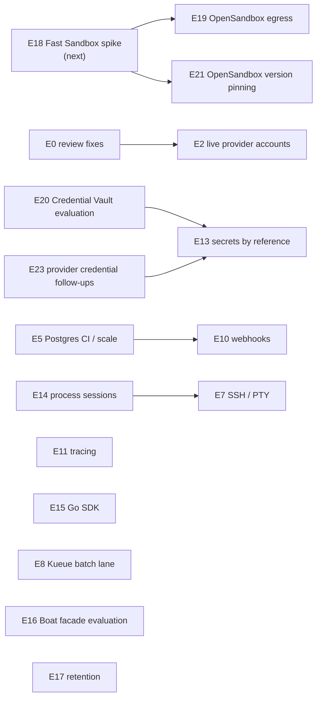

# Backlog

| | |
|---|---|
| Status date | 2026-10-28 |
| Scope | Implementation-ready epics for Phase 3 (solidification) and the P2 items after it. Phase 4 themes are listed in [roadmap.md](roadmap.md). |
| Priorities | **P0** gates any production recommendation · **P1** next, user-facing or operational · **P2** after P0/P1, or needs a decision first |
| Conventions | Branches `<type>/<short-outcome>` into `pre-release` ([ADR 0012](adr/0012-pre-release-integration-branch-model.md)). Every behavioural change ships with a test; changes to the public API update `api/openapi.yaml` and the SDKs. |
| Runtime change | [ADR 0020](adr/0020-opensandbox-replaces-node-agent.md) removed Differently's Firecracker node agent; OpenSandbox is the default private runtime. Epics that only concerned the agent are marked **obsolete** and kept as history. |

## Dependency overview

Obsolete since ADR 0020, kept below as history: E1 (Firecracker on real
KVM), E3 (authenticated agent channel), E4 (Firecracker jailer), E6 (preview
URLs for Firecracker pools), E9 (memory snapshots on Firecracker). E12
(per-sandbox egress) is superseded by E19.

---

## E18. Fast Sandbox spike

Run OpenSandbox's Firecracker runtime (Fast Sandbox) on KVM targets through
the `opensandbox` adapter.

**Priority** P0, first. **Depends on** nothing. **Why**
[ADR 0020](adr/0020-opensandbox-replaces-node-agent.md) made OpenSandbox the
runtime before [ADR 0019](adr/0019-opensandbox-backend-first.md)'s criteria
were met. Only the Docker runtime has run through Differently
([spike](research/opensandbox-spike.md)); containers share the host kernel.
Until this epic is done, microVM isolation through Differently is unverified.

- **E18.1 Host preparation.** Meet Fast Sandbox's documented host
  requirements: Linux ≥ 5.10, `/dev/kvm`, `/dev/net/tun`, cgroup v2, an XFS
  filesystem with reflink for images, and an enlarged `/dev/shm`. First on the
  `colima-differently` VM (nested KVM, tun and cgroup v2 already present; its
  ext4 root needs an added XFS volume), then on one x86_64 cloud KVM target
  (`.metal` or nested virtualization; see the cloud notes in
  [deploy/](deploy/README.md)). *Acceptance:* an OpenSandbox server with the
  Fast Sandbox runtime is healthy on both, with server, `execd` and runtime
  versions recorded.
- **E18.2 Through the adapter.** Register the server as an `opensandbox` pool
  with `isolation: microvm`. Run `TestLiveOpenSandbox` and the end-to-end
  suite against it: boot, isolation, pause/resume, snapshot and fork, recovery
  after restarts. *Acceptance:*
  [POC 11](proof-of-concepts.md#poc-11-fast-sandbox-through-the-adapter)
  success criteria.
- **E18.3 Memory snapshots.** Check that a process survives snapshot and
  restore and that clones get distinct identity. Only then document adding
  `snapshots.memory` to the pool's `config.features`. *Acceptance:* a fork of a
  running sandbox keeps a running process, or the guide records why
  `snapshots.memory` stays off.
- **E18.4 Egress and isolation probes.** Probe from inside a microVM: cloud
  metadata, node addresses, other sandboxes, the control plane, a public host.
  Feeds E19. *Acceptance:* results recorded per target.
- **E18.5 Measurements.** Benchmarks B1 and B2
  ([reliability-and-performance.md §4](reliability-and-performance.md#4-benchmark-plan))
  on the Fast Sandbox runtime, compared with the Docker runtime on the same
  host.
- **E18.6 Footprint.** Which OpenSandbox components Fast Sandbox needs (its
  per-node runtime agent among them), how it is installed next to the
  Differently chart, and multi-node behaviour. *Acceptance:* a deploy guide
  section with tested steps.
- **E18.7 Record.** Update the spike, the trust model and (with its owner)
  [feature-parity.md](feature-parity.md) from "unverified" to what was
  observed.

## E19. OpenSandbox network policy and egress

**Priority** P1. **Depends on** E18 for microVM results; the Docker runtime
part can start now. **Supersedes** E12. **Why** Differently enforces no
isolation or egress itself. OpenSandbox has network-policy and egress specs
(its server config already names an egress image), but the adapter sends no
network settings, so sandbox egress is whatever the runtime's defaults
allow.

- **E19.1 Read the contract.** Review OpenSandbox's network-policy and egress
  specs at the pinned version (E21) and record what each runtime (Docker,
  Kubernetes, Fast Sandbox) enforces.
- **E19.2 API.** `network: {egress: "deny" | "allow", allow: [CIDR or domain]}`
  on create, capped by organization and project policy (stricter wins), as
  planned in E12.1.
- **E19.3 Adapters.** Map the request to OpenSandbox's network policy on
  create; to Freestyle firewall rules and Daytona
  `networkBlockAll`/`networkAllowList`; reject what a backend cannot enforce
  (`unsupported_capability`). Advertise `network.egress-control` only on pools
  where it is enforced.
- **E19.4 Trust report.** State per pool whether egress is enforced by the
  backend, or left to the runtime's defaults.
- **E19.5 Probes.** From inside a sandbox on each runtime: cloud metadata,
  node and pod addresses, the control plane, other sandboxes, a public host.
  *Acceptance:* a sandbox created with `egress: deny` reaches nothing; with an
  allow-list, only the listed destinations.

The control plane's own egress is a separate matter: the Helm chart's
NetworkPolicy lets the server reach OpenSandbox on port 8090, and that
restricts the control plane, not sandboxes.

## E20. Credential Vault evaluation

**Priority** P2. **Depends on** nothing. **Informs** E13. **Why** sandbox
environment values are stored unencrypted in Differently's database and
passed to the backend at create. The spike listed OpenSandbox's Credential
Vault API as a possible way to give sandboxes credentials without Differently
storing them; it has not been reviewed.

- **E20.1 Review.** At the pinned OpenSandbox version: what the vault stores,
  who can read it, how a sandbox receives a credential, whether values ever
  leave the server, and how it relates to the single server-wide API key.
- **E20.2 Prototype.** Resolve E13's `secretRefs` into vault entries on
  OpenSandbox pools instead of plain `env`.
- **E20.3 Decision.** Record the result in E13 (or an ADR) with a short threat
  analysis. *Acceptance:* if adopted, a database dump contains no secret values
  for sandboxes on OpenSandbox pools.

## E21. OpenSandbox version pinning and upgrade testing

**Priority** P1. **Depends on** nothing. **Why** the published OpenSandbox
specs run ahead of the images its server deploys by default; the spike found
four differences that would each have broken a spec-only adapter
([spike](research/opensandbox-spike.md)). ADR 0019 requires the live test on
every OpenSandbox upgrade, and no CI job runs it today.

- **E21.1 Pin.** State the OpenSandbox server and `execd` versions each
  Differently release supports (today server `release-1.2.0` with `execd`
  v1.1.0, the versions in `test/opensandbox/`), in the OpenSandbox guide and
  the release notes.
- **E21.2 CI.** A job that starts `test/opensandbox/compose.yaml` and runs
  `go test -tags live ./internal/adapters/opensandbox/` and the end-to-end
  suite (`make e2e-prepare e2e-up e2e`) against the pinned images.
  *Acceptance:* the job runs on every PR into `pre-release`.
- **E21.3 Upgrade test.** Before raising the pin, run both suites against the
  next OpenSandbox release; then upgrade a running server in place and check
  that existing sandboxes are still listed by their `differently-installation`
  metadata and still answer exec. *Acceptance:* a recorded upgrade run per
  pin change.
- **E21.4 Keep the fake honest.** Every skew found is reproduced in the fake
  server in `internal/adapters/opensandbox/opensandbox_test.go`.

## E23. Provider credential follow-ups

**Priority** P2. **Depends on** nothing. **Why** provider credentials can
be stored in Differently, sealed under one key-encryption key
([ADR 0021](adr/0021-provider-credentials-stored-encrypted.md)), and that
first version has known limits.

- **E23.1 External vault behind `secret:`.** Resolve `secret:` names from
  Azure Key Vault or HashiCorp Vault (and later cloud secret managers),
  so the value never enters Differently's database. Keep the existing API:
  the store holds a pointer and the resolver fetches and caches the value,
  and the same fingerprint check rebuilds adapters when it changes. Today
  vault-held values reach the server only as `file:` mounts through the
  vault's CSI driver. *Acceptance:* a pool whose credential lives in a
  vault rotates live when the vault's value changes, tested against a fake
  vault API.
- **E23.2 Per-organization provider credentials.** Let an organization use
  its own Daytona or Freestyle account. Either org-scoped pools, or a
  per-organization credential on a shared pool. Placement, the trust report
  and usage must show whose account a sandbox ran in, and org admins must
  not read other organizations' credentials. *Acceptance:* two organizations
  on one installation place sandboxes in different provider accounts, and
  the trust report and audit log say which.
- **E23.3 Rotate the secrets key.** Today changing it makes every sealed
  value unopenable. Record a key ID on each sealed value and accept a
  keyring (current key plus previous keys). Add a command that re-seals
  every value under the current key. *Acceptance:* the key changes on a
  running installation without re-entering any value, including while
  replicas run with old and new keyrings during a rolling restart.
- **E23.4 Show which credential version each pool uses.** Report, per pool
  and replica, the fingerprint the adapter was built with, so operators can
  confirm a rotation reached every replica before revoking the old provider
  key. *Acceptance:* `GET /v1/admin/pools/{name}` shows it, and the
  rotation guide uses it.
- ✅ **E23.5 `differently-server secrets-key`.** Prints a new base64
  32-byte key, like `differently-server token`.
- **E23.6 Live verification.** Rotate stored keys against live Daytona and
  Freestyle accounts (with [E2](#e2-external-adapters-on-live-accounts)).
  Check `file:` pickup from a Kubernetes Secret volume and an Azure Key Vault
  CSI mount on AKS, and the chart's generated key across upgrade and
  reinstall.

---

## E0. Correctness and security fixes from the code review

**Status (2026-10-28):** items marked ✅ were fixed before the initial import,
with tests; the rest are open. Items that only concerned the removed node
agent are marked obsolete ([ADR 0020](adr/0020-opensandbox-replaces-node-agent.md));
their tests left with the agent.

**Priority** P0 (security and data-loss items), P1/P2 per task. **Depends on**
nothing. **Why** issues found while documenting the code on 2026-10-28
([trust model §6](security/trust-model.md#6-not-yet-implemented-and-known-issues),
[storage §12](storage-and-lifecycle.md#12-known-issues),
[adapter spec §12](adapters/specification.md#12-known-issues-in-the-contract-implementation)).

### Security

- ✅ **E0.1 Ownership check on policy delete** (P0). `deletePolicy` in
  `internal/server/tenancy.go` must apply the same project-ownership check as
  `putPolicy`. *Acceptance:* an organization key with `policies:write`
  receives `404` for `DELETE /v1/policies/project:<other org's project>`; a
  cross-tenant test covers `PUT` and `DELETE` for `org:` and `project:` scopes.
- **E0.2 Pin agent identity until mTLS lands.** *Obsolete (ADR 0020): there
  are no node agents.* It was implemented as trust-on-first-use per-agent
  secrets ([ADR 0018](adr/0018-per-agent-secrets-until-mtls.md)); the code
  and `TestAgentIdentityIsPinned` were removed with the agent.
- **E0.3 Bound responses from the guest.** *Obsolete (ADR 0020): the guest
  agent and its client were removed.* The same concern for backends is open
  as E0.35.
- **E0.4 PID reuse safety.** *Obsolete (ADR 0020): Differently no longer
  supervises VMM processes.*
- ✅ **E0.5 Audit fail-closed option** (P1). `audit.failClosed`; when set,
  mutating requests fail with `503` if the audit append fails;
  `differently_audit_append_failures_total` counts failures in both modes.
  *Covered by* `TestAuditFailClosed`.
- ✅ **E0.6 Complete the trust report limitations** (P1). The trust report's
  limitations (`limitations` in `internal/server/admin.go`) list what
  Differently cannot control; conditional entries (fail-open audit, `/metrics`
  on the API listener) disappear when their fix is configured. Since ADR 0020
  the entries about the jailer, the agent channel and IPv6 egress rules are
  gone, replaced by the statement that isolation and egress come from each
  pool's backend runtime. *Covered by* `TestAuditFailClosed`,
  `TestHybridOverflowAndPrivateOnly`.
- ✅ **E0.7 Protect `/metrics`** (P1). `metrics.listen` serves `/metrics` on its
  own address and removes it from the API listener. *Covered by*
  `TestMetricsCanLeaveTheAPIListener`.
- **E0.8 Rate limiting before key lookup** (P2). Add a per-client-IP limiter
  for unauthenticated failures and evict idle per-key buckets. *Acceptance:* a
  flood of invalid keys from one IP is answered `429` without a database read
  per request; bucket memory stays bounded.
- ✅ **E0.9 Bootstrap key revocation sticks** (P2). A revoked bootstrap key is
  not re-activated when the environment value changes. As built, there is no
  `--rotate-bootstrap` flag: a changed value for a key that is not revoked
  replaces its hash on start, and every hash change is audited as
  `key.rotate` with actor `bootstrap`
  ([the bootstrap operator token](guides/keys-and-providers.md#the-bootstrap-operator-token)).
  The planned acceptance (a flag, and `key.rotate` only on explicit
  rotation) was not implemented.
- **E0.10 Key lifetime controls** (P2). Configurable maximum `ttlHours`;
  record the creating key on each key; optional cascade revocation. (Rotation
  with a grace period is done: `POST /v1/api-keys/{id}/rotate`, covered by
  `TestRotateAPIKey`.)
  *Acceptance:* minting above the maximum is `400`; revoking with
  `?cascade=true` revokes descendants.
- **E0.35 Bound synchronous exec output from backends** (P1). The
  `opensandbox` adapter's `Exec` accumulates stdout and stderr in memory with
  no cap (only single events are bounded, at 16 MiB), and file reads stop
  silently at 100 MiB instead of failing. *Acceptance:* a command printing
  1 GiB through synchronous exec returns an error (or truncated output with a
  flag) within a fixed memory budget; a file over the limit fails with a clear
  error.

### Correctness and data safety

- ✅ **E0.11 Quota check on start** (P0). `POST .../start` re-reserves CPU and
  memory through an atomic store operation that locks the organization and
  runs `CheckActivation`. *Covered by* store conformance
  `ConcurrentStartRespectsCPUQuota`. (OpenSandbox pools have no start; this
  applies to backends that do.)
- **E0.12 Tolerate agent partitions.** *Obsolete (ADR 0020): the Firecracker
  pool and its 10-minute partition grace were removed.* The general rule that
  remains: when a pool's `List` fails, the reconciler skips that pool for the
  pass instead of failing its sandboxes (`Scheduler.Reconcile`). Behaviour
  during real backend outages is
  [POC 13](proof-of-concepts.md#poc-13-opensandbox-outage-and-recovery).
- ✅ **E0.13 Reconcile instance state** (P1). When `List` reports an instance as
  `stopped` or `error` while the sandbox is `running` or `paused`, the sandbox
  moves to `stopped` (or `failed` with the backend message), after a 30-second
  grace that keeps it from racing a lifecycle call. *Covered by*
  `TestFailureRecoveryAndReconcile`. The `opensandbox` adapter never reports
  `stopped`; an OpenSandbox `Failed` state fails the sandbox.
- **E0.14 Recreate networking on start.** *Obsolete (ADR 0020): Differently
  no longer creates per-VM networking.*
- **E0.15 Clean up `pending` VMs after an agent crash.** *Obsolete (ADR 0020):
  there is no agent.*
- ✅ **E0.16 Set TTL on adoption** (P1). The reconciler's adoption path sets
  `expiresAt` like the provisioning path.
- ✅ **E0.17 Exclude failed pools on retry** (P1). `retry` appends the pool to
  `ExcludedPools` (except when the sandbox is pinned to it); the list is
  cleared when no other pool is eligible.
- ✅ **E0.18 Fail fast on non-transient `Create` errors** (P1). `invalid_request`
  and `not_found` from `Create` fail the sandbox (or retry a bounded number of
  times) without marking the pool unhealthy. For example, an image the backend
  cannot pull fails the sandbox with the backend's message.
- ✅ **E0.19 Exec and transfer timeouts** (P0). No fixed 5-minute HTTP client
  timeout for exec, streams and file transfers: the `adapterhttp` and `httpx`
  clients both allow up to 2 h 15 min, and the request context bounds each
  call.
- **E0.20 Provider TTL backstops follow TTL changes** (P1). `PATCH ttlSeconds`
  updates Daytona (`POST /sandbox/{id}/ttl/{minutes}`), Freestyle
  (`PATCH /v5/vms/{id}`, noting that its TTL counts from creation) and
  OpenSandbox (whose `timeout` is set once at create; the adapter has no
  renewal call), or the API refuses extensions beyond the backstop.
  *Acceptance:* fake-server tests for each adapter.
- **E0.21 Detect duplicate instances per sandbox** (P1). The reconciler deletes
  any instance whose sandbox's `backendRef` differs, even on the same pool.
  *Acceptance:* test with two instances for one sandbox on one pool.
- **E0.22 Terminate when a backend is gone** (P1). A terminating sandbox
  whose pool was removed, or whose backend is permanently unreachable, retries
  `Delete` on every tick forever (`Scheduler.destroy`). Add an operator path
  that completes the termination without a backend call (audited). The
  original item was about deregistered agents. *Acceptance:* a sandbox on a
  deleted pool can be terminated.
- ✅ **E0.23 Queue time accounting** (P2). Add only the time since the last
  enqueue on activation.

- ✅ **E0.36 Pool registry changes reach every replica** (P1). Done: each
  pool refresh (about every 5 s, on every replica) re-reads the store's
  pool list (`pools.Manager.Recheck`), covered by a two-manager test; a
  multi-replica cluster has not been tried. It was: pool changes
  made through the admin API are applied only to the pool manager of the
  replica that handled the call: `POST /v1/admin/pools`, `PATCH`, `drain`,
  `undrain`, `use` and `DELETE`. `pools.Manager.Recheck` re-resolves
  credentials on every replica but rebuilds from its in-memory pool list,
  not from the store. So until restart, the scheduler leader can keep
  placing sandboxes on a pool another replica drained, or never see a pool
  another replica added. Re-read the store's pool list on each refresh, or
  notify replicas. *Acceptance:* a two-replica test (one Postgres store, two
  servers, one leader) where `use` on the non-leader changes where the
  leader places the next sandbox within one refresh interval.

### Consistency and hygiene

- **E0.24 Make the jailer switch honest.** *Obsolete (ADR 0020): the agent and
  its `--jailer` flag were removed.*
- **E0.25 Adapter protocol version check** (P1). `adapterhttp.Client` checks
  `Differently-Adapter-Protocol` and `info.protocol` on discovery and marks the
  pool unhealthy on an unknown major version. *Acceptance:* test with a server
  answering protocol `2`.
- **E0.26 Admin reconcile only on the leader** (P2). `POST
  /v1/admin/reconcile` returns `409` (with the leader's identity if known) on a
  non-leader, or forwards. *Acceptance:* no concurrent reconcile passes in a
  two-replica test.
- **E0.27 `maxQueueSeconds` for quota waits** (P2). Apply the queue deadline
  when activation waits on tenant quota, not only when no pool is ready.
- **E0.28 Snapshot quota** (P2). Check `maxSnapshots` atomically and at project
  level too.
- **E0.29 `poolBudgetsPerHour`** (P2). Enforce it at activation (estimated
  hourly cost of active sandboxes per pool) or remove it from the API, SDKs and
  OpenAPI document.
- **E0.30 Adapter regions** (P2). Use adapter-reported `regions` in placement
  or stop reporting them.
- **E0.31 Custom in-process adapter kinds** (P2). Let `config.Validate` accept
  kinds registered with `pools.Register`, not only `config.KnownAdapters`.
- **E0.32 Store parity** (P2). Align `DeletePool` between stores (the memory
  store counts queued sandboxes with a pool set; Postgres excludes queued).
- **E0.33 Scheduler unit tests** (P1). Direct tests for `dispatch`, `retry`
  backoff, `expire`, `nudge` and every `reconcilePool` branch.
- **E0.34 Adapter conformance suite** (P1). A shared suite (`adaptertest`, like
  `storetest`) covering the checklist in
  [adapters/specification.md §11](adapters/specification.md#11-adapter-conformance-checklist),
  runnable against in-process adapters and against any HTTP endpoint.
  `pkg/adapter/adapterhttp` has its own round-trip tests against the fake
  adapter (every operation, error codes, token, unsupported operations), but
  nothing checks a third-party plugin against the contract. *Acceptance:* runs against fake, devhost, the
  OpenSandbox, Daytona and Freestyle fakes, a live OpenSandbox server
  (`-tags live`), and a `remote` pool served by `adapterhttp.Handler`.
  (`TestStoredProviderSecretReachesBackendAndRotatesLive` now registers a
  `remote` pool served by `adapterhttp.Handler` through the API and checks
  health against its bearer token. That is not a conformance run.)
- ✅ **E0.37 Credential changes visible in the trust report** (P2). Done:
  `secret.*` events are among `recentAdminActions`, `pool.update` records
  the new `credentialRef`, and the `limitations` text names stored
  credentials. It was three gaps in what operators can see:
  - add `secret.*` events to the trust report's `recentAdminActions`;
  - record the old and new `credentialRef` in `pool.update` details;
  - update the trust report's `limitations` text, which still describes
    backend credentials as environment variables or files only.

  *Acceptance:* a server test asserts all three.

---

## E1. Firecracker on real KVM

> Obsolete ([ADR 0020](adr/0020-opensandbox-replaces-node-agent.md)): the node
> agent, guest agent and image scripts were removed. Running microVMs on real
> KVM is now [E18](#e18-fast-sandbox-spike), through OpenSandbox's Fast
> Sandbox runtime. History kept.

Before removal, the agent's end-to-end suite booted real Firecracker microVMs
under nested virtualization on Colima (arm64, 2026-10-28); cloud and
bare-metal KVM were never run.

- **E1.1 Guest image tooling** (`deploy/images/`, removed). Reproducible
  kernel and rootfs builds, and a guest DNS resolver.
- **E1.2 Real-KVM smoke suite** behind a build tag.
- **E1.3 POC 1, POC 2, POC 5, POC 9** (all obsolete).
- **E1.4 Nightly real-KVM CI.**
- **E1.5 `doctor` checks** for the agent.
- **E1.6 Agent restart design.**

## E2. External adapters on live accounts

**Priority** P0 for any external pool recommendation. **Depends on** E0.19,
E0.20.

- **E2.1 POC 7.** Resolve every item in
  [POC 7](proof-of-concepts.md#poc-7-external-provider-live-account-verification).
- **E2.2 Daytona resources.** Send `cpu`, `memory`, `disk` where the API honours
  them, or reject requests whose resources differ from the snapshot's size.
  *Acceptance:* the sandbox size Daytona reports matches the request, or the
  request fails with `invalid_request`.
- **E2.3 Recorded fixtures.** Replace spec-derived fake responses with recorded,
  scrubbed responses. *Acceptance:* adapter tests run against them.
- **E2.4 Budget-guarded live tests.** An opt-in job with provider keys and a
  spend cap that runs the adapter conformance suite (E0.34) against live
  accounts. *Acceptance:* runs on release candidates.
- **E2.5 Feature matrix update.** Move verified cells in
  [feature-parity.md](feature-parity.md) from 🧪 to ✅ (with the feature-parity
  owner).

## E3. Authenticated agent channel

> Obsolete ([ADR 0020](adr/0020-opensandbox-replaces-node-agent.md)): there is
> no agent channel. The control plane reaches OpenSandbox with the pool's API
> key; transport security for that link is the operator's (HTTPS `apiURL` or
> cluster networking). History kept.

- **E3.1 Join flow and per-node identity**, **E3.2 mTLS both ways**, **E3.3
  Rotation and revocation**, **E3.5 Production default**: agent-only, dropped.
- **E3.4 Remote plugin TLS options.** Still open for `remote` pools: optional
  client certificates and CA pinning. *Acceptance:* config fields documented
  and tested.

## E4. Firecracker jailer

> Obsolete ([ADR 0020](adr/0020-opensandbox-replaces-node-agent.md)):
> Differently no longer launches Firecracker. How Fast Sandbox runs its VMM
> (jailer, user, seccomp) is recorded as part of
> [POC 11](proof-of-concepts.md#poc-11-fast-sandbox-through-the-adapter).
> History kept.

- **E4.1 `JailerLauncher`**, **E4.2 Agent flag and chart**, **E4.3 Recovery
  with jails**, **E4.4 Default on**: never implemented.

## E5. Postgres in CI, failover and scale

**Priority** P1. **Depends on** none.

- **E5.1 Conformance in CI.** The `postgres conformance` job in
  `.github/workflows/ci.yml` exists; make it a required check, and make the
  test fail instead of skipping when CI sets a flag (a skipped test passes
  today). *Acceptance:* removing the database URL in CI turns the job red.
- **E5.2 POC 6 (failover).** Run and publish; document recommended Postgres
  settings (TCP keepalives, synchronous replication). *Acceptance:* POC 6
  criteria.
- **E5.3 POC 10 (throughput).** Run and publish benchmark B3 and B5.
- **E5.4 Tally cost.** Replace per-admission document scans with an aggregate
  query or summary rows maintained in the same transaction. *Acceptance:*
  admission latency flat from 10 to 10 000 live sandboxes per organization;
  conformance suite still passes.
- **E5.5 Audit throughput.** Batch or pipeline audit appends without breaking
  chain contiguity. *Acceptance:* audit is no longer the first global
  bottleneck in B3.
- **E5.6 Leader observability.** Metrics for leadership per replica, ticks,
  dispatch duration, provisioning in flight; a bound on concurrent
  provisioning goroutines. *Acceptance:* dashboards show a leader handover.
- **E5.7 Paging for reports.** Trust report, usage and audit verify work in
  bounded memory (paging, checkpoints). *Acceptance:* trust report on 1 million
  audit events stays under a memory budget.

## E6. Preview URLs for Firecracker pools

> Obsolete ([ADR 0020](adr/0020-opensandbox-replaces-node-agent.md)): there
> are no Firecracker pools. OpenSandbox pools advertise `ports.expose` and
> return OpenSandbox's endpoint URL, but only when OpenSandbox serves the port
> directly without request headers; endpoints that need the server's API key
> are refused. History kept.

- **E6.1 Port forwarding over vsock** and **E6.2 Gateway** were agent-specific.
- **E6.3 Access control** still applies to any port exposure: URLs returned
  today carry no Differently token. A signed, expiring access layer (or a
  gateway in front of OpenSandbox's ingress) remains open work, tracked with
  E19.

## E7. SSH gateway and PTY

**Priority** P1. **Depends on** E14 for PTY sessions.

- **E7.1 PTY through backends.** Use OpenSandbox's `execd` sessions and PTYs
  (read from its spec, not yet tried) and provider equivalents where they
  exist.
- **E7.2 PTY over WebSocket.** `GET /v1/sandboxes/{id}/pty` with the same scope
  and audit as exec. *Acceptance:* interactive shell from the CLI.
- **E7.3 SSH gateway.** SSH front end that authenticates users with API keys or
  short-lived certificates and maps `sandbox@gateway` to a PTY session.
  *Acceptance:* `ssh` and `scp` work against an OpenSandbox sandbox; `ssh` and
  `pty` features advertised accordingly.

## E8. Kueue batch lane

**Priority** P2. **Depends on** a design decision. **Why** Kueue fits
ephemeral batch work, not interactive sandboxes
([architecture §13](architecture/README.md#13-why-kueue-and-kubernetes-jobs-are-not-the-mvp-sandbox-abstraction)).

- **E8.1 Design record.** API shape (a `jobs` resource or a `kueue` adapter),
  isolation (Kata or gVisor RuntimeClass), how Kueue quota relates to
  Differently quota, how results and logs return. *Acceptance:* ADR accepted.
- **E8.2 Prototype.** Submit suspended Kubernetes Jobs to a `LocalQueue`; map
  admission, running, completion and preemption to Differently states; record
  usage and audit. *Acceptance:* 1 000 eval jobs run under Kueue quota and fair
  sharing, visible in Differently usage; interactive sandboxes unaffected.
- **E8.3 Optionality.** The lane is disabled unless configured; Kubernetes stays
  optional for everything else.

## E9. Memory snapshots on Firecracker

> Obsolete ([ADR 0020](adr/0020-opensandbox-replaces-node-agent.md); ADR 0014
> is obsolete with it): Differently no longer captures snapshots itself.
> Memory snapshots depend on the runtime; an OpenSandbox pool advertises
> `snapshots.memory` only when the operator adds it to `config.features`.
> Verifying Fast Sandbox's memory restore is
> [E18.3](#e18-fast-sandbox-spike). History kept.

- **E9.1 Capture and restore**, **E9.2 Integrity**, **E9.3 Clone identity**,
  **E9.4 Lifetime**, **E9.5 Advertise**: the Firecracker plan, never
  implemented. Its clone-identity and integrity questions carry over to
  [POC 11](proof-of-concepts.md#poc-11-fast-sandbox-through-the-adapter).

## E10. Webhooks

**Priority** P1. **Depends on** E5.1 (durable outbox needs Postgres tests).

- **E10.1 Events.** `sandbox.running`, `sandbox.failed`, `sandbox.terminated`,
  `sandbox.placed` (with trust and pool), `quota.exceeded`, `pool.unhealthy`.
- **E10.2 Delivery.** Per-organization endpoints; HMAC-SHA256 signature over
  timestamp and body; durable outbox in Postgres written in the same
  transaction as the state change; retries with backoff; delivery log.
  *Acceptance:* no event lost across a leader handover; signature verification
  examples in the SDKs.
- **E10.3 Egress control.** Webhook destinations allow-listed by the operator;
  disabled by default for air-gapped installs.

## E11. OpenTelemetry tracing

**Priority** P1. **Depends on** none.

- **E11.1 Spans.** API handler → placement → activation → adapter call →
  backend request (OpenSandbox lifecycle and `execd` calls, provider APIs,
  remote plugins), with sandbox, pool and organization attributes (no env
  values, no command lines unless `audit.recordCommands`).
- **E11.2 Propagation.** `traceparent` through `adapterhttp` and the `httpx`
  backend clients.
- **E11.3 Off by default.** No exporter unless an OTLP endpoint is configured;
  the trust report states the destination. *Acceptance:* the exec overhead SLI
  in [reliability-and-performance.md](reliability-and-performance.md#1-service-level-objectives-proposed)
  can be measured from traces.

## E12. Per-sandbox egress allow-lists

> Superseded by [E19](#e19-opensandbox-network-policy-and-egress)
> ([ADR 0020](adr/0020-opensandbox-replaces-node-agent.md)): Differently no
> longer programs node networking, so per-sandbox egress becomes a request
> field mapped onto each backend's own controls. E12.1 and E12.3 moved to E19;
> the Firecracker parts are history.

- **E12.1 API** → E19.2.
- **E12.2 Firecracker** per-VM chain rules: dropped.
- **E12.3 Providers** → E19.3.
- **E12.4 Deny list configuration** for nodes: dropped.

## E13. Sandbox secrets by reference

**Priority** P1. **Depends on** none; E20 may change the design. **Why**
sandbox environment values are stored in plaintext
([ADR 0008](adr/0008-secrets-by-reference-only.md)).

- **E13.1 Encryption at rest.** Encrypt `env` values in the store with a key
  from a file or KMS reference; the API still returns keys only.
  `internal/secrets` (AES-256-GCM under the secrets key, ADR 0021) can seal
  them; E23.3's key rotation then applies to both.
- **E13.2 References.** `secretRefs: {NAME: "project-secret:<name>" | "env:..." }`
  resolved at provisioning time; project-level secret objects with their own
  scope.
- **E13.3 Backend handling.** Values reach the backend at create (OpenSandbox
  `env`, provider APIs) and are then held by the backend. Document what each
  backend stores, or deliver them through OpenSandbox's Credential Vault if
  E20 adopts it. (The original item, keeping values out of the agent's
  `vm.json`, is obsolete.)
- **E13.4 Fork policy.** Fork copies secrets only when requested. *Acceptance:*
  a database dump contains no environment values.

## E14. Process sessions

**Priority** P2. **Depends on** none.

- Detached processes with IDs, attach by output offset, kill and list in the
  API (the main Boat-parity gap for exec), mapped onto backend sessions where
  they exist (OpenSandbox `execd` sessions, not yet tried). *Acceptance:* start
  a long-running process, disconnect, reattach and read output from an offset.

## E15. Go SDK polishing

**Priority** P1. **Depends on** none.

- **E15.1 Public module.** Stable import path, semantic versioning, package
  docs and examples.
- **E15.2 Ergonomics.** Typed errors (`*api.Error` with code helpers), wait
  helpers, streaming exec as an iterator, automatic `Idempotency-Key` on
  create with retries, pagination helpers, context everywhere.
- **E15.3 Tests.** Against a dev-mode server in CI. *Acceptance:* parity with
  the TypeScript and Python SDK feature lists.

## E16. Boat-compatible facade evaluation

**Priority** P2. **Depends on** a demand signal ([ADR 0013](adr/0013-no-boat-compatible-facade-in-mvp.md)).

- **E16.1 Licence check** of Boat's published OpenAPI document.
- **E16.2 Prototype** of the portable core at `/compat/boat/v1` behind a flag,
  on top of existing handlers; `501` for product-specific routes.
- **E16.3 Decision.** A new ADR that supersedes or reaffirms ADR 0013 with
  measured effort and a named migration user. *Acceptance:* Boat SDK examples
  for the portable core run unchanged against the prototype, or the decision
  records why not.

## E17. Retention and garbage collection

**Priority** P2. **Depends on** E5.7.

- Configurable retention for terminated and failed sandbox records; snapshot
  TTLs and a sweep for backend snapshots without records; audit archival with
  signed checkpoints so a pruned chain still verifies from its anchor. (Agent
  record pruning is gone: migration `0002_drop_agents.sql` drops the table.)
  *Acceptance:* a year of synthetic history stays within a configured database
  size, and verification succeeds from the latest checkpoint.
