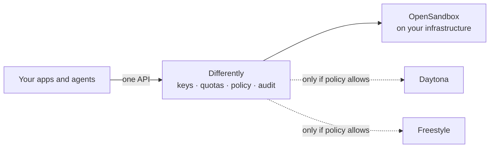

# Differently explained

What Differently is, in plain words, and the least you need to know to use
it. Five minutes, no background assumed. To skip straight to running it, go
to the [quickstart](guides/quickstart.md).

## The problem

Agents, CI jobs and "run this code" features need somewhere to run code that
is not your laptop and not production. That place is a **sandbox**: a
container or a small virtual machine you can start, run commands in, read
files from and throw away.

There are many ways to get one. Some you host yourself, such as
[OpenSandbox](https://github.com/opensandbox-group/OpenSandbox) on your own
Docker hosts, Kubernetes clusters or microVM nodes. Others are services, such
as Daytona or Freestyle. Each has its own API, its own keys and its own
limits.

One team with one backend can call it directly. The questions start with the
second team or the second backend:

- Who may create sandboxes, and how many?
- Which code and data may leave our network, and which must not?
- Where did this particular sandbox run, and who asked for it?
- How do we move to another backend without changing every application?

## What Differently does

Differently is a server you run on your own infrastructure. Applications and
agents ask it for a sandbox through one API. It checks who is asking, decides
which backend the sandbox goes to, and records the decision. Then it passes
your commands and files through to that sandbox.

Differently does not run sandboxes itself. It is the layer in front of the
things that do, which is why it is called a control plane.

## Five words

| Word | Meaning |
|---|---|
| **Sandbox** | An isolated place to run commands: create it, run things, read and write files, snapshot or fork it, delete it. |
| **Pool** | One backend Differently can place sandboxes on, such as an OpenSandbox server or a Daytona account. A pool is either *private* (you run it) or *external* (someone else does). |
| **Policy** | The rules for where work may go. The default is private pools only. External pools get work only when an operator approves them. |
| **Organization and project** | Who the work belongs to. Quotas, keys and policies attach to them. |
| **Key** | What an application sends to prove who it is. A key is limited to a project, an organization or, for operators, the whole installation. |

## What happens when you ask for a sandbox

1. Your key says which project the request is for.
2. The request is checked against that project's quota. If the project is
   over its limit the request waits in a queue, and projects take turns so
   one cannot starve the others.
3. The scheduler removes every pool the policies forbid, ranks the rest and
   picks one. It records why.
4. Differently asks that pool's backend to create the sandbox.
5. From then on you use the same calls whatever the backend is: run a
   command, read a file, take a snapshot. You can also ask where the sandbox
   runs and why.

Your application never names a backend. It says what it needs, such as a
size, a capability or "this data must stay private", and operators change
where work goes without touching application code.

## What you need

To **try it**, you need one command to install it and nothing else: no
account, no cluster, no database. See the [quickstart](guides/quickstart.md).
This is *dev mode*: commands run directly on your machine with no isolation,
so it is for learning the API, not for running code you do not trust.

To **use it with a team**, you need three things you run yourself:

- a Linux machine or a Kubernetes cluster for Differently;
- a sandbox runtime for it to place work on, by default an OpenSandbox
  server;
- Postgres, so state survives a restart.

[One Linux VM on any cloud](deploy/single-vm.md) sets up all three on a
single machine. The [deployment overview](deploy/README.md) lists the other
ways and says which have been tested.

Everything else can wait until you need it: external providers, policies
beyond the default, quotas, the admin console and the experimental adapters.

## What it is not

- **Not a sandbox runtime.** Isolation comes from the backend you choose.
  Differently records what each pool declares and reports it.
- **Not a hosted service.** There is nothing to sign up for. You run all of
  it, and it sends no telemetry.
- **Not finished.** It is a pre-release. The
  [deployment overview](deploy/README.md) says what has run on real
  infrastructure and what has not, and the [roadmap](roadmap.md) says what is
  planned.

## Where next

| You want to | Go to |
|---|---|
| Run it now | [Quickstart](guides/quickstart.md) |
| Have a coding agent set it up | [Use Differently with an agent](guides/agents.md) |
| Put it on a server for a team | [Deployment overview](deploy/README.md) |
| See it route load in a browser | [Load simulator](https://different-ai.github.io/differently/simulator/) |
| Compare it with other products | [Feature parity](feature-parity.md) |
| Understand how it is built | [Architecture](architecture/README.md) |
