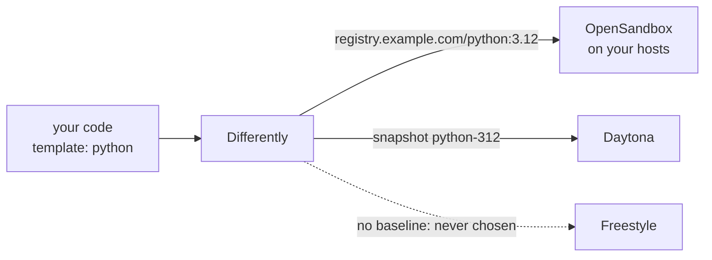

# One baseline on every provider

**The question:** "If my sandboxes can land on different providers, don't I
need my image or snapshot on each one?"

**The answer:** yes. Every backend boots its own images, and nothing copies
a snapshot from one provider to another. What Differently adds is that you
do this once per provider and never again per application: you give those
baselines **one name**, your code asks for the name, and Differently sends
the request only to pools that have it, handing each backend its own image.



<!-- Remove this note in the release that ships `differently run` (the first after v0.1.0-alpha.5); do not bump its version. -->
> **Version note.** The mapping of one template name to each pool's image is
> in `v0.1.0-alpha.5`, the latest release. These are newer:
> `differently admin template set` and `remove` (setting a template on a
> running server), `differently templates`, `differently run`, the
> `--from-snapshot` flag, the side-by-side table from `differently
> capabilities`, and the two refusal messages quoted below. With that
> release, a template is declared in the server's config file (the second
> way in step 2), `differently capabilities` prints the same facts as JSON,
> `GET /v1/templates` lists the templates, a sandbox starts from a snapshot
> through the API or an SDK (`fromSnapshot`), and a refusal says only that
> no pool satisfies the policy. Building from source (`make build`) gives
> you everything on this page.

## What is shared and what is not

| | Shared across providers? | What Differently does |
|---|---|---|
| The **name** your code uses for a baseline | Yes | One template name maps to each pool's own image or snapshot |
| The **baseline itself** (image, snapshot) | No. You build it on each provider you want to use | Routes only to pools that have it, and says which do not |
| A **running sandbox** | No. It stays on the pool it was created on | Decides the pool once, at create, and records why |
| A **snapshot** of a running sandbox | No. It stays with the backend that took it | Remembers which pool holds it and sends every restore and fork there |
| What a provider **can do** (memory snapshots, fork, stop and start) | No. Backends differ | Shows the differences side by side, and places a request that needs a feature only where it exists |

So the rule is: **Differently routes when a sandbox is created, and the
sandbox then stays where it is.** That is why a missing baseline can never
surprise a running workload. It can only make one pool ineligible for new
ones.

## Set it up

### 1. Build the baseline on each backend

Use each backend's own form. This is the part nothing can do for you.

| Backend | A baseline is | The value to register |
|---|---|---|
| OpenSandbox, Docker or Kubernetes runtime | A container image in a registry the runtime can pull from | The image, such as `registry.example.com/python:3.12` |
| OpenSandbox, Fast Sandbox microVMs | A Fast Sandbox template | The template ID (the pool's `templateId`) |
| Daytona | A Daytona snapshot | The snapshot's name |
| Freestyle | A Freestyle snapshot | The snapshot's slug |

### 2. Give them one name

There are two ways, and both end in the same template. A template with
images runs only on the pools it lists.

**With a command, on a running server.** It needs an operator key and
nothing else: no config edit and no restart.

```bash
differently admin template set python \
  --image opensandbox=registry.example.com/python:3.12 \
  --image daytona=python-312 \
  --description "Python 3.12 with our tools"
```

`--image` is `POOL=IMAGE`: the pool's name in Differently, then whatever its
backend calls the baseline (the value from step 1). The next request for
`python` already uses it. Later changes name only what changes:

```bash
differently admin template set python --image freestyle=python-312-fs   # add a provider
differently admin template set python --image daytona=python-313        # point one at a new baseline
differently admin template remove python --pool daytona                 # stop offering it there
differently admin template remove python                                # remove the template
```

**In the server configuration** (with the Helm chart, under `config:`), when
you want templates reviewed and versioned with the rest of the installation:

```yaml
templates:
  - name: python
    description: Python 3.12 with our tools
    images:                                    # keyed by pool name
      opensandbox: registry.example.com/python:3.12
      daytona: python-312
```

The server reads the file at start, so this way takes a restart
(`helm upgrade` does that).

**If both define a name, the config file wins.** A template the file
declares cannot be changed or removed with the command, which says so
instead of making a change the next restart would undo. `differently
templates` shows where each one is set.

What the commands will and will not do:

- `set` adds to what is stored. Pools you do not name keep their image, so
  adding a provider cannot drop another one by omission.
- An image for a pool that does not exist is refused, with the pool named
  and the pools that do exist listed. So is an empty image.
- A template's last image cannot be removed with `--pool`. With none left,
  the name would be passed to every pool as given, which is wider than what
  you had. Removing the template does that, and says so.
- A template only narrows where a sandbox runs. Giving it an image on a pool
  never lets work go where the [placement policy](../scheduling/placement-policy.md)
  forbids: private-only work still stays on private pools.
- Every change is in the audit log (`template.put`, `template.image_delete`,
  `template.delete`) with who made it, and in the trust report's recent
  admin actions.

The same calls are in the API (`PUT /v1/admin/templates/{name}`,
`DELETE /v1/admin/templates/{name}` and
`DELETE /v1/admin/templates/{name}/images/{pool}`) and in both SDKs
(`admin.templates.set`, `removeImage` / `remove_image`, `delete`).

### 3. Ask for the name

```bash
differently run --template python -- python3 --version
```

```ts
const sandbox = await differently.sandboxes.create({ template: "python" });
```

Nothing in the request names a provider. Operators can move work between
pools, or add one, without a change to this code.

## See what each pool has

```bash
differently templates
```

```text
TEMPLATE  opensandbox                       daytona     freestyle  SET BY   DESCRIPTION
python    registry.example.com/python:3.12  python-312  -          command  Python 3.12 with our tools
```

A dash means that pool has no baseline for the template and will not be
chosen for it. `SET BY` says where the template is defined, which is where
to change it: `command` or `config file`. For a sandbox that exists, `differently sandbox placement
<id>` shows every pool that was considered, with the reason each one was
skipped, for example `template python has no image for this pool`.

If no pool you are allowed to use has the template, the request fails at
once with the reason, instead of a sandbox that never starts:

```text
error [no_eligible_pool]: no permitted pool has template python
  classification: internal
  template: python
```

## Snapshots of work in progress

A baseline is a starting point everyone shares. A snapshot is a copy of one
sandbox at one moment: after `pip install`, after a build, in the middle of
a task.

```bash
differently sandbox create --template python --wait      # prints the sandbox ID
differently sandbox exec <id> -- pip install pandas
differently sandbox snapshot <id>                        # prints a snapshot ID, snp_...
differently run --from-snapshot <snp-id> -- python3 -c 'import pandas'
differently sandbox fork <id>                            # a second sandbox from this one, now
```

Starting from a snapshot skips the setup, on self-hosted backends as much as
on hosted ones. The snapshot stays with the backend that took it, so a
sandbox started from it runs on the same pool. You do not have to keep track
of that: the snapshot's record names its pool, and Differently sends the
restore there. If that pool is busy the new sandbox waits for it. If the
request cannot run there at all, it is refused with the reason:

```text
error [no_eligible_pool]: a sandbox started from a snapshot runs on the pool that holds it, onprem, and that pool cannot take this one
  classification: internal
  pool: onprem
```

To have the same prepared state on a second provider, build it there too and
register it as a baseline (steps 1 and 2). To move the *contents* of one
sandbox elsewhere, copy the files out through the API and into a new
sandbox.

## What each provider can do

Snapshot kinds, fork, stop and start, and isolation differ by backend. Put
them side by side:

```bash
differently capabilities
```

```text
                      opensandbox  daytona   freestyle
adapter               opensandbox  daytona   freestyle
trust                 private      external  external
status                healthy      healthy   healthy
fork                  yes          -         yes
lifecycle.stop-start  -            yes       yes
snapshots.disk        yes          yes       yes
snapshots.memory      -            -         yes
...
```

The output above is an illustration (OpenSandbox on its Docker runtime,
Daytona's container class): run the command for what your pools report, and
see the [provider catalog](../providers/README.md) for what has
been tested against each provider. When code needs a feature, say so, and
only pools that have it are considered:

```bash
differently sandbox create --capability snapshots.memory --wait
```

## Try the routing on a laptop

Dev mode can run two pools, which is enough to watch one name go to
different places. Sandboxes here are directories on your machine, so the
"images" are only labels, but the routing is the real thing. Stop any dev
server you have running, save this as `two-pools.yaml`:

```yaml
dev: true
pools:
  - {name: onprem, adapter: devhost, trust: private}
  - {name: burst, adapter: devhost, trust: private}
templates:
  - name: python
    images:
      onprem: registry.example.com/python:3.12
  - name: node
    images:
      onprem: registry.example.com/node:22
      burst: node-22-snapshot
```

```bash
differently-server --config two-pools.yaml --data-dir ~/.differently/dev
```

and in a second terminal:

```bash
differently templates                                         # who has what
differently sandbox create --template python --wait           # always onprem
differently sandbox create --template node --pool burst --wait
differently sandbox create --template python --pool burst     # refused: burst has no python
```

Then change a template while the server runs:

```bash
differently admin template set go --image burst=go-1.23-snapshot
differently sandbox create --template go --wait               # always burst
differently admin template set go --image onprem=registry.example.com/go:1.23
differently sandbox create --template go --pool onprem --wait # onprem has it now
differently admin template remove go --pool burst
differently sandbox create --template go --pool burst         # refused: burst no longer has go
differently admin template set python --image burst=python-312   # refused: python is in the config file
```

## What this does not do yet

- **A template in the server's config file is changed there.**
  `differently admin template set` and `remove` change templates on a
  running server, but not one the file declares: the file wins, and a change
  to it takes a restart.
- **A snapshot taken through Differently cannot be named as a template's
  image.** A baseline is registered by the backend's own name for it.
- **Nothing copies an image or a snapshot between providers**, and a running
  sandbox does not move. [Storage and lifecycle](../storage-and-lifecycle.md#8-what-is-not-portable)
  has the full list and the reasons.

More questions of this kind are answered in [Questions people ask](../faq.md).
