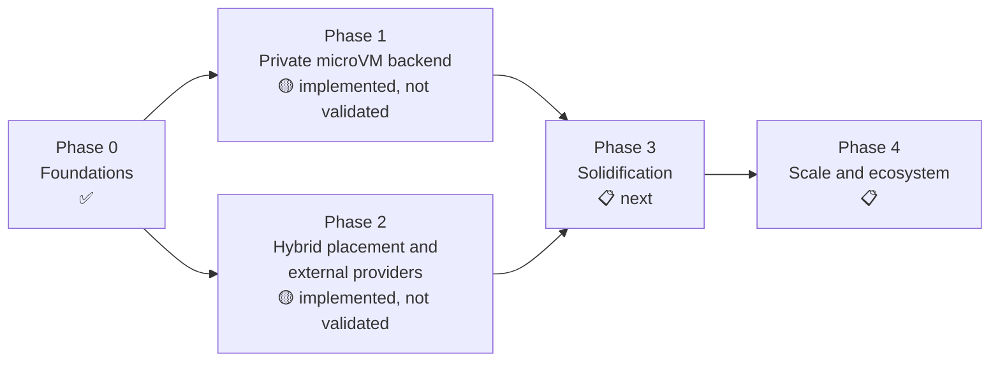

# Roadmap

| | |
|---|---|
| Status date | 2026-10-28 |
| Evidence rule | **Done** means implemented and covered by automated tests, which today run in-process with fakes. **Validated** means run on real infrastructure or live accounts; nothing is validated yet. |
| Detail | Tasks and acceptance criteria in [backlog.md](backlog.md); experiments in [proof-of-concepts.md](proof-of-concepts.md) |

Legend: ✅ done (tested in-process) · 🧪 implemented against published specs, fake servers only · 🟡 partial · 📋 planned

## Phase 0: Foundations

**Goal.** A vendor-neutral API and a control plane that enforces tenancy,
quota and placement policy, runnable on a laptop.

| Item | Status | Where / notes |
|---|---|---|
| `/v1` API, error codes, OpenAPI 3.1 document | ✅ | `pkg/api`, `api/openapi.yaml`; `TestOpenAPICoversRoutes` |
| API keys, scopes, tenancy, no-escalation grants | ✅ | `internal/auth`; one known cross-tenant policy-delete gap ([E0](backlog.md#e0-correctness-and-security-fixes-from-the-code-review)) |
| Organizations, projects, quotas, fair queueing | ✅ | `internal/store`; one known start-after-stop quota gap |
| Placement policy engine (filter, rank, fail-closed external) | ✅ | `internal/policy` |
| Scheduler, retries, reconciler | ✅ | `internal/scheduler` (no package-level tests; covered by server tests) |
| Memory store | ✅ | `internal/store/memory.go` |
| Postgres store, migrations, advisory-lock leadership | 🟡 | Implemented; the conformance suite needs `DIFFERENTLY_TEST_POSTGRES_URL`; a CI job exists but has never run (no remote yet) |
| CI and release workflows | 🟡 | `.github/workflows/ci.yml`, `release.yml`; encode the branch model ([ADR 0012](adr/0012-pre-release-integration-branch-model.md)); never run |
| Tamper-evident audit chain, verify endpoint, JSON-lines mirror | ✅ | `internal/audit`, `internal/auditlog` |
| Dev mode with `devhost` pool | ✅ | `differently-server --dev` |
| CLI, dashboard | ✅ | `cmd/differently`, `internal/dashboard` |
| TypeScript and Python SDKs | ✅ | Tested against mock servers (`sdk/*/test*`) |
| Go client | 🟡 | `pkg/client`, used by the CLI; not yet a polished SDK ([E15](backlog.md#e15-go-sdk-polishing)) |
| Prometheus metrics, structured logs | ✅ | `internal/metrics` |

**Exit criteria.** Met, except a recorded Postgres conformance run
([E5](backlog.md#e5-postgres-in-ci-failover-and-scale)).

## Phase 1: Private microVM backend

**Goal.** Firecracker microVMs on KVM hosts the operator owns, managed by a
node agent, with real isolation.

| Item | Status | Where / notes |
|---|---|---|
| Node agent: lifecycle, capacity, heartbeat, `doctor` | ✅ unit | `internal/agent`, `cmd/differently-agent`; fake VMM only |
| Firecracker API client | ✅ unit | `internal/firecracker` |
| Guest agent over vsock | ✅ unit | `internal/guest`, `cmd/differently-guest` |
| Per-VM tap, /30, iptables isolation, default deny list, egress deny | ✅ unit | `internal/agent/network.go`; rules checked as command strings only |
| Stop/start, pause/resume, disk snapshots, fork pinned to node | ✅ unit | Memory snapshots deliberately not advertised ([ADR 0014](adr/0014-defer-memory-snapshots-until-restore-proven.md)) |
| Restart recovery | 🟡 | In-process test only; container restarts expected to kill VMs ([POC 2](proof-of-concepts.md#poc-2-agent-restart-semantics-in-kubernetes)) |
| Firecracker pool adapter (multi-agent placement, routing) | ✅ unit | `internal/adapters/firecracker` |
| Helm chart with agent DaemonSet, Terraform for AWS | 🟡 | `deploy/`; not run on a real cluster |
| Kernel and rootfs build scripts | 🟡 | `deploy/images/build-kernel.sh`, `build-rootfs.sh`: syntax-checked only, never booted; no guest DNS resolver configured |
| systemd unit for non-Kubernetes nodes | 🟡 | `deploy/systemd`; unverified |
| **Any run on real KVM** | 📋 | [POC 1](proof-of-concepts.md#poc-1-firecracker-on-real-kvm), [E1](backlog.md#e1-firecracker-on-real-kvm) |
| Jailer | 📋 | [ADR 0015](adr/0015-defer-jailer-integration.md), [E4](backlog.md#e4-firecracker-jailer) |
| Authenticated agent channel | 📋 | Plain HTTP with one shared token today ([E3](backlog.md#e3-authenticated-agent-channel)) |
| Inbound ports on Firecracker | 📋 | [E6](backlog.md#e6-preview-urls-for-firecracker-pools) |

**Exit criteria (not met).** POC 1, 2 and 9 pass on at least one `.metal`
environment; known agent issues in E0 fixed.

## Phase 2: Hybrid placement and external providers

**Goal.** Policy-gated use of external providers next to private pools, with
an operator-visible record of what left private infrastructure.

| Item | Status | Where / notes |
|---|---|---|
| Classifications, overflow, explicit external approval | ✅ | `internal/policy`, `internal/config` |
| Placement explanation per sandbox | ✅ | `GET /v1/sandboxes/{id}/placement` |
| Trust report | ✅ | `GET /v1/admin/trust-report`; limitations list incomplete (E0) |
| Daytona adapter | 🧪 | `internal/adapters/daytona`; resources not sent; live verification pending |
| Freestyle adapter | 🧪 | `internal/adapters/freestyle` |
| HTTP plugin protocol and `remote` pools | ✅ unit | `pkg/adapter/adapterhttp`; no protocol-version check yet |
| Usage and cost estimates | ✅ | `GET /v1/usage`; estimates only, no invoice reconciliation |
| **Live-account verification** | 📋 | [POC 7](proof-of-concepts.md#poc-7-external-provider-live-account-verification), [E2](backlog.md#e2-external-adapters-on-live-accounts) |

**Exit criteria (not met).** POC 7 complete; Daytona and Freestyle rows in
[feature-parity.md](feature-parity.md) moved from 🧪 to ✅.

## Phase 3: Solidification (next)

**Goal.** Make what exists trustworthy on real infrastructure, close the
security gaps, and add the features users hit first.

Ordered by priority. P0 items gate any production recommendation.

| Priority | Epic | Status |
|---|---|---|
| P0 | [E0 Correctness and security fixes from the code review](backlog.md#e0-correctness-and-security-fixes-from-the-code-review) | 📋 |
| P0 | [E1 Firecracker on real KVM](backlog.md#e1-firecracker-on-real-kvm) (POC 1, 2, 5, 8, 9) | 📋 |
| P0 | [E2 External adapters on live accounts](backlog.md#e2-external-adapters-on-live-accounts) (POC 7) | 📋 |
| P0 | [E3 Authenticated agent channel (mTLS, per-node identity)](backlog.md#e3-authenticated-agent-channel) | 📋 |
| P0 | [E4 Firecracker jailer](backlog.md#e4-firecracker-jailer) (POC 3) | 📋 |
| P1 | [E5 Postgres in CI, failover and scale](backlog.md#e5-postgres-in-ci-failover-and-scale) (POC 6, 10) | 📋 |
| P1 | [E6 Preview URLs for Firecracker pools](backlog.md#e6-preview-urls-for-firecracker-pools) | 📋 |
| P1 | [E7 SSH gateway and PTY](backlog.md#e7-ssh-gateway-and-pty) | 📋 |
| P1 | [E10 Webhooks](backlog.md#e10-webhooks) | 📋 |
| P1 | [E11 OpenTelemetry tracing](backlog.md#e11-opentelemetry-tracing) | 📋 |
| P1 | [E12 Per-sandbox egress allow-lists](backlog.md#e12-per-sandbox-egress-allow-lists) | 📋 |
| P1 | [E13 Sandbox secrets by reference](backlog.md#e13-sandbox-secrets-by-reference) | 📋 |
| P1 | [E15 Go SDK polishing](backlog.md#e15-go-sdk-polishing) | 📋 |
| P2 | [E9 Memory snapshots on Firecracker](backlog.md#e9-memory-snapshots-on-firecracker) (POC 4) | 📋 |
| P2 | [E8 Kueue batch lane](backlog.md#e8-kueue-batch-lane) | 📋 |
| P2 | [E16 Boat-compatible facade evaluation](backlog.md#e16-boat-compatible-facade-evaluation) | 📋 |
| P2 | [E14 Process sessions](backlog.md#e14-process-sessions) | 📋 |
| P2 | [E17 Retention and garbage collection](backlog.md#e17-retention-and-garbage-collection) | 📋 |

**Exit criteria.** All P0 epics done; POC 1–8 run with results published;
release gates in
[reliability-and-performance.md §7](reliability-and-performance.md#7-release-gates-proposal)
automated; first release candidate tagged from `pre-release`
([ADR 0012](adr/0012-pre-release-integration-branch-model.md)).

## Phase 4: Scale and ecosystem

**Goal.** Grow capacity, backends and integrations once the core is proven.
All planned; order to be set after Phase 3 measurements.

| Item | Notes |
|---|---|
| Second VMM (Cloud Hypervisor) for virtio-fs and GPU passthrough | Firecracker has no VFIO in any release; Cloud Hypervisor has VFIO, virtio-fs, snapshot/restore |
| InfrastructureAdapter: scale private pools from queue pressure | Design sketch in [adapters/specification.md §8](adapters/specification.md#8-infrastructureadapter-design-not-implemented) |
| Warm pools and pause-to-disk density | Depends on E9 |
| OCI image to rootfs pipeline, image signing and verification | Today images are raw ext4 files per node |
| Shared or replicated snapshot storage | Restores across nodes |
| Sharded or `SKIP LOCKED` scheduling | Only if POC 10 shows one leader is the limit |
| OIDC/SSO for humans; key lineage | Builds on E0 key-lifetime tasks |
| More adapters (flintlock, E2B runtime, Modal, Kubernetes RuntimeClass) | Through the HTTP protocol where possible |
| Multi-region and federation | Several installations with a shared policy view |
