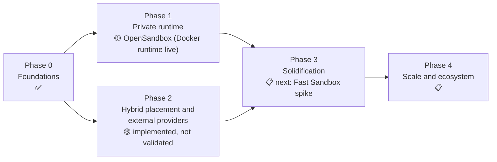

# Roadmap

| | |
|---|---|
| Status date | 2026-10-28 |
| Evidence rule | **Done** means implemented and covered by automated tests, most of which run in-process with fakes. **Validated** means run against real infrastructure or live accounts; today only the `opensandbox` adapter with OpenSandbox's Docker runtime is validated. |
| Detail | Tasks and acceptance criteria in [backlog.md](backlog.md); experiments in [proof-of-concepts.md](proof-of-concepts.md) |
| Runtime change | [ADR 0020](adr/0020-opensandbox-replaces-node-agent.md): Differently's own Firecracker node agent was removed; OpenSandbox is the default private runtime. |

Legend: ✅ done (tested in-process) · ✅ live: also run against a real backend · 🧪 implemented against published specs, fake servers only · 🟡 partial · 📋 planned · ⛔ obsolete (ADR 0020)

Differently's deliverables are the parts above the runtime: one
vendor-neutral API, tenancy and scoped keys, quotas and fair queueing,
policy-gated placement across providers, the adapter contract and plugin
protocol, the tamper-evident audit chain, placement explanations and the
trust report. Running sandboxes is the backends' job.

## Phase 0: Foundations

**Goal.** A vendor-neutral API and a control plane that enforces tenancy,
quota and placement policy, runnable on a laptop.

| Item | Status | Where / notes |
|---|---|---|
| `/v1` API, error codes, OpenAPI 3.1 document | ✅ | `pkg/api`, `api/openapi.yaml`; `TestOpenAPICoversRoutes` |
| API keys, scopes, tenancy, no-escalation grants | ✅ | `internal/auth`; `TestScopedKeyIsolation` |
| Organizations, projects, quotas, fair queueing | ✅ | `internal/store`; store conformance suite |
| Placement policy engine (filter, rank, fail-closed external) | ✅ | `internal/policy` |
| Scheduler, retries, reconciler | ✅ | `internal/scheduler` (no package-level tests; covered by server tests) |
| Memory store | ✅ | `internal/store/memory.go` |
| Postgres store, migrations, advisory-lock leadership | 🟡 | Implemented; the conformance suite needs `DIFFERENTLY_TEST_POSTGRES_URL` and runs in the CI `postgres conformance` job; multi-replica failover not yet run ([E5](backlog.md#e5-postgres-in-ci-failover-and-scale)) |
| CI and release workflows | 🟡 | `.github/workflows/ci.yml`, `release.yml`; encode the branch model ([ADR 0012](adr/0012-pre-release-integration-branch-model.md)) |
| Tamper-evident audit chain, verify endpoint, JSON-lines mirror | ✅ | `internal/audit`, `internal/auditlog` |
| Dev mode with `devhost` pool | ✅ | `differently-server --dev` |
| CLI, dashboard | ✅ | `cmd/differently`, `internal/dashboard` |
| TypeScript and Python SDKs | ✅ | Tested against mock servers (`sdk/*/test*`) |
| Go client | 🟡 | `pkg/client`, used by the CLI; not yet a polished SDK ([E15](backlog.md#e15-go-sdk-polishing)) |
| Prometheus metrics, structured logs | ✅ | `internal/metrics` |

**Exit criteria.** Met, except a recorded multi-replica run against Postgres
([E5](backlog.md#e5-postgres-in-ci-failover-and-scale)).

## Phase 1: Private microVM backend

**Goal (revised by ADR 0020).** A private runtime on infrastructure the
operator controls, under Differently's policies. Originally this was
Differently's own Firecracker node agent; it is now OpenSandbox, installed
with its own tooling and registered as a pool with `trust: private`.

| Item | Status | Where / notes |
|---|---|---|
| `opensandbox` adapter | ✅ live (Docker runtime) | `internal/adapters/opensandbox`; fake-server tests plus `TestLiveOpenSandbox` against OpenSandbox server `release-1.2.0` and `execd` v1.1.0 (arm64, Colima); a manual run through Differently ([spike](research/opensandbox-spike.md)) |
| OpenSandbox as the default private runtime | ✅ decided | [ADR 0020](adr/0020-opensandbox-replaces-node-agent.md); the Helm chart's `opensandbox:` values render a pool named `opensandbox` |
| OpenSandbox Kubernetes runtime | 🟡 | Single-node k3s on Azure: e2e 11/11 and a recorded adapter run; pause and snapshots need OpenSandbox's snapshot registry; multi-node and drain not run ([POC 12](proof-of-concepts.md#poc-12-opensandbox-kubernetes-runtime)) |
| OpenSandbox Fast Sandbox (Firecracker microVMs) | 📋 | Unverified; first Phase 3 item ([E18](backlog.md#e18-fast-sandbox-spike)) |
| End-to-end suite against a real OpenSandbox server | ✅ | `test/e2e` runs Postgres, `differently-server` and OpenSandbox 1.2.0 on the Docker runtime (11/11, arm64 Colima) and the Kubernetes runtime (11/11, k3s on Azure, Helm install), 2026-10-28 ([results](../test/e2e/README.md)). Fast Sandbox not yet |
| Sandbox egress control | 📋 | Not enforced by Differently; OpenSandbox's network policy is not wired up ([E19](backlog.md#e19-opensandbox-network-policy-and-egress)) |
| Node agent: lifecycle, capacity, heartbeat, `doctor` | ⛔ | Removed (`internal/agent`, `cmd/differently-agent`) |
| Firecracker API client | ⛔ | Removed (`internal/firecracker`) |
| Guest agent over vsock | ⛔ | Removed (`internal/guest`, `cmd/differently-guest`); the command runner moved to `internal/localexec` for `devhost` |
| Per-VM tap, /30, iptables isolation | ⛔ | Removed; isolation and egress are the runtime's |
| Stop/start, disk snapshots, fork pinned to node | ⛔ | OpenSandbox has pause/resume and snapshots, no stop/start |
| Restart recovery ([POC 2](proof-of-concepts.md#poc-2-agent-restart-semantics-in-kubernetes)) | ⛔ | Backend outages are now [POC 13](proof-of-concepts.md#poc-13-opensandbox-outage-and-recovery) |
| Firecracker pool adapter (multi-agent placement, routing) | ⛔ | Removed (`internal/adapters/firecracker`) |
| Helm chart with agent DaemonSet | ⛔ | The chart now deploys the control plane only, with an egress rule to OpenSandbox on port 80 |
| Terraform for AWS | 🟡 | `deploy/terraform/aws`; creates EKS with a KVM node group, which only Fast Sandbox needs; not run |
| Kernel and rootfs build scripts, systemd unit | ⛔ | Removed (`deploy/images`, `deploy/systemd`) |
| Any run on real KVM ([POC 1](proof-of-concepts.md#poc-1-firecracker-on-real-kvm), [E1](backlog.md#e1-firecracker-on-real-kvm)) | ⛔ | The agent's e2e suite booted real microVMs under nested virtualization on Colima before removal; KVM through OpenSandbox is [E18](backlog.md#e18-fast-sandbox-spike) |
| Jailer ([ADR 0015](adr/0015-defer-jailer-integration.md), [E4](backlog.md#e4-firecracker-jailer)) | ⛔ | Differently no longer launches a VMM |
| Authenticated agent channel ([E3](backlog.md#e3-authenticated-agent-channel)) | ⛔ | No agent channel; pools hold a backend credential by reference |
| Inbound ports on Firecracker ([E6](backlog.md#e6-preview-urls-for-firecracker-pools)) | ⛔ | OpenSandbox pools expose ports when OpenSandbox serves them without request headers |

**Exit criteria (revised).** The end-to-end suite passes against a real
OpenSandbox server with the Docker runtime; E18 (Fast Sandbox) and POC 12
(Kubernetes runtime) recorded. The original criteria (POC 1, 2 and 9 on
`.metal`) are obsolete.

## Phase 2: Hybrid placement and external providers

**Goal.** Policy-gated use of external providers next to private pools, with
an operator-visible record of what left private infrastructure.

| Item | Status | Where / notes |
|---|---|---|
| Classifications, overflow, explicit external approval | ✅ | `internal/policy`, `internal/config` |
| Placement explanation per sandbox | ✅ | `GET /v1/sandboxes/{id}/placement` |
| Trust report | ✅ | `GET /v1/admin/trust-report`; per-pool declared isolation; limitations from `limitations` in `internal/server/admin.go` |
| Daytona adapter | 🧪 | `internal/adapters/daytona`; resources not sent; live verification pending |
| Freestyle adapter | 🧪 | `internal/adapters/freestyle` |
| OpenSandbox as an external pool | ✅ | `trust: external` pools follow the usual approval rules; trust must be declared |
| HTTP plugin protocol and `remote` pools | 🟡 | `pkg/adapter/adapterhttp`; untested since the agent tests, its only coverage, were removed ([E0.34](backlog.md#e0-correctness-and-security-fixes-from-the-code-review)); no protocol-version check yet |
| Usage and cost estimates | ✅ | `GET /v1/usage`; estimates only, no invoice reconciliation |
| **Live-account verification** | 📋 | [POC 7](proof-of-concepts.md#poc-7-external-provider-live-account-verification), [E2](backlog.md#e2-external-adapters-on-live-accounts) |

**Exit criteria (not met).** POC 7 complete; Daytona and Freestyle rows in
[feature-parity.md](feature-parity.md) moved from 🧪 to ✅.

## Phase 3: Solidification (next)

**Goal.** Make what exists trustworthy on real infrastructure, close the
security gaps, and add the features users hit first.

> **Next: [E18 Fast Sandbox spike](backlog.md#e18-fast-sandbox-spike).** Run
> OpenSandbox's Firecracker runtime on KVM targets through the adapter. Until
> it is done, microVM isolation through Differently is unverified.

Ordered by priority. P0 items gate any production recommendation.

| Priority | Epic | Status |
|---|---|---|
| P0 | **[E18 Fast Sandbox spike](backlog.md#e18-fast-sandbox-spike)** (POC 11) | 📋 next |
| P0 | [E0 Correctness and security fixes from the code review](backlog.md#e0-correctness-and-security-fixes-from-the-code-review) | 📋 |
| P0 | [E2 External adapters on live accounts](backlog.md#e2-external-adapters-on-live-accounts) (POC 7) | 📋 |
| P1 | [E19 OpenSandbox network policy and egress](backlog.md#e19-opensandbox-network-policy-and-egress) (replaces E12) | 📋 |
| P1 | [E21 OpenSandbox version pinning and upgrade testing](backlog.md#e21-opensandbox-version-pinning-and-upgrade-testing) (POC 13) | 📋 |
| P1 | [E5 Postgres in CI, failover and scale](backlog.md#e5-postgres-in-ci-failover-and-scale) (POC 6, 10) | 📋 |
| P1 | [E7 SSH gateway and PTY](backlog.md#e7-ssh-gateway-and-pty) | 📋 |
| P1 | [E10 Webhooks](backlog.md#e10-webhooks) | 📋 |
| P1 | [E11 OpenTelemetry tracing](backlog.md#e11-opentelemetry-tracing) | 📋 |
| P1 | [E13 Sandbox secrets by reference](backlog.md#e13-sandbox-secrets-by-reference) | 📋 |
| P1 | [E15 Go SDK polishing](backlog.md#e15-go-sdk-polishing) | 📋 |
| P2 | [E20 Credential Vault evaluation](backlog.md#e20-credential-vault-evaluation) (informs E13) | 📋 |
| P2 | [E8 Kueue batch lane](backlog.md#e8-kueue-batch-lane) | 📋 |
| P2 | [E16 Boat-compatible facade evaluation](backlog.md#e16-boat-compatible-facade-evaluation) | 📋 |
| P2 | [E14 Process sessions](backlog.md#e14-process-sessions) | 📋 |
| P2 | [E17 Retention and garbage collection](backlog.md#e17-retention-and-garbage-collection) | 📋 |
| — | [E1 Firecracker on real KVM](backlog.md#e1-firecracker-on-real-kvm) | ⛔ replaced by E18 |
| — | [E3 Authenticated agent channel](backlog.md#e3-authenticated-agent-channel) | ⛔ no agent channel |
| — | [E4 Firecracker jailer](backlog.md#e4-firecracker-jailer) | ⛔ no VMM in Differently |
| — | [E6 Preview URLs for Firecracker pools](backlog.md#e6-preview-urls-for-firecracker-pools) | ⛔ no Firecracker pools |
| — | [E9 Memory snapshots on Firecracker](backlog.md#e9-memory-snapshots-on-firecracker) | ⛔ runtime-dependent; see E18.3 |
| — | [E12 Per-sandbox egress allow-lists](backlog.md#e12-per-sandbox-egress-allow-lists) | ⛔ superseded by E19 |

**Exit criteria.** All P0 epics done; POC 6, 7 and 10–13 run with results
published; release gates in
[reliability-and-performance.md §7](reliability-and-performance.md#7-release-gates-proposal)
automated; first release candidate tagged from `pre-release`
([ADR 0012](adr/0012-pre-release-integration-branch-model.md)).

## Phase 4: Scale and ecosystem

**Goal.** Grow capacity, backends and integrations once the core is proven.
All planned; order to be set after Phase 3 measurements.

| Item | Notes |
|---|---|
| GPU sandboxes | Through a backend that offers them; Firecracker (and so Fast Sandbox) has no VFIO passthrough |
| InfrastructureAdapter: scale private pools from queue pressure | Design sketch in [adapters/specification.md §8](adapters/specification.md#8-infrastructureadapter-design-not-implemented) |
| Warm pools and pause-to-disk density | Depends on the runtime (Fast Sandbox templates and snapshots, E18) |
| Image policy: allowed registries, signature verification | Enforced by the runtime today, if at all |
| Shared or replicated snapshot storage | Restores across OpenSandbox servers |
| Sharded or `SKIP LOCKED` scheduling | Only if POC 10 shows one leader is the limit |
| OIDC/SSO for humans; key lineage | Builds on E0 key-lifetime tasks |
| More adapters (flintlock, E2B runtime, Modal, Kubernetes RuntimeClass) | Through the HTTP protocol where possible |
| Multi-region and federation | Several installations with a shared policy view |
