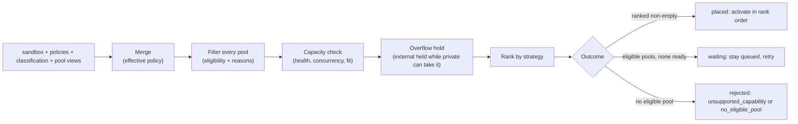

# Placement policy

| | |
|---|---|
| Status | Describes the code as of 2026-10-28 |
| Code | `internal/policy/policy.go` (merge, filter, rank), `internal/scheduler/scheduler.go` (dispatch, retries), `internal/store/store.go` (quota checks, fair order) |
| Decision record | [ADR 0006](../adr/0006-filter-then-rank-placement-fail-closed-external.md) |
| Tests | `internal/policy/policy_test.go`, `internal/server/server_test.go` |

## 1. Model

Placement answers two questions for every queued sandbox, every time it is
considered:

1. **Where may it run?** Hard constraints filter the pools. Nothing that fails
   a constraint is ever ranked.
2. **Where should it run now?** The remaining pools with capacity are ranked by
   a strategy, and the scheduler tries them in order.



## 2. Inputs

| Input | Source |
|---|---|
| Sandbox | Resources, template, requested `capabilities`, `classification`, request `placement`, creation time |
| Policies | The global policy (the stored `global` policy if one exists, otherwise `policy` from the config file), then `org:<id>`, then `project:<id>` if they exist (`Scheduler.policies`) |
| Classification | From the config file by name; defaults are `private-only` (external `never`), `internal` (`overflow`, the default class), `public` (`allowed`) |
| Pool views | For every pool the replica knows: the pool record, effective capabilities, last capacity report, health, active count (`pools.Manager.Views`) |
| Pinned pool | The pool of the snapshot in `fromSnapshot`, if set |
| Excluded pools | Meant to hold pools that already failed this sandbox; currently never populated (see §12) |

A `PlacementPolicy` (`pkg/api/types.go`) has these fields:

| Field | Meaning |
|---|---|
| `scope` | `global`, `org:<id>` or `project:<id>` |
| `external` | `never`, `overflow` or `allowed` |
| `externalPools` | External pools approved by name |
| `allowedPools`, `deniedPools` | Pool allow and deny lists |
| `allowedRegions` | Region allow list (matched against `pool.region`) |
| `strategy` | `private-first`, `cost` or `spread` |
| `maxCostPerHour` | Cost ceiling per sandbox-hour |
| `maxQueueSeconds` | How long a sandbox may wait before failing |

Who may write them (`internal/server/tenancy.go` `policyScopeAllowed`):
operators any scope; keys with `policies:write` their own `org:<id>` (if not
project-scoped) and `project:<id>` scopes inside their tenancy. `PUT` replaces
the whole document; omitted fields are cleared. The request's own
`placement` (`strategy`, `allowedPools`, `regions`, `external`) is the most
specific level.

## 3. Merge rules

`policy.Merge` combines the levels in order global → organization → project
→ classification → request.

| Field | Rule | Effect |
|---|---|---|
| External mode | Ceiling from the global policy; **unset global means `never`**. Every other level, the classification and the request can only lower it (`never` < `overflow` < `allowed`). A classification with no mode means `never`. | Stricter wins. No level below global can raise it. |
| `externalPools` | Intersection across policy levels; a level with an empty list does not narrow. No list anywhere means no approved external pool. The request cannot approve pools. | An external pool must be named at least once and not excluded by a narrower list. |
| `allowedPools` | Intersection across policy levels and the request; empty list = no constraint at that level; an empty intersection allows nothing | Lists only narrow |
| `allowedRegions` / request `regions` | Intersection, same semantics. A pool with no region fails any region constraint. | Lists only narrow |
| `deniedPools` | Union across policy levels | Denials accumulate |
| `strategy` | The most specific non-empty value wins: global, then organization, then project, then request. Default `private-first`. | Preference, not security |
| `maxCostPerHour` | Minimum of the non-zero values | Tightest ceiling |
| `maxQueueSeconds` | Minimum of the non-zero values | Tightest deadline |

The effective policy and the list of scopes that contributed are stored on the
decision (`external`, `strategy`, `policies`, including
`classification:<name>`).

## 4. Filters

Each pool starts eligible; every failed rule adds a reason
(`policy.Decide`). The reason strings below are exactly what
`GET /v1/sandboxes/{id}/placement` shows.

| Rule | Reason |
|---|---|
| Pool disabled | `pool disabled` |
| Pool draining | `pool draining` |
| Pool in excluded list | `an earlier provisioning attempt on this pool failed` |
| Restore pinned elsewhere | `restore requires pool <name>` |
| In `deniedPools` | `denied by policy` |
| Not in effective `allowedPools` | `not in allowed pools` |
| External and effective mode `never` | `external placement not permitted (effective mode "never")` |
| External and not in effective `externalPools` | `external pool not approved by policy` |
| Region not allowed | `region "<r>" not allowed` |
| Missing requested capabilities | `missing capabilities: a, b` |
| Over adapter limits or template unavailable | `cpu above adapter maximum`, `memory above adapter maximum`, `disk above adapter maximum`, `template <t> not available` |
| Estimated cost above ceiling | `estimated cost X/h exceeds ceiling Y/h` |

Estimated cost uses the pool's `costModel`:
`sandboxHour + cpu × cpuHour + memoryMiB/1024 × memoryGiBHour + diskGiB × diskGiBHour`.

## 5. Capacity

An eligible pool **has capacity** unless (first match wins):

| Check | Reason |
|---|---|
| Health probe failed, adapter could not be built, or the pool was marked unhealthy after a provisioning failure | `unhealthy: <detail>` |
| `maxConcurrency > 0` and active slots ≥ cap (slots: provisioning, running, paused, stopped, terminating) | `at concurrency limit N` |
| Bounded capacity and the sandbox does not fit (uses the roomiest single node when reported) | `insufficient free capacity` |

Unbounded adapters (OpenSandbox, Daytona, Freestyle, devhost) always fit;
their `maxConcurrency` is what limits them. OpenSandbox's API reports no
capacity, so a healthy OpenSandbox pool without `maxConcurrency` is always
ready, and under `overflow` it holds external pools back indefinitely (§6).
Capacity comes from the pool manager's cache, refreshed every 5 seconds, so
it can be stale; activation re-checks pool concurrency atomically, and the
backend can still answer `insufficient_capacity` (for HTTP backends, a 429).

Placement chooses a pool, not a host. Which host or node runs the sandbox is
decided by the backend: OpenSandbox's runtime, or the provider.

## 6. Overflow

When the effective mode is `overflow`, an eligible external pool with capacity
is **held** (`held for overflow: a private pool can take this now`) if any
eligible private pool has capacity for this sandbox right now. "Eligible"
includes capabilities: if no private pool offers a requested feature,
approved external pools are used even while private pools are idle.

When the mode is `allowed`, external pools rank alongside private ones and the
strategy decides.

## 7. Ranking

Ready pools (eligible, with capacity, not held) are sorted stably:

| Strategy | Order |
|---|---|
| `private-first` (default) | private before external → lower estimated cost → higher free ratio → pool name |
| `cost` | lower estimated cost → private before external → pool name |
| `spread` | higher free ratio → private before external → pool name |

Free ratio: `freeCPU / totalCPU` for bounded pools that report a total;
otherwise `1 − active / maxConcurrency` if a cap is set; otherwise 1. Every
built-in production adapter is unbounded, so in practice the free ratio
comes from `maxConcurrency`; bounded capacity is reported only by the `fake`
adapter and by `remote` plugins that choose to.

## 8. Outcomes

| Outcome | Condition | At admission (`POST /v1/sandboxes`) | At dispatch (scheduler) |
|---|---|---|---|
| `placed` | At least one ranked pool | Admitted as `queued` (202) | Activate in rank order (§9) |
| `waiting` | Some pool is eligible but none is ready | Admitted as `queued` (202) | Stay queued; `statusReason` = `waiting for capacity: <pool (reasons)>`; next attempt in 2 s; fail if `maxQueueSeconds` has passed since creation |
| `rejected` | No pool is eligible | `422 unsupported_capability` if every policy-eligible pool was ruled out only by missing capabilities (detail `capabilities`), else `422 no_eligible_pool` (detail `classification`) | Sandbox `failed` with the reason (a policy change can turn a waiting sandbox into a rejected one) |

Admission runs the full decision once to fail fast. A suspended organization's
queued sandboxes wait with reason `organization suspended`.

## 9. Activation and fallback

For a `placed` decision the scheduler walks the ranked list
(`Scheduler.activate`):

1. `ActivateSandbox` on the pool, atomically re-checking tenant quota and pool
   concurrency.
2. Success: the stored decision names the pool actually used; if it was not the
   first choice, the reason says
   `<first> filled concurrently, used next ranked pool <name>`. An audit event
   `sandbox.placed` records pool, trust, strategy, external mode and reason.
3. `quota_exceeded`: stop and wait (`waiting for tenant quota: ...`), retry in
   2 s. Quota is per tenant, so another pool would not help.
4. `insufficient_capacity` (pool cap reached concurrently): try the next pool.
5. Any other error: log and leave the sandbox queued for the next tick.
6. All ranked pools filled: wait
   (`waiting for capacity: ranked pools filled concurrently`).

## 10. Retries and backoff

| Situation | Next attempt | Counts as an attempt | Pool health |
|---|---|---|---|
| Waiting for capacity or quota | +2 s (`scheduler.RetryDelay`) | no | unchanged |
| Capacity released by a termination | Immediately: `nudge` takes the 200 most recently created queued sandboxes, makes those never attempted runnable now, and wakes the scheduler (older ones still retry within 2 s) | no | unchanged |
| `Create` returned `insufficient_capacity` | +2 s | no (the activation's increment is undone) | unchanged |
| `Create` failed otherwise | +`2 s × 2^min(attempts, 5)`: 4 s after the first failure, 8 s after the second, capped at 64 s | yes | marked unhealthy until the next successful probe (≤ 5 s) |
| Attempts reach `scheduler.maxAttempts` (default 3) | none: sandbox `failed` with `provisioning failed after N attempts: <error>` | | |
| Provisioning interrupted by a crash, no instance found after `provisionTimeoutSeconds` (default 120) | Requeued by the reconciler as a `provider_unavailable` failure | yes | marked unhealthy |

A requeued sandbox is placed again with the pools whose `Create` failed for
it excluded (`ExcludedPools`; capacity failures do not count). If that leaves
no pool, the excluded pools are tried again.

## 11. Fairness

Dispatch considers runnable queued sandboxes in fair order
(`store.FairOrder`):

1. organizations sorted by active CPU (provisioning, running, paused,
   terminating), lowest first, then by ID;
2. round-robin across organizations: each organization's first sandbox, then
   each one's second, and so on;
3. within an organization, higher `priority` first, then older first (IDs sort
   by creation time).

The Postgres store applies this to the 1000 oldest runnable rows; the
scheduler dispatches at most 100 per tick (250 ms by default). `priority` only
orders work inside one organization. `FairOrderAcrossOrgs` in the store
conformance suite and `TestMultiTenantQuotas` cover it.

## 12. Quotas: admission versus activation

Zero means unlimited. Organization and project quotas are both checked.

| Limit | At admission (`AdmitSandbox`) | At activation (`ActivateSandbox`) |
|---|---|---|
| `maxQueued` | queued + 1 > limit → `429 quota_exceeded` | |
| `maxCPU`, `maxMemoryMiB`, `maxDiskGiB` | a single request larger than the limit → `429 quota_exceeded` | usage + request > limit → wait |
| `maxActiveSandboxes` | | active + 1 > limit → wait |
| `maxTTLSeconds` | TTL above limit → `429 quota_exceeded` (also checked on `PATCH`) | |
| `maxSnapshots` | Checked when a snapshot is created, organization level only, outside a transaction | |
| `poolBudgetsPerHour` | Present in the API type, **not enforced anywhere** | |

Usage is derived from sandbox states ([ADR 0005](../adr/0005-quota-derived-from-state-atomic-activation.md)):
stopped sandboxes keep their disk and active-sandbox count but release CPU and
memory; paused sandboxes keep everything. Known issue: `start` re-reserves CPU
and memory without a quota check.

## 13. Worked examples

All examples use two pools like those in `internal/server/server_test.go`:

| Pool | Trust | Capacity | `maxConcurrency` | Cost |
|---|---|---|---|---|
| `fc` | private | bounded, 4 CPU, 16 GiB | none | 0.04 per CPU-hour |
| `burst` | external | unbounded | 10 | 0.02 per CPU-hour |

and the default classifications (`internal` is the default and has an
`overflow` ceiling). Both are `fake` pools in the tests; the name `fc` is
historical. A real private OpenSandbox pool reports no capacity, so it is
"full" only when it reaches its `maxConcurrency`: read
`insufficient free capacity` below as `at concurrency limit N` for such a
pool.

### Scenario D: hybrid overflow

Global policy: `{external: overflow, externalPools: [burst]}`.

1. Sandbox A, 4 CPU, `internal`. Effective external mode: global `overflow`,
   class `overflow` → `overflow`. `fc` is eligible and fits (4 CPU free).
   `burst` is eligible (approved, mode not `never`) and has capacity, but is
   held: a private pool can take A now. Ranked `[fc]`; A runs on `fc` at an
   estimated 0.16/h.
2. Sandbox B, 2 CPU, `internal`, with `fc` full. `fc` is eligible but
   `insufficient free capacity`. No private pool is ready, so `burst` is not
   held. Ranked `[burst]`; B runs on `burst` (0.04/h). The trust report lists B
   under `recentExternalPlacements` with the reason
   `selected burst by private-first strategy`.

Tests: `TestOverflowWhenPrivateFull`, `TestPrivateFirstPrefersPrivateCapacity`,
`TestHybridOverflowAndPrivateOnly`.

### Scenario E: private-only data never leaves

Same global policy. Sandbox C, 2 CPU, classification `private-only`
(ceiling `never`).

1. Effective mode `never`. `burst` is ineligible:
   `external placement not permitted (effective mode "never")`.
2. With `fc` full, `fc` is eligible without capacity: outcome `waiting`. C stays
   queued with `waiting for capacity: fc (insufficient free capacity)` and
   starts when capacity frees (or fails after `maxQueueSeconds`, if set).
3. If no private pool could ever take C (none exists, or all are denied), the
   outcome is `rejected` and the create call returns `422 no_eligible_pool`;
   it is never routed outside.
4. The same holds for an `internal` request that sets
   `"placement": {"external": "never"}`, and for an organization or project
   policy with `external: never`. A project policy with `external: allowed`
   cannot raise a global `overflow`.

Tests: `TestPrivateOnlyNeverLeaves`, `TestNarrowerScopesOnlyTighten`,
`TestHybridOverflowAndPrivateOnly`.

### Scenario F: provider substitution without application changes

The operator runs:

```
PUT /v1/policies/global
{"external": "allowed", "externalPools": ["burst"], "deniedPools": ["fc"]}
```

1. A new `internal` sandbox: the global mode `allowed` is capped by the class
   to `overflow`. `fc` is ineligible (`denied by policy`), so no private pool
   is ready and `burst` is not held. Ranked `[burst]`.
2. The application sent the same request as before; only the policy changed.
3. Running sandboxes stay where they are: placement applies to new and still
   queued sandboxes (queued ones are re-evaluated on their next attempt).
   Nothing is migrated.
4. Because `PUT` replaces the document, fields left out (strategy, regions,
   cost ceiling) revert to their defaults.

Test: `TestProviderSubstitution`.

### Scenario I: capability mismatch

1. **No backend can do it.** A request with `capabilities: ["gpu"]` under the
   default policy (`external: never`). `fc` passes every policy rule and fails
   only on `missing capabilities: gpu`; `burst` fails on external mode. No pool
   is eligible, and the only policy-eligible pool was excluded for
   capabilities, so the create call returns
   `422 unsupported_capability` with detail `capabilities: gpu`.
2. **Another authorized backend can.** A private pool without `ports.expose`
   and an approved external pool with it, global `overflow`. A request for
   `ports.expose` finds no eligible private pool, so overflow does not hold the
   external pool and it is selected. (In the server test the fake private pool
   supports ports, so the sandbox stays private.)
3. **Operation not supported after placement.** A sandbox placed on `burst`
   (features: exec, files, ports) receives `POST .../pause`: the answer is
   `501 unsupported_operation` with details `operation`, `pool`, `adapter`.

Tests: `TestCapabilityMismatch` (policy and server packages).

## 14. Known limitations

Tracked in [backlog E0](../backlog.md#e0-correctness-and-security-fixes-from-the-code-review)
unless noted.

- `maxQueueSeconds` is only checked when no pool is ready; a sandbox waiting on
  tenant quota never times out.
- Adapter-reported `regions` (Daytona `target`) are not used; only
  `pool.region` is matched.
- `poolBudgetsPerHour` is accepted and stored but not enforced.
- Capacity and health come from a cache refreshed every 5 s on each replica.
- There is no bin-packing, anti-affinity, warm pool or preemption.
- Overflow is evaluated per sandbox per tick, not against a sustained
  utilization threshold.
- Placement cannot see a backend's real headroom when the adapter reports
  none (OpenSandbox, Daytona, Freestyle); set `maxConcurrency` to match what
  the backend can run.
