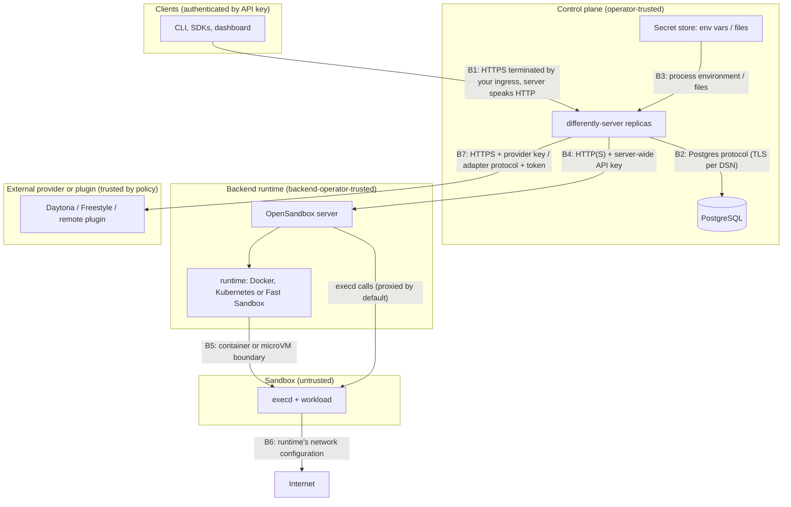

# Security and trust model

| | |
|---|---|
| Status | Describes the code as of 2026-10-28, after the move to OpenSandbox removed Differently's own node agent. Nothing here has been validated by a penetration test. |
| Companion | [Hardening checklist](hardening-checklist.md) · [Architecture](../architecture/README.md) · [OpenSandbox pools](../guides/opensandbox-pools.md) · [Keys and providers](../guides/keys-and-providers.md) |

This document separates three things that are easy to blur:

- **Enforced in code today**: what Differently itself guarantees, with the code
  that does it.
- **Operator responsibility**: what Differently depends on but cannot enforce.
- **Not yet implemented**: gaps, including issues found while writing this
  document.

The most important line: **Differently does not isolate sandboxes.**
Isolation and network egress come from each pool's backend runtime: an
OpenSandbox server with its Docker, Kubernetes or Fast Sandbox runtime, an
external provider, or whatever a `remote` plugin fronts. Differently decides
*where* work may run, controls *who* may touch it, and records *what*
happened. The trust report states each pool's declared isolation; Differently
does not check it.

Verification level of the backends: OpenSandbox with the Docker runtime has
run live through the adapter and through `differently-server`. The Kubernetes
runtime and Fast Sandbox have not, so microVM isolation through Differently
is unverified ([backlog E18](../backlog.md#e18-fast-sandbox-spike)). Daytona
(container class) and Freestyle ran live through their adapters and
`differently-server` on 2026-10-29; Daytona's VM class has not.

## 1. Assets

| Asset | Where it lives | Why it matters |
|---|---|---|
| Tenant code, data and processes inside sandboxes | In the backend: OpenSandbox sandboxes (containers or Fast Sandbox microVMs) on hosts you run; provider sandboxes on external pools | The thing being isolated, by the backend |
| Sandbox environment values (`env`) | Postgres `sandboxes.doc` (plaintext JSON). Also sent to the backend at creation: OpenSandbox's create body (stored by OpenSandbox), Daytona's create body, Freestyle's `/etc/differently/env` inside the VM (mode 0600), devhost's `meta.json` | Often holds secrets |
| API keys | Clients; Postgres holds `sha256(secret)` only | Full access within their scopes |
| Bootstrap operator token, database DSN, backend credentials (OpenSandbox API key, provider API keys, remote plugin tokens) | Environment variables or mounted files on the server. Backend credentials can instead be stored in Postgres `secrets`, sealed (`secret:` references) | Control of the installation and of every backend it uses |
| The secrets key (key-encryption key for stored backend credentials) | An environment variable or file on the server (Helm: Secret `<fullname>-secrets-key` or `secrets.existingSecret`), and the operator's backup. Never in the database | With a copy of the database, it opens every stored backend credential. Without it, they cannot be opened at all |
| The OpenSandbox server's API key, in particular | The control plane's environment, and the OpenSandbox server's own configuration | OpenSandbox has one server-wide key and no tenant model: whoever holds it can create, exec into, read and delete every sandbox on that server without going through Differently |
| Placement policy, classifications, pool trust and isolation declarations | Config file, `policies` and `pools` tables | Decide whether data may leave private infrastructure, and what the trust report claims |
| Audit chain | Postgres `audit_events`; optional JSON-lines mirror | Accountability and evidence |
| Snapshots | Backend-side: OpenSandbox snapshots, provider snapshots | Copies of tenant disks, and of memory where the runtime captures it |
| Images and templates | Image URIs and template IDs in pool config and templates; pulled by the runtime from the registries you configure | Supply chain for every sandbox |

## 2. Actors

| Actor | Trust | Can do |
|---|---|---|
| Installation operator (`admin` scope) | Fully trusted for the installation | Everything, including pools, global policy, suspending tenants |
| Organization admin (`org:admin`) | Trusted inside one organization | All tenant scopes in its organization, mint keys up to its own scopes |
| Project or CI key | Trusted inside one project and its scopes | Sandboxes, exec, files as scoped |
| Sandbox workload | **Untrusted.** Assume arbitrary and malicious code | Whatever the runtime's isolation and network configuration allow |
| Backend operator: whoever runs the OpenSandbox server and its hosts (root on Docker hosts or KVM nodes, administrators of the cluster OpenSandbox uses) | Trusted; Differently cannot protect workloads from them | Read sandbox memory, disks and environment; act on sandboxes directly, outside Differently's audit log |
| Holder of an OpenSandbox API key | Equivalent to the backend operator for that server | Create, exec into, read files of and delete any sandbox on that server. Differently sees such changes only as orphans or lost instances during reconciliation |
| Cloud provider hosting your hosts | Trusted for the hardware it runs | Physical and hypervisor access |
| External provider (trust `external` pool) | Trusted for workloads policy sends to it | Sees code, data and environment of those sandboxes |
| Database administrator | Trusted | Read env values; rewrite the audit chain; see stored credentials' names and fingerprints, but not their values without the secrets key |
| Holder of the secrets key and a database copy | Equivalent to the control plane for backends | Open every stored backend credential |
| Community adapter (`remote` pool) | Trusted as declared by the operator's `trust` setting | Sees everything sent to its pool |
| Network attacker | Untrusted | Observe or tamper with unencrypted links, including a plain-HTTP OpenSandbox URL |

## 3. Trust boundaries

| Boundary | Enforced in code | Operator responsibility | Not yet implemented |
|---|---|---|---|
| B1 client → API | Token parsing and hashed verification; scopes; tenancy (404 across tenants); per-key rate limit; 4 MiB JSON bodies with unknown fields rejected; 100 MiB uploads; suspended orgs blocked for writes | TLS termination, ingress and WAF, exposure of `/metrics` | OIDC/SSO; IP allow-lists; global (cross-replica) rate limits |
| B2 API → Postgres | Parameterized queries (pgx); transactions and row locks for quota | TLS in the DSN, network policy, encryption at rest, backups (they include sealed backend credentials, so keep them apart from the secrets key), least-privilege DB role | Application-level encryption of env values |
| B3 secrets → server | Values are never logged or returned. A pool's credential is a reference (`env:`, `file:`) or a stored value (`secret:`). Stored values are sealed with AES-256-GCM, with the secret's name bound in, under a key that never enters the database. Only `admin` keys can store, list or delete them, and listings show fingerprints only | The secret store itself; file permissions; the secrets key and its backup, kept apart from database backups | Native Vault / cloud secret manager clients behind `secret:`; rotating the secrets key ([backlog E23](../backlog.md#e23-provider-credential-follow-ups)) |
| B4 control plane → OpenSandbox | The API key is sent only to the configured server, in `OPEN-SANDBOX-API-KEY`; the API never returns it, the trust report shows only its reference, and in the live run it did not appear in the server log. Port endpoints that would need the key are refused (`ExposePort`). The adapter acts only on sandboxes whose metadata it wrote and re-checks the server's metadata filter | TLS: the chart's default `apiURL` is plain HTTP inside the cluster, so use an `https` URL or an encrypting mesh across untrusted networks. Restrict who can reach the server's port. Rotate the key on both sides | Scoped or per-tenant OpenSandbox credentials (OpenSandbox has one key per server) |
| B5 runtime → sandbox | **Nothing in Differently.** The pool's declared `isolation` (`container` or `microvm`) is reported, not verified. With the server proxy (default), Differently relies on OpenSandbox not forwarding the API key into the sandbox; this has not been checked separately | Choose a runtime that matches the data: Docker and Kubernetes containers share the host kernel. Harden it in OpenSandbox (capabilities, `no_new_privileges`, PID limits, seccomp), patch hosts, and declare `isolation` truthfully | Fast Sandbox through Differently ([E18](../backlog.md#e18-fast-sandbox-spike)) |
| B6 sandbox → network | **Nothing in Differently.** OpenSandbox pools do not advertise `network.egress-control` | Egress rules in OpenSandbox, NetworkPolicy in its namespace, host and VPC firewalls. Block cloud metadata endpoints, private ranges, the control plane and Postgres from sandboxes | Wiring OpenSandbox's network policy ([E19](../backlog.md#e19-opensandbox-network-policy-and-egress)) |
| B7 control plane → provider or plugin | Fail-closed placement; explicit `externalPools` approval; classification ceilings; provider TTL backstop; HTTPS to providers. For `remote` pools, the operator's `trust` overrides the plugin's claim, and the plugin's handler checks its bearer token in constant time | Provider account security, key scoping, data processing agreements; TLS on plugin endpoints | Provider-side network policy beyond Freestyle's firewall option; adapter protocol version check (E0.25) |

## 4. Enforced in code today

**Identity and access** (`internal/auth/auth.go`, `internal/server/server.go`)

- Tokens are `dly_<keyid>_<secret>` with a 40-character random secret; only
  `sha256(secret)` is stored and compared in constant time. Revoked and
  expired keys are refused.
- Rotation (`POST /v1/api-keys/{id}/rotate`) issues a replacement with the
  same name, scopes, organization, project and lifetime. The old key stays
  valid for at most 7 days, or is revoked at once. The caller must be able
  to grant every scope the key holds (the same `CheckGrant` rule as
  creation), and the rotation is audited as `key.rotate`.
- A key belongs to the operator (no organization), one organization, or one
  project. `CanAccess` confines organization keys to their organization and
  project keys to their project; resources in other tenants are reported as
  `404 not_found`, never `403`.
- Scopes: `admin`, `org:admin`, `sandboxes:read|write|exec`, `projects:write`,
  `keys:write`, `usage:read`, `audit:read`, `policies:write`. `org:admin`
  implies every tenant scope; `admin` implies everything.
- No escalation (`CheckGrant`): a key can mint only keys with scopes it holds,
  only in its own tenancy, `org:admin` only if it holds `org:admin` itself, and
  `admin` only as an operator key.
- Admin routes (`/v1/admin/*`) require the `admin` scope.
- Per-key token bucket rate limit (default 50 requests/s, burst 100) per
  replica.
- Suspended organizations cannot make non-GET calls, and their queued work is
  held.

**Placement security** (`internal/policy/policy.go`, `internal/config/config.go`)

- With no global policy, external placement is `never`.
- Lower levels (organization, project, classification, request) can only
  tighten external mode, intersect allowed pools and regions, and add denials.
- An external pool must be named in `externalPools`; registering a pool
  authorizes nothing.
- `daytona` and `freestyle` pools are forced to `trust: external` regardless of
  configuration. `opensandbox` pools must declare `trust`; configuration
  without it is rejected.
- Every decision records each pool's verdict and reasons.

**Backend boundaries** (`internal/config`, `internal/adapters/*`, `internal/server/admin.go`)

- Differently does not isolate sandboxes. The trust report lists, per pool,
  the adapter, trust, declared isolation, endpoint and credential reference.
- `devhost` (no isolation) and `fake` pools refuse to start outside dev mode,
  and the config validator rejects `devhost` without `dev: true`.
- The OpenSandbox adapter tags each sandbox with its Differently and
  installation IDs, and lists, adopts or deletes only sandboxes carrying them.
  It refuses exec stdin and port endpoints that need request headers.
- Exec timeouts are passed to the backend as requested. For OpenSandbox pools
  Differently sets no default or maximum; the `devhost` runner defaults to
  10 minutes with a 2-hour maximum.
- The server caps uploads at 100 MiB per request; streamed exec output is
  passed through without buffering.

**Secrets and data handling**

- Control-plane secrets (DSN, bootstrap token) are referenced, never
  stored. There is
  no agent token any more.
- Backend credentials are referenced (`env:`, `file:`) or stored sealed
  (`secret:`; `internal/secrets`, `internal/server/secrets.go`):
  - AES-256-GCM with a random nonce per value;
  - the secret's name bound in as associated data;
  - a 32-byte key read at start-up from `secrets.keyEnv` or
    `secrets.keyFile`.

  The API returns names, 12-hex-character fingerprints (a truncated
  SHA-256) and the pools using each secret, never values. A secret in use
  cannot be deleted. Without a key, nothing can be stored.
- A changed credential value (a stored secret, or the file behind a
  `file:` reference) is picked up within about 5 seconds on every replica,
  without a restart (`internal/pools` `fingerprint`, `Recheck`).
- The API returns `envKeys`, never env values.
- Labels with the prefix `differently.dev/` are reserved for ownership
  tracking and cannot be set by tenants.
- Exec audit events record the program name only unless
  `audit.recordCommands` is enabled.
- The dashboard keeps the viewer's key in `sessionStorage` and is served with a
  strict Content-Security-Policy (`internal/dashboard/dashboard.go`).

**Integrity and accountability**

- Tamper-evident audit chain with a verification endpoint.
- No telemetry or phone-home code path.

## 5. Operator responsibilities

Differently cannot do these for you. The [hardening checklist](hardening-checklist.md)
turns them into steps.

1. Terminate TLS in front of the server; it serves plain HTTP.
2. Restrict network access to Postgres, `/metrics` (unauthenticated) and the
   OpenSandbox server's port. That port accepts the server-wide API key, which
   bypasses Differently's tenancy and audit.
3. Protect Postgres: TLS, a dedicated role, encryption at rest, backups. It
   holds sandbox environment values in plaintext, and stored backend
   credentials sealed under the secrets key.
4. Keep secrets in a real secret store, and rotate the bootstrap token and
   the backend credentials. Rotating the OpenSandbox key means changing it on
   the OpenSandbox server and where the control plane reads it: the Secret,
   or the stored value (`differently admin secret put`). If you store backend
   credentials in Differently, back up the secrets key apart from database
   backups, and use `secrets.existingSecret` with GitOps renderers that
   cannot `lookup` ([keys and providers](../guides/keys-and-providers.md#back-up-the-secrets-key)).
5. Choose and harden the runtime. Docker and Kubernetes runtimes run
   containers that share the host kernel; use Fast Sandbox (once verified) or
   dedicated hosts for code you would not run beside other tenants. Patch
   hosts, restrict who administers the OpenSandbox server and its hosts, and
   declare each pool's `isolation` truthfully.
6. Supply trustworthy images and templates from registries you control, and
   pin their versions.
7. Decide sandbox egress in the runtime: block cloud metadata endpoints,
   private ranges, the control plane and the database unless needed.
8. Declare `trust` truthfully for every `opensandbox` pool, and set
   `trust: external` for any `remote` pool that runs on third-party
   infrastructure. The default for `remote` is `private`.
9. Register each OpenSandbox server as exactly one pool.
10. Approve external pools deliberately, per classification, and review the
    trust report.
11. Pin OpenSandbox server and `execd` versions and run the adapter's live
    test on every upgrade ([backlog E21](../backlog.md#e21-opensandbox-version-pinning-and-upgrade-testing)).
12. Export the audit mirror (`audit.file`) or periodic head hashes to
    write-once storage.
13. Never run `--dev` or `devhost` pools in production.

## 6. Not yet implemented, and known issues

### Gaps by design (tracked)

| Gap | Effect | Tracking |
|---|---|---|
| Isolation and egress belong to the runtime | Differently cannot prove or enforce what a pool declares; the trust report shows declarations | By design: the runtime's job |
| microVM isolation through Differently is unverified | Only the Docker runtime has run through Differently; its containers share the host kernel | [backlog E18](../backlog.md#e18-fast-sandbox-spike), [POC 11](../proof-of-concepts.md#poc-11-fast-sandbox-through-the-adapter) |
| OpenSandbox's network policy is not wired up | No per-sandbox egress control through Differently on OpenSandbox pools | [backlog E19](../backlog.md#e19-opensandbox-network-policy-and-egress) |
| One server-wide OpenSandbox API key | Anyone holding it controls every sandbox on that server, outside Differently's tenancy and audit | OpenSandbox's model; keep the key in the control plane only |
| Sandbox env values in plaintext | Database readers and the backend see them; fork copies them | [backlog E13](../backlog.md#e13-sandbox-secrets-by-reference), informed by [E20](../backlog.md#e20-credential-vault-evaluation) |
| Memory snapshot protection | Depends on the runtime; Differently reports the snapshot kind the pool declares | [backlog E18](../backlog.md#e18-fast-sandbox-spike) |
| Webhooks, SSH gateway, PTY | Missing features, each with its own authentication design | Backlog E10, E7 |
| OIDC/SSO, key lineage, maximum key lifetime | Keys are standalone; child keys outlive revoked parents; no TTL cap | [backlog E0](../backlog.md#e0-correctness-and-security-fixes-from-the-code-review) |
| Remote plugin protocol has no tests | Its only tests were the removed node agent's | Backlog E0.34 |
| The secrets key cannot be rotated | Sealed values carry no key version and there is no re-encryption; changing the key means storing every value again | [backlog E23](../backlog.md#e23-provider-credential-follow-ups) |
| No external vault behind `secret:` | Stored credentials live in Differently's database; vault-held values reach the server only as `file:` mounts | [backlog E23](../backlog.md#e23-provider-credential-follow-ups) |
| One credential per pool for the whole installation | Every organization's sandboxes on a pool use the same provider account | [backlog E23](../backlog.md#e23-provider-credential-follow-ups) |

### Issues found while documenting the code (2026-10-28)

Defects found in review, each with a task in
[backlog E0](../backlog.md#e0-correctness-and-security-fixes-from-the-code-review).
Numbers are kept so earlier references stay valid.

| # | Issue | Status |
|---|---|---|
| 1 | Agent impersonation through the shared agent token. | **Obsolete.** Node agents, their tokens and per-agent secrets were removed. |
| 2 | Cross-tenant deletion of project policies. | **Fixed.** `DELETE /v1/policies/project:<id>` checks project ownership like `PUT`. |
| 3 | Stopped sandboxes restarted without a quota check. | **Fixed.** `start` re-reserves CPU and memory atomically (`Store.ReserveCompute`). |
| 4 | Audit was fail-open only. | **Option added.** `audit.failClosed: true` records each state-changing request before acting and answers `503` if that fails. Failures are counted in `differently_audit_append_failures_total` in both modes. Scheduler-side events stay fail-open. |
| 5 | PID reuse on agent nodes. | **Obsolete.** Differently no longer manages VM processes. |
| 6 | Unauthenticated `/metrics` on the API port. | **Option added, on by default in Helm.** `metrics.listen` serves metrics on a separate port (chart default `9091`) that the ingress never routes to. |
| 7 | Rate limiting runs after the key lookup, so unauthenticated floods still cost a database read per request, and limits are per replica. | Open (E0.8). |
| 8 | A changed bootstrap token un-revoked the bootstrap key. | **Fixed.** A revoked bootstrap key stays revoked. |
| 9 | Unbounded responses from the guest agent. | **Obsolete** for the guest; see issue 10 for the same class of problem with OpenSandbox. |
| 10 | The OpenSandbox adapter collects synchronous exec output without a size limit, and cuts file downloads at 100 MiB without reporting truncation. A sandbox can make a control-plane replica buffer arbitrary output. | Open (E0.35). |
| 11 | OpenSandbox's own `timeout` is set from the TTL only at creation; extending the TTL through the API does not extend it, so OpenSandbox can delete the sandbox first. | Open (E0.20). |
| 12 | A pool registered as `firecracker` through the admin API before the upgrade stays in the store with no adapter; its sandboxes cannot be reached and terminating them retries forever. | Open (E0.22). |
| 13 | Pool registry changes made through the API reach only the replica that handled the call. That covers adding a pool, `use`, drain, undrain and `PATCH`. Other replicas, including the scheduler leader, keep their old view until restart, so a switch or drain may not take effect where placement happens. Credential values are re-read on every replica. Found by reading `internal/pools`; not reproduced. | **Fixed.** Every replica re-reads the pool registry on each refresh (about 5 s). |
| 14 | `secret.put` and `secret.delete` are not among the trust report's `recentAdminActions`. `pool.update` does not record a changed `credentialRef`. The trust report's `limitations` still describes backend credentials as environment variables or files only. | **Fixed.** |

## 7. Residual risks

Risks that remain even when everything above is done:

- **Isolation is only as strong as the runtime.** The Docker and Kubernetes
  runtimes run sandboxes as containers on a shared host kernel; a kernel
  exploit crosses tenants. Fast Sandbox's microVMs are a stronger boundary
  but have not been verified through Differently.
- **Backend operators see everything.** Whoever operates an OpenSandbox
  server and its hosts, a cloud provider, or an external provider can read
  the workloads it runs, including code, data and environment variables.
  Differently does not offer confidential computing.
- **Backend credentials are powerful.** The control plane holds them as
  environment variables or mounted files, or opens stored ones with the
  secrets key. Anyone who can read the server's environment or memory can
  use every credential it can use: storing them in Differently does not
  change that. Anyone with the secrets key and a database copy can open
  every stored one. An OpenSandbox key gives full control of its server.
- **Losing the secrets key loses every stored credential.** There is no
  recovery except storing each value again.
- **Actions outside Differently** (the backend's own API or console,
  kubectl, SSH to hosts) are not in its audit log.
- **Egress is whatever the runtime allows.** Differently does not inspect or
  restrict sandbox traffic.
- **External providers see everything sent to them.** Classification and
  policy decide what goes there; once there, the provider's controls apply.
- **Hypervisor and CPU side channels.** For microVM runtimes and providers,
  co-tenant isolation depends on host patching and CPU mitigations.
- **The audit chain can be rewritten** by anyone with database write access
  unless heads are anchored externally.
- **Sandbox environment values are stored unencrypted** in the database.
- **Usage costs are estimates** from configured cost models.
- **Port URLs.** Freestyle port URLs are reachable by anyone who has them;
  Daytona signed URLs are valid for one hour; an OpenSandbox direct endpoint
  is reachable by anyone who can reach it on the network, with no
  authentication from Differently.

## 8. How the trust report answers Scenario L

Scenario L asks: can an operator see where workloads may go, where they went,
why, and what Differently cannot prove? `GET /v1/admin/trust-report`
(`internal/server/admin.go` `trustReport`, CLI `differently admin trust-report`)
answers each part. Per-sandbox detail comes from
`GET /v1/sandboxes/{id}/placement`.

| Question | Trust report field | Notes |
|---|---|---|
| Is anything phoning home? | `telemetry` | Always `none: Differently has no telemetry or phone-home code paths` |
| What is the control plane? | `controlPlane` | Store driver, public URL, audit mirror path, dev flag |
| Where can work go? | `pools[]` | Name, adapter, trust, enabled, draining, region, declared `isolation` (from the adapter's `Info`), backend `endpoint` (OpenSandbox, Daytona, Freestyle, remote), `credentialRef` (reference only), health, `approvedForExternalPlacement` |
| Under which rules? | `globalPolicy`, `scopedPolicies[]`, `classifications[]` | `approvedForExternalPlacement` is computed from the global policy; scoped policies can only narrow it, so it is an upper bound |
| Where did work go? | `placementsByPool[]` | Sandboxes and accumulated run seconds per pool (the current running interval is not included) |
| What left private infrastructure? | `recentExternalPlacements[]` | Up to 50, newest first: sandbox, organization, pool, classification, creator, time, placement reason |
| Who changed the rules? | `recentAdminActions[]` | Last 50 `admin.*`, `pool.*`, `policy.*`, `org.*`, `key.create`, `key.revoke`, `key.rotate` events (not `secret.*`; query `GET /v1/audit-events?action=secret.put`) |
| Has the log been edited? | `auditChain` | `audit.Verify` over the full chain: `ok`, `events`, `brokenAt`, `problem`, `headHash` |
| What can't Differently prove? | `limitations[]` | Listed below |
| Why did this sandbox land here? | `/v1/sandboxes/{id}/placement` | Stored decision: strategy, effective external mode, policies applied, every candidate with eligibility, capacity, estimated cost, rank and reasons; for a queued sandbox also the decision as it would be made now |

The report no longer has an `agents[]` field. The `isolation` value is what
the pool declares (for OpenSandbox, from `config.isolation`); compare it with
the runtime you actually deployed.

`TestHybridOverflowAndPrivateOnly` asserts that an overflowed sandbox appears
in `recentExternalPlacements`, that `limitations` is non-empty and that the
audit chain verifies.

The `limitations` list returned today (`limitations` in
`internal/server/admin.go`), in summary:

1. Differently does not isolate sandboxes; isolation and egress come from each
   pool's backend runtime, and each pool's declared isolation should be
   checked against the runtime actually deployed.
2. Whoever operates a backend (an OpenSandbox server and its hosts, a cloud
   provider, an external provider) can read the workloads it runs.
3. Actions taken directly on a backend bypass Differently's audit log.
4. The audit chain is tamper-evident, not tamper-proof; export events to
   write-once storage to anchor it.
5. Backend credentials are held by the control plane as environment variables
   or files; anyone who can read its environment can use them. (The text has
   not been updated for credentials stored in Differently, issue 14.)
6. Sandbox environment variables are stored unencrypted in the control-plane
   database.
7. Exec commands are audited by program name unless `audit.recordCommands` is
   enabled.
8. Usage costs are estimates, not reconciled invoices.

It adds the fail-open audit entry unless `audit.failClosed` is set, and the
unauthenticated `/metrics` entry unless `metrics.listen` is set.

Scaling note: the report reads every sandbox row and the whole audit chain on
each call.
