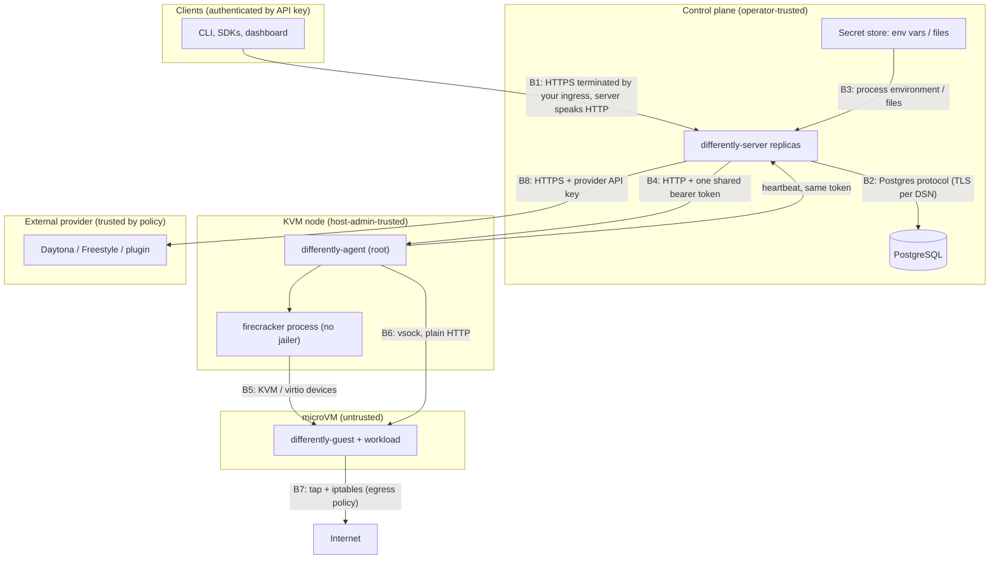

# Security and trust model

| | |
|---|---|
| Status | Describes the code as of 2026-10-28. Nothing here has been validated by a penetration test or on real KVM infrastructure. |
| Companion | [Hardening checklist](hardening-checklist.md) · [Architecture](../architecture/README.md) · [ADR 0008](../adr/0008-secrets-by-reference-only.md) · [ADR 0009](../adr/0009-tamper-evident-audit-chain.md) · [ADR 0015](../adr/0015-defer-jailer-integration.md) |

This document separates three things that are easy to blur:

- **Enforced in code today**: what Differently itself guarantees, with the code
  that does it.
- **Operator responsibility**: what Differently depends on but cannot enforce.
- **Not yet implemented**: gaps, including issues found while writing this
  document.

## 1. Assets

| Asset | Where it lives | Why it matters |
|---|---|---|
| Tenant code, data and processes inside sandboxes | Firecracker VMs on your nodes; provider sandboxes on external pools | The thing being isolated |
| Sandbox environment values (`env`) | Postgres `sandboxes.doc` (plaintext JSON); node `vm.json` (mode 0600); devhost `meta.json`; provider-side for Daytona (create body) and Freestyle (`/etc/differently/env` inside the VM, mode 0600) | Often holds secrets |
| API keys | Clients; Postgres holds `sha256(secret)` only | Full access within their scopes |
| Bootstrap operator token, agent token, database DSN, provider API keys | Environment variables or mounted files on the server (and agents for the agent token) | Control of the installation and of provider accounts |
| Placement policy, classifications, pool trust declarations | Config file, `policies` and `pools` tables | Decide whether data may leave private infrastructure |
| Audit chain | Postgres `audit_events`; optional JSON-lines mirror | Accountability and evidence |
| Snapshots | Node disk (`<state-dir>/snapshots/<id>/rootfs.ext4`); provider-side snapshots | Copies of tenant disks |
| Guest kernel and rootfs images | Node `--images-dir` | Supply chain for every VM |

## 2. Actors

| Actor | Trust | Can do |
|---|---|---|
| Installation operator (`admin` scope) | Fully trusted for the installation | Everything, including pools, global policy, suspending tenants |
| Organization admin (`org:admin`) | Trusted inside one organization | All tenant scopes in its organization, mint keys up to its own scopes |
| Project or CI key | Trusted inside one project and its scopes | Sandboxes, exec, files as scoped |
| Sandbox workload | **Untrusted.** Assume arbitrary and malicious code | Whatever the VM and its network rules allow |
| KVM host administrator, Kubernetes cluster-admin | Trusted; Differently cannot protect workloads from them | Read guest memory and disks |
| Cloud provider hosting your nodes | Trusted for the hardware it runs | Physical and hypervisor access |
| External provider (trust `external` pool) | Trusted for workloads policy sends to it | Sees code, data and environment of those sandboxes |
| Database administrator | Trusted | Read env values; rewrite the audit chain |
| Community adapter (`remote` pool) | Trusted as declared by the operator's `trust` setting | Sees everything sent to its pool |
| Network attacker | Untrusted | Observe or tamper with unencrypted links |
| Holder of the agent token | Any node | Register a *new* agent ID; cannot take over another agent's ID or call other agents (each has its own secret, see §6) |

## 3. Trust boundaries

| Boundary | Enforced in code | Operator responsibility | Not yet implemented |
|---|---|---|---|
| B1 client → API | Token parsing and hashed verification; scopes; tenancy (404 across tenants); per-key rate limit; 4 MiB JSON bodies with unknown fields rejected; 100 MiB uploads; suspended orgs blocked for writes | TLS termination, ingress and WAF, exposure of `/metrics` | OIDC/SSO; IP allow-lists; global (cross-replica) rate limits |
| B2 API → Postgres | Parameterized queries (pgx); transactions and row locks for quota | TLS in the DSN, network policy, encryption at rest, backups, least-privilege DB role | Application-level encryption of env values |
| B3 secrets → server | References only; values never logged or stored | The secret store itself; file permissions | Native Vault / cloud secret manager clients |
| B4 control plane ↔ agent | Constant-time bearer token check on both directions; agents accept only `/adapter/v1` and `/healthz` | Network isolation of the agent port (Helm `NetworkPolicy` allows only server pods) | mTLS, per-node identity, endpoint pinning (see §6) |
| B5 VMM ↔ guest | Hardware virtualization (KVM); Firecracker's default seccomp filters; SMT disabled in machine config | Host kernel, microcode and Firecracker patching; KVM host hardening | Jailer (chroot, namespaces, cgroups, unprivileged UID) |
| B6 agent ↔ guest | Separate vsock socket per VM; guest path resolution confined under its root; file reads from the guest capped at 100 MiB, streamed lines at 8 MiB | Guest image contents | The guest is untrusted, but synchronous exec results and directory listings from it are decoded without a size limit (issue 9 below) |
| B7 guest → network | Per-VM tap and chain; no inbound connections; deny list for metadata, RFC 1918 and CGNAT; optional egress deny | Upstream firewalls, NAT egress IPs, DNS for guests, IPv6 policy, blocking public node IPs | Per-sandbox allow-lists; IPv6 filtering; DNS filtering |
| B8 control plane → provider | Fail-closed placement; explicit `externalPools` approval; classification ceilings; provider TTL backstop; HTTPS | Provider account security, key scoping, data processing agreements | Provider-side network policy beyond Freestyle's firewall option |

## 4. Enforced in code today

**Identity and access** (`internal/auth/auth.go`, `internal/server/server.go`)

- Tokens are `dly_<keyid>_<secret>` with a 40-character random secret; only
  `sha256(secret)` is stored and compared in constant time. Revoked and
  expired keys are refused.
- A key belongs to the operator (no organization), one organization, or one
  project. `CanAccess` confines organization keys to their organization and
  project keys to their project; resources in other tenants are reported as
  `404 not_found`, never `403`.
- Scopes: `admin`, `org:admin`, `sandboxes:read|write|exec`, `projects:write`,
  `keys:write`, `usage:read`, `audit:read`, `policies:write`. `org:admin`
  implies every tenant scope; `admin` implies everything.
- No escalation (`CheckGrant`): a key can mint only keys with scopes it holds,
  only in its own tenancy, `org:admin` only if it holds `org:admin` itself, and
  `admin` only as an operator key.
- Admin routes (`/v1/admin/*`) require the `admin` scope.
- Per-key token bucket rate limit (default 50 requests/s, burst 100) per
  replica.
- Suspended organizations cannot make non-GET calls, and their queued work is
  held.

**Placement security** (`internal/policy/policy.go`, `internal/config/config.go`)

- With no global policy, external placement is `never`.
- Lower levels (organization, project, classification, request) can only
  tighten external mode, intersect allowed pools and regions, and add denials.
- An external pool must be named in `externalPools`; registering a pool
  authorizes nothing.
- `daytona` and `freestyle` pools are forced to `trust: external` regardless of
  configuration.
- Every decision records each pool's verdict and reasons.

**Isolation** (`internal/agent`, `internal/firecracker`, `internal/guest`)

- One Firecracker microVM per sandbox; SMT disabled in the machine config.
- Per-VM tap and /30; the VM cannot reach the agent's namespace (`INPUT DROP`),
  cannot be reached by anything new (`FORWARD -o tap DROP` after
  established/related), and egress passes through a per-VM chain that drops
  the default deny list and then accepts (with NAT) or drops everything.
- The guest channel is vsock, not the network.
- Exec runs in its own process group; timeouts (default 10 min, maximum 2 h)
  kill the whole group. The guest agent caps synchronous output at 10 MiB per
  stream; the protocol and server cap files at 100 MiB.
- `devhost` (no isolation) and `fake` pools refuse to start outside dev mode,
  and the config validator rejects `devhost` without `dev: true`.

**Secrets and data handling**

- Control-plane and provider secrets are referenced, never stored
  ([ADR 0008](../adr/0008-secrets-by-reference-only.md)).
- The API returns `envKeys`, never env values.
- Labels with the prefix `differently.dev/` are reserved for ownership
  tracking and cannot be set by tenants.
- Exec audit events record the program name only unless
  `audit.recordCommands` is enabled.
- The dashboard keeps the viewer's key in `sessionStorage` and is served with a
  strict Content-Security-Policy (`internal/dashboard/dashboard.go`).

**Integrity and accountability**

- Tamper-evident audit chain with a verification endpoint
  ([ADR 0009](../adr/0009-tamper-evident-audit-chain.md)).
- No telemetry or phone-home code path.

## 5. Operator responsibilities

Differently cannot do these for you. The [hardening checklist](hardening-checklist.md)
turns them into steps.

1. Terminate TLS in front of the server; it serves plain HTTP.
2. Restrict network access to the agent port, Postgres and `/metrics`
   (unauthenticated).
3. Protect Postgres: TLS, a dedicated role, encryption at rest, backups. It
   holds sandbox environment values in plaintext.
4. Keep secrets in a real secret store and rotate the bootstrap, agent and
   provider credentials.
5. Harden and patch KVM hosts (kernel, microcode, Firecracker version), taint
   them for agents only, and restrict who can administer them.
6. Supply trustworthy guest kernels and rootfs images, including a DNS
   configuration that works with the egress rules.
7. Decide egress: the default allows the public internet. Block node public
   IPs and IPv6 upstream if guests must not reach them.
8. Declare `trust: external` for any `remote` pool that runs on third-party
   infrastructure. The default for `remote` is `private`.
9. Approve external pools deliberately, per classification, and review the
   trust report.
10. Export the audit mirror (`audit.file`) or periodic head hashes to
    write-once storage.
11. Never run `--dev` or `devhost` pools in production.

## 6. Not yet implemented, and known issues

### Gaps by design (tracked)

| Gap | Effect | Tracking |
|---|---|---|
| Firecracker jailer | A VMM escape gets the agent's privileges (root; privileged container in default Helm values) | [ADR 0015](../adr/0015-defer-jailer-integration.md), [backlog E4](../backlog.md#e4-firecracker-jailer) |
| Agent channel is plain HTTP; registration uses one shared token | Per-agent secrets stop impersonation (issue 1), but traffic is unencrypted | [backlog E3](../backlog.md#e3-authenticated-agent-channel) |
| Sandbox env values in plaintext | Database and node-disk readers see them; fork copies them | [backlog E13](../backlog.md#e13-sandbox-secrets-by-reference) |
| Per-sandbox egress policy, IPv6 rules, DNS policy | Node-level allow-all-public or deny-all only | [backlog E12](../backlog.md#e12-per-sandbox-egress-allow-lists) |
| Memory snapshot authentication and encryption | Not needed until memory snapshots ship; Firecracker treats snapshot files as trusted input | [ADR 0014](../adr/0014-defer-memory-snapshots-until-restore-proven.md) |
| Webhooks, SSH gateway, preview URLs on Firecracker | Missing features, each with its own authentication design | Backlog E10, E7, E6 |
| OIDC/SSO, key lineage, maximum key lifetime | Keys are standalone; child keys outlive revoked parents; no TTL cap | [backlog E0](../backlog.md#e0-correctness-and-security-fixes-from-the-code-review) |

### Issues found while documenting the code (2026-10-28)

Defects found in review, each with a task in
[backlog E0](../backlog.md#e0-correctness-and-security-fixes-from-the-code-review).

| # | Issue | Status |
|---|---|---|
| 1 | **Agent impersonation.** Every node shared one token, and the heartbeat accepted any agent ID and endpoint, so a compromised node could take over another node's ID and traffic. | **Fixed.** Each agent creates its own secret (`<state-dir>/agent-secret`), pinned when its ID first registers. Heartbeats for a known ID with another secret or pool get `409` and an `agent.register` failure event. The control plane calls each agent with that agent's secret, so the shared token can no longer drive another node's VMs. Remaining gap: a token holder can still register *new* IDs, and the channel is unencrypted until mTLS ([E3](../backlog.md#e3-authenticated-agent-channel)). |
| 2 | Cross-tenant deletion of project policies. | **Fixed.** `DELETE /v1/policies/project:<id>` checks project ownership like `PUT`. |
| 3 | Stopped sandboxes restarted without a quota check. | **Fixed.** `start` re-reserves CPU and memory atomically (`Store.ReserveCompute`). |
| 4 | Audit was fail-open only. | **Option added.** `audit.failClosed: true` records each state-changing request before acting and answers `503` if that fails. Failures are counted in `differently_audit_append_failures_total` in both modes. Scheduler-side events stay fail-open. |
| 5 | PID reuse: a reused PID could be treated as a live VM and receive `SIGKILL`. | **Fixed.** On Linux the agent signals a PID only if its command line names the VM's API socket. |
| 6 | Unauthenticated `/metrics` on the API port. | **Option added, on by default in Helm.** `metrics.listen` serves metrics on a separate port (chart default `9091`) that the ingress never routes to. |
| 7 | Rate limiting runs after the key lookup, so unauthenticated floods still cost a database read per request, and limits are per replica. | Open (E0.8). |
| 8 | A changed bootstrap token un-revoked the bootstrap key. | **Fixed.** A revoked bootstrap key stays revoked. |
| 9 | Unbounded responses from the guest. | **Fixed for synchronous paths.** Exec results and listings are read through size limits; streamed exec is passed through without buffering. |

## 7. Residual risks

Risks that remain even when everything above is done:

- **Infrastructure operators see everything.** Root on KVM hosts, cluster
  administrators and the cloud provider under your nodes can read guest memory
  and disks. Differently does not offer confidential computing.
- **External providers see everything sent to them.** Classification and
  policy decide what goes there; once there, the provider's controls apply.
- **Hypervisor and CPU side channels.** KVM and Firecracker are a strong
  boundary but not perfect; co-tenant isolation depends on host patching and
  CPU mitigations. Disabling SMT in the guest machine config does not disable
  host SMT.
- **Actions outside Differently** (kubectl, provider consoles, SSH to nodes)
  are not in its audit log.
- **The audit chain can be rewritten** by anyone with database write access
  unless heads are anchored externally.
- **Usage costs are estimates** from configured cost models.
- **Public preview URLs.** Freestyle port URLs are reachable by anyone who has
  them; Daytona signed URLs are valid for one hour.

## 8. How the trust report answers Scenario L

Scenario L asks: can an operator see where workloads may go, where they went,
why, and what Differently cannot prove? `GET /v1/admin/trust-report`
(`internal/server/admin.go` `trustReport`, CLI `differently admin trust-report`)
answers each part. Per-sandbox detail comes from
`GET /v1/sandboxes/{id}/placement`.

| Question | Trust report field | Notes |
|---|---|---|
| Is anything phoning home? | `telemetry` | Always `none: Differently has no telemetry or phone-home code paths` |
| What is the control plane? | `controlPlane` | Store driver, public URL, audit mirror path, dev flag |
| Where can work go? | `pools[]` | Name, adapter, trust, enabled, draining, region, provider `endpoint` (Daytona, Freestyle, remote), `credentialRef` (reference only), health, `approvedForExternalPlacement` |
| Under which rules? | `globalPolicy`, `scopedPolicies[]`, `classifications[]` | `approvedForExternalPlacement` is computed from the global policy; scoped policies can only narrow it, so it is an upper bound |
| Where did work go? | `placementsByPool[]` | Sandboxes and accumulated run seconds per pool (the current running interval is not included) |
| What left private infrastructure? | `recentExternalPlacements[]` | Up to 50, newest first: sandbox, organization, pool, classification, creator, time, placement reason |
| Who changed the rules? | `recentAdminActions[]` | Last 50 `admin.*`, `pool.*`, `policy.*`, `org.*`, `key.create`, `key.revoke`, `key.rotate` events |
| Which nodes serve private pools? | `agents[]` | ID, pool, node, endpoint, version, capacity, last heartbeat |
| Has the log been edited? | `auditChain` | `audit.Verify` over the full chain: `ok`, `events`, `brokenAt`, `problem`, `headHash` |
| What can't Differently prove? | `limitations[]` | Fixed list, quoted below |
| Why did this sandbox land here? | `/v1/sandboxes/{id}/placement` | Stored decision: strategy, effective external mode, policies applied, every candidate with eligibility, capacity, estimated cost, rank and reasons; for a queued sandbox also the decision as it would be made now |

`TestHybridOverflowAndPrivateOnly` asserts that an overflowed sandbox appears
in `recentExternalPlacements`, that `limitations` is non-empty and that the
audit chain verifies.

The `limitations` list returned today (`limitations` in `internal/server/admin.go`, adjusted to the configuration):

1. Host administrators (root on KVM nodes, Kubernetes cluster-admins) can read
   guest memory and disks.
2. Cloud providers hosting your nodes can access their hardware.
3. External providers run the workload and can see its code, data and
   environment variables.
4. The audit chain is tamper-evident, not tamper-proof; export events to
   write-once storage to anchor it.
5. Actions taken directly on backends bypass Differently's audit log.
6. Egress from Firecracker sandboxes is controlled only by node networking.
7. Exec commands are audited by program name unless `audit.recordCommands` is
   enabled.
8. Usage costs are estimates, not reconciled invoices.

The list also states the absent jailer, the unencrypted agent channel,
plaintext environment values and agent secrets in the database, and the IPv4-only
egress rules. It adds the fail-open audit entry unless `audit.failClosed` is
set, and the unauthenticated `/metrics` entry unless `metrics.listen` is set.

Scaling note: the report reads every sandbox row and the whole audit chain on
each call.
