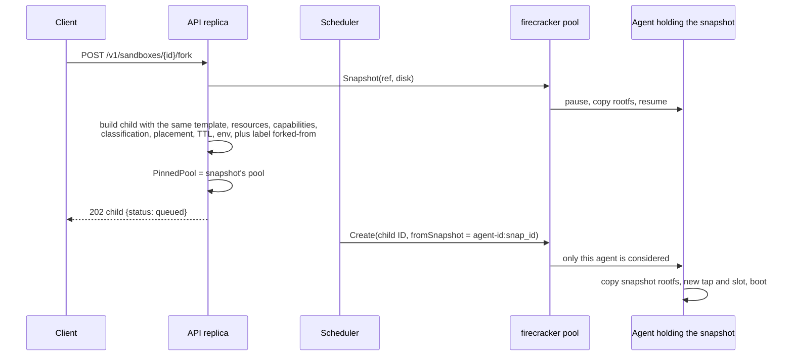

# Storage and lifecycle

| | |
|---|---|
| Status | Describes the code as of 2026-10-28. The Firecracker behaviour below is implemented and unit-tested with a fake VMM; it has not run on real KVM. |
| Code | `internal/agent/agent.go`, `internal/server/sandboxes.go` (`lifecycle`, `snapshot`, `forkSandbox`), `internal/scheduler/scheduler.go` (`expire`, `reconcilePool`) |
| Related | [ADR 0014](adr/0014-defer-memory-snapshots-until-restore-proven.md) · [Adapter specification §9](adapters/specification.md#9-built-in-adapters) · [Placement policy](scheduling/placement-policy.md) |

## 1. Summary

| Question | Firecracker pools | External pools (Daytona, Freestyle) |
|---|---|---|
| Does the disk survive stop? | Yes, on the node's local disk | Yes, provider-side |
| Does memory survive? | Only while paused (vCPUs frozen, memory resident) | Pause on Freestyle and Daytona VM class; Freestyle and Daytona VM snapshots include memory |
| Can I snapshot? | Disk only | Daytona: disk, or memory for VM class; Freestyle: always memory and disk |
| Can I fork? | Yes, from a disk snapshot; the child boots fresh | Freestyle yes (memory); Daytona not advertised |
| Where does a restore or fork run? | Same pool **and same node** as the snapshot | Same pool |
| Can a sandbox move between pools or providers? | **No.** Neither running state nor snapshots are portable | **No** |

## 2. Firecracker on-node layout

The agent keeps everything under `--state-dir` (default
`/var/lib/differently/agent`) and reads images from `--images-dir` (default
`/var/lib/differently/images`):

```
/var/lib/differently/
  images/
    vmlinux                 guest kernel (--kernel)
    default.ext4            template "default" (used when a request names none)
    <template>.ext4         one file per template
  agent/
    vms/<sandbox-id>/
      vm.json               VM record: state, PID, slot, addresses, resources, env (mode 0600)
      rootfs.ext4           the VM's writable root disk
      fc.sock               Firecracker API socket
      vsock.sock            host side of the guest vsock device
      firecracker.log       VMM output
    snapshots/<snap_id>/
      rootfs.ext4           disk snapshot
```

`vm.json` is written atomically (temporary file, then rename) on every state
change.

## 3. Disk persistence

At create (`Manager.build`):

1. The source is `<images-dir>/<template>.ext4`, or a snapshot's
   `rootfs.ext4` for a restore. A missing source is `invalid_request`
   (`image X is not available on node Y`).
2. It is copied to `rootfs.ext4` with `cp --reflink=auto --sparse=always` on
   Linux, falling back to a plain byte copy. On a reflink-capable filesystem
   (XFS with reflink, btrfs) the copy is near-instant and shares blocks;
   otherwise create time and disk usage grow with the image size
   ([POC 5](proof-of-concepts.md#poc-5-rootfs-copy-on-write)).
3. If `diskGiB` is larger than the file, the file is extended and
   `resize2fs` grows the filesystem. Disks never shrink; `diskGiB` smaller than
   the image is ignored.
4. The disk is attached read-write as the only drive.

The disk lives until the sandbox is terminated, when the agent deletes the
whole VM directory.

## 4. Stop and start

| Step | Firecracker agent | Control plane |
|---|---|---|
| Stop | Send Ctrl-Alt-Del through the API, wait up to 10 s for the process to exit, then `SIGKILL`; mark `stopped`; disk kept | `running → stopped`; run time clock stops; CPU and memory leave quota usage; disk, active-sandbox count and the pool concurrency slot stay |
| Start | Re-check node capacity (`insufficient_capacity` if full), boot a new Firecracker process from the retained disk, wait for the guest | `stopped → running`; run clock restarts. **No tenant quota check** (known issue) |

Notes:

- Firecracker's Ctrl-Alt-Del action is x86-only, so on arm64 nodes every stop
  waits the full 10 seconds and then kills the VM; the disk is then only
  crash-consistent.
- The TTL keeps running while stopped. `expiresAt` is set when provisioning
  completes (and reset from "now" by a `PATCH` of `ttlSeconds`); `start` does
  not reset it. Stopped sandboxes expire and are terminated like running ones.
- The network (tap and rules) is created once, at create time, and not
  recreated by `start`. After a host reboot the tap is gone and `start` is
  expected to fail (known issue).
- Other backends: Daytona uses its stop and start endpoints; Freestyle has no
  stop endpoint, so the adapter runs `poweroff` in the guest and polls for
  `stopped`; devhost only flips a flag.

## 5. Pause and resume

Firecracker: `PATCH /vm {"state": "Paused"}` freezes vCPUs; memory stays
resident and keeps counting against node capacity and tenant quota. Exec and
file operations on a paused VM return `409 invalid_state`. Resume sets the
state back to `Resumed`. Pause is not persisted across a VMM restart: an agent
restart that finds the process gone marks the VM `stopped`.

## 6. Agent restart and host reboot

- **Recovery logic.** On start the agent reloads every `vm.json`. VMs whose
  PID is alive stay `running` or `paused`; others become `stopped` with their
  disks kept (`TestRestartRecoversVMs`, in-process only). Firecracker is
  launched with `setsid`, which only helps if nothing else kills the agent's
  children.
- **Agent restart in the shipped deployments.** In Kubernetes the agent is PID
  1 of the container's PID namespace; when it exits, Linux kills every process
  in the namespace. The systemd unit uses `KillMode=control-group`, which stops
  every process in the unit's cgroup. In both cases VMs are expected to stop
  with the agent, so in practice recovery means "disks kept, VMs stopped".
  Untested ([POC 2](proof-of-concepts.md#poc-2-agent-restart-semantics-in-kubernetes)).
- **Host reboot.** VMs stop; disks and records survive; taps and iptables rules
  are gone (see §4).
- **What the control plane sees.** The reconciler checks that instances
  exist, not their state. A VM that stopped underneath a `running` sandbox stays
  `running` in the API, and exec returns `409 invalid_state`. If the agent
  misses heartbeats for longer than `scheduler.agentTimeoutSeconds` (30 s),
  its instances drop out of `List` and the reconciler fails their sandboxes as
  lost; when the agent returns, the VMs are deleted as orphans. Both are known
  issues ([backlog E0](backlog.md#e0-correctness-and-security-fixes-from-the-code-review)).

## 7. Disk snapshots and fork

**Snapshot** (`POST /v1/sandboxes/{id}/snapshots`, kind `disk`, the default):

1. The sandbox must be `running`, `stopped` or `paused`, its pool must
   advertise `snapshots.disk`, and the organization must be under
   `maxSnapshots`.
2. The API replica calls the adapter synchronously. On Firecracker the agent
   pauses a running VM, copies `rootfs.ext4` into `snapshots/<snap_id>/`
   (reflink when possible), and resumes the VM. A stopped or paused VM is
   copied as is.
3. The snapshot is **crash-consistent, not application-consistent**: guest
   page-cache contents not yet written to disk are not captured, and the
   restored filesystem replays its journal on boot.
4. The record (`snp_<ulid>`) stores the pool and the backend ref
   `<agent-id>:<snap_id>`; status is always `ready` because the call is
   synchronous. The snapshot outlives the source sandbox.

**Restore** (`POST /v1/sandboxes` with `fromSnapshot`) and **fork**
(`POST /v1/sandboxes/{id}/fork`):



- Fork uses a memory snapshot only if the pool advertises
  `snapshots.memory` and the source is running (Freestyle); otherwise a disk
  snapshot, so on Firecracker the child boots fresh from the parent's disk.
- The child is pinned to the snapshot's pool (`restore requires pool X`) and,
  within a Firecracker pool, to the snapshot's node. If that node is full the
  child waits (`insufficient_capacity`); if the node is gone, the restore
  cannot succeed.
- The child inherits the parent's environment values, labels plus
  `forked-from: <parent>`, and placement preferences, and goes through
  admission and quota like any new sandbox.

## 8. What is not portable

| Thing | Why | What to do instead |
|---|---|---|
| A running sandbox moving to another pool or provider | No live migration; backends have different VMMs and memory formats | Snapshot (disk) and recreate on the same pool; for cross-backend moves, copy files through the API |
| Firecracker snapshots to another node | Stored on one node's local disk | Restore on the same node; shared or replicated snapshot storage is future work |
| Snapshots between adapters | Refs are adapter-specific (`agent:snap`, Daytona snapshot name, Freestyle snapshot ID) | Placement pins restores to the snapshot's pool |
| Memory state between Firecracker versions or CPU types | Firecracker snapshot compatibility rules (applies once memory snapshots exist) | Restore on matching hosts |
| Network identity | Each VM gets a fresh slot, address and MAC | Applications must not depend on the sandbox IP |
| Provider-side lifetimes | Daytona `ttlMinutes` and Freestyle `ttlSeconds` are set once at create | Extending a sandbox's TTL with `PATCH` does not update the provider backstop; the provider may delete it earlier and the reconciler then marks it failed (known issue) |

## 9. Memory snapshot plan

Memory snapshots are deliberately not advertised on Firecracker pools
([ADR 0014](adr/0014-defer-memory-snapshots-until-restore-proven.md)). The
plan, to be proven in
[POC 4](proof-of-concepts.md#poc-4-memory-snapshot-restore-with-network-overrides)
before enabling `snapshots.memory` ([backlog E9](backlog.md#e9-memory-snapshots-on-firecracker)):

1. **Capture.** Pause the VM, call `PUT /snapshot/create` with
   `snapshot_type: Full` (the client method `CreateSnapshot` exists in
   `internal/firecracker/client.go`), and take a reflink copy of the disk while
   paused so disk and memory agree. Store `vmstate`, the memory file and the
   disk under `snapshots/<id>/`, together with the Firecracker version, CPU
   template and host CPU model.
2. **Protect.** Firecracker treats snapshot files as trusted input: compute
   and verify an HMAC (or sign) over the files, and encrypt them at rest.
3. **Restore.** Start a new Firecracker process for a new slot and load the
   snapshot, pointing its network device at the new tap. Whether the pinned
   Firecracker version supports network overrides on load, or requires the
   original device name, must be checked in the POC.
4. **Fix up identity.** The guest keeps the IP from the original boot
   arguments, so the guest agent needs a hook to re-address `eth0` (or restore
   into the same slot). Regenerate machine IDs and reseed entropy for clones.
   vsock connections do not survive restore; the agent reconnects.
5. **Keep the memory file.** Pages are mapped lazily, so the memory file must
   stay until every VM restored from it is gone; snapshot deletion needs
   reference counting.
6. **Measure.** Restore latency (Firecracker notes high restore latency on
   cgroup v1; use v2), memory file size and disk usage.
7. **Pause to disk.** Once restore works, a sandbox can be paused to disk to
   free memory, and resumed later on the same node.

Diff snapshots stay out of scope while they are in Firecracker developer
preview.

## 10. Image distribution

- Each node serves the templates present as `<images-dir>/*.ext4` and one
  guest kernel. Agents report their templates in every heartbeat; the pool's
  templates are the union, and `Create` only chooses agents that have the
  requested template (an agent reporting none accepts any).
- The Helm chart's `guest-images` init container copies a kernel and rootfs
  files from a container image onto the node, replacing changed files
  atomically so running VMs keep their open inode.
- The config's `templates` list is informational (served by
  `GET /v1/templates`); availability is decided by the agents' reports.
- There is no OCI image pull, lazy loading or per-tenant image upload. Image
  building and signing are the operator's pipeline (see the
  [hardening checklist](security/hardening-checklist.md#guest-images)).
- External pools use provider-side images: Daytona `snapshot`, Freestyle
  `snapshotId` (pool `config.snapshot` or the request's `template`).

## 11. Retention

| Object | Kept until | Removed by |
|---|---|---|
| VM directory and disk | Sandbox terminated | Agent `Delete` |
| Sandbox record (Postgres) | Forever; there is no pruning | Nothing yet |
| Snapshot (record and backend data) | `DELETE /v1/snapshots/{id}`; independent of the source sandbox | The API; if the pool adapter is unavailable at that moment, only the record is deleted and the backend data is left behind |
| Agent records | Forever | Nothing yet |
| Audit events | Forever | Nothing (and deleting would break the chain) |
| Daytona sandboxes | Differently deletes them on terminate; the provider deletes them at `ttlMinutes` | Both |
| Freestyle VMs | Differently deletes them on terminate; the provider deletes them at `ttlSeconds` | Both |

Retention policies for records and snapshots are
[backlog E17](backlog.md#e17-retention-and-garbage-collection).

## 12. Known issues

All in [backlog E0](backlog.md#e0-correctness-and-security-fixes-from-the-code-review).
Items marked **Fixed** were resolved before the initial import.

1. **Fixed:** `start` re-reserved CPU and memory without a quota check.
2. **Fixed:** `start` after a host reboot failed because the tap device was not recreated.
3. The reconciler does not reconcile state (a stopped VM under a `running`
   sandbox).
4. **Partly fixed:** a heartbeat gap now pauses reconciliation of the pool for
   a 10-minute grace instead of failing the node's sandboxes; a node silent for
   longer is still treated as lost.
5. **Fixed:** a VM left `pending` by an agent crash mid-boot reserved capacity
   forever; recovery now marks it stopped.
6. **Fixed:** adopting an interrupted provisioning did not set `expiresAt`.
7. Provider TTL backstops are not updated when the TTL is changed.
8. **Fixed:** queue time was added from creation on every activation, so
   retried sandboxes over-reported `queueSeconds`.
