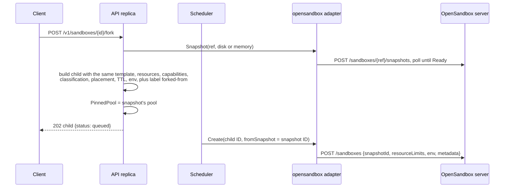

# Storage and lifecycle

| | |
|---|---|
| Status | Describes the code as of 2026-10-28, after the move to OpenSandbox removed Differently's Firecracker node agent. Differently stores records; sandbox filesystems, memory and snapshots live in the backend. OpenSandbox behaviour below is checked live with its Docker runtime unless marked otherwise; its Kubernetes and Fast Sandbox runtimes are unverified. |
| Code | `internal/adapters/opensandbox/opensandbox.go`, `internal/server/sandboxes.go` (`lifecycle`, `snapshot`, `forkSandbox`), `internal/scheduler/scheduler.go` (`provision`, `expire`, `reconcilePool`) |
| Related | [OpenSandbox pools](guides/opensandbox-pools.md) · [Adapter specification §9](adapters/specification.md#9-built-in-adapters) · [Placement policy](scheduling/placement-policy.md) · [OpenSandbox spike](research/opensandbox-spike.md) |

## 1. Summary

| Question | OpenSandbox pools | External pools (Daytona, Freestyle) |
|---|---|---|
| Is there stop/start? | **No.** OpenSandbox has pause/resume and delete only; `stop` returns `501 unsupported_operation` | Yes (Freestyle stops by running `poweroff` in the guest) |
| How long does the filesystem live? | Until the sandbox is deleted, or OpenSandbox's `timeout` ends it | Until deleted, or the provider's TTL ends it |
| Does memory survive? | While paused, if the runtime keeps it; pause and resume kept files on the Docker runtime; memory-preserving pause on Fast Sandbox kept a desktop's processes and unsaved work in a live run (a pause takes minutes) | Pause on Freestyle and Daytona VM class; Freestyle and Daytona VM snapshots include memory |
| Can I snapshot? | Disk by default; memory only if the pool adds `snapshots.memory` to `config.features` | Daytona: disk, or memory for VM class; Freestyle: always memory and disk |
| Can I fork? | Yes, through a snapshot restored with `snapshotId`; checked against the fake server only | Freestyle yes (memory); Daytona not advertised |
| Where does a restore or fork run? | Same pool, that is, the same OpenSandbox server | Same pool |
| Can a sandbox move between pools or providers? | **No.** Neither running state nor snapshots are portable | **No** |

## 2. Where state lives

| State | Where |
|---|---|
| Sandbox, snapshot, quota, policy and audit records | The control-plane store (Postgres, or memory in dev mode) |
| Sandbox filesystem, processes and memory | The OpenSandbox runtime: a container (Docker or Kubernetes runtime) or a Firecracker microVM (Fast Sandbox), on hosts the OpenSandbox operator runs |
| Snapshots | OpenSandbox's snapshot storage; Differently keeps only the snapshot ID as the backend ref |
| Mapping between the two | OpenSandbox sandbox metadata written at create: `differently-sandbox-id`, `differently-installation` and `name` |

Differently keeps nothing on runtime hosts. The `agents` table that used to
track node agents is dropped by migration `0002_drop_agents.sql`.

## 3. Create

`opensandbox.Adapter.Create`, called by the scheduler with the sandbox ID as
the idempotency key:

1. **Idempotency.** List sandboxes whose metadata has
   `differently-sandbox-id=<sandbox ID>`; if one exists (and is not
   `Terminated`), reuse it instead of creating another.
2. **Create.** `POST /v1/sandboxes` with:
   - the source: `snapshotId` for a restore or fork; otherwise the pool's
     `templateId` if set; otherwise an image (`image.uri`, the request's
     `template` or the pool's `config.image`, default `ubuntu:24.04`) with the
     entrypoint `tail -f /dev/null`;
   - `resourceLimits`: CPU (at least 1) and memory (at least 128 Mi) as
     strings; **`diskGiB` is not sent**, although quota and cost count it;
   - `env`, and the metadata above;
   - `timeout` = the sandbox TTL, raised to at least 60 s, when a TTL is set.
     This is a provider-side backstop.
3. **Ready.** Poll the sandbox every 500 ms until `Running` (a `Failed` state
   is an error), then ping `execd` every 200 ms. The adapter allows up to
   3 minutes, but the scheduler's `provisionTimeoutSeconds` (default 120)
   bounds the call first.

State mapping: `Running` → running, `Paused` → paused, `Failed` → error,
`Terminated` → gone; every other OpenSandbox state is reported as pending.
The adapter never reports `stopped`.

## 4. Stop and start

OpenSandbox pools do not advertise `lifecycle.stop-start` or
`persistence.disk`, so:

- `POST .../stop` and `POST .../start` return `501 unsupported_operation`;
- placement rejects requests that require those capabilities with
  `422 unsupported_capability` when no other permitted pool offers them.

For backends that do support stop and start (Daytona, Freestyle, `devhost`),
the control plane behaves as follows:

| Step | Control plane |
|---|---|
| Stop | `running → stopped`; run-time clock stops; CPU and memory leave quota usage; disk, active-sandbox count and the pool concurrency slot stay |
| Start | `stopped → running` after re-reserving CPU and memory atomically against the tenant quota (store conformance `ConcurrentStartRespectsCPUQuota`); run clock restarts |

The TTL keeps running while stopped or paused. `expiresAt` is set when
provisioning completes (and reset from "now" by a `PATCH` of `ttlSeconds`);
`start` does not reset it. Stopped and paused sandboxes expire and are
terminated like running ones.

## 5. Pause and resume

`POST .../pause` calls OpenSandbox's asynchronous pause and waits until the
sandbox is `Paused`; `resume` waits for `Running` and then for `execd` to
answer again. A paused sandbox keeps reserving CPU and memory in the tenant's
quota and its pool concurrency slot. Exec and file operations on a paused
sandbox return `409 invalid_state`.

Whether process memory survives a pause depends on the runtime. The live test
checks that files survive pause and resume on the Docker runtime; it does not
check running processes.

## 6. Backend restarts and host loss

What Differently does is defined by the reconciler (every
`reconcileIntervalSeconds`, default 30 s, on the leader):

- **Server unreachable.** If `List` fails, the pool is skipped for that pass;
  no sandbox is failed or deleted. The health probe (every 5 s on every
  replica) marks the pool unhealthy, so new work waits or goes to another
  permitted pool, and exec and file calls fail with `provider_unavailable`.
- **Sandbox gone.** A `running` or `paused` sandbox whose OpenSandbox sandbox
  is no longer listed, or is `Terminated`, is failed with "backend instance
  disappeared". This includes OpenSandbox's own `timeout` expiring.
- **Sandbox failed.** An OpenSandbox `Failed` state fails the sandbox with the
  backend's message.
- **Orphans.** OpenSandbox sandboxes carrying this installation's metadata
  whose Differently sandbox is gone or terminal are deleted.
- **Grace.** Sandboxes changed within the last 30 seconds are left alone, so
  the reconciler does not race a lifecycle call on another replica.

Whether sandboxes survive an OpenSandbox server restart, a runtime host
reboot or a Kubernetes node drain is OpenSandbox's behaviour and has not been
tested through Differently
([POC 13](proof-of-concepts.md#poc-13-opensandbox-outage-and-recovery)).
Because OpenSandbox has no stop/start, a sandbox lost this way cannot be
started again from its disk: it is failed and has to be recreated, or
restored from a snapshot.

## 7. Snapshots and fork

**Snapshot** (`POST /v1/sandboxes/{id}/snapshots`, kind `disk`, the default):

1. The sandbox must be `running`, `stopped` or `paused`, its pool must
   advertise the requested kind, and the organization must be under
   `maxSnapshots`.
2. The API replica calls the adapter synchronously. The adapter calls
   `POST /v1/sandboxes/{id}/snapshots` (name `differently-<ref>`) and polls
   `GET /v1/snapshots/{id}` until `Ready`.
3. What is captured (filesystem only, or memory too) and how consistent it is
   depends on the runtime. The adapter reports the kind the pool declares.
   Kind `memory` is refused with `unsupported_operation` unless the pool's
   features include `snapshots.memory`.
4. The record (`snp_<ulid>`) stores the pool and the OpenSandbox snapshot ID;
   status is `ready` because the call is synchronous. The snapshot outlives
   the source sandbox.

Snapshot creation was observed on the Docker runtime; restore and fork
through OpenSandbox are checked only against the fake server
(`TestOpenSandboxLifecycleExecFiles`). Fork through the control plane is
covered in-process with the fake adapter (`TestIdempotentCreateAndSnapshots`).

**Restore** (`POST /v1/sandboxes` with `fromSnapshot`) and **fork**
(`POST /v1/sandboxes/{id}/fork`):

- Fork uses a memory snapshot only if the pool advertises
  `snapshots.memory` and the source is running; otherwise a disk snapshot,
  and the child starts fresh from the parent's filesystem.
- The child is pinned to the snapshot's pool (`restore requires pool X`). If
  that pool is unhealthy or at its concurrency cap, the child waits.
- The child inherits the parent's environment values, labels plus
  `forked-from: <parent>`, and placement preferences, and goes through
  admission and quota like any new sandbox.

## 8. What is not portable

| Thing | Why | What to do instead |
|---|---|---|
| A running sandbox moving to another pool or provider | No live migration; backends have different runtimes and memory formats | Snapshot and recreate on the same pool; for cross-backend moves, copy files through the API |
| Snapshots to another OpenSandbox server | Stored by the server that took them | Restore on the same pool; shared or replicated snapshot storage is future work |
| Snapshots between adapters | Refs are adapter-specific (OpenSandbox snapshot ID, Daytona snapshot name, Freestyle snapshot ID) | Placement pins restores to the snapshot's pool |
| Memory state between runtimes, versions or CPU types | Each runtime has its own snapshot format and compatibility rules | Restore on matching hosts |
| Network identity | Each sandbox gets its address from the runtime | Applications must not depend on the sandbox IP |
| Provider-side lifetimes | OpenSandbox `timeout`, Daytona `ttlMinutes` and Freestyle `ttlSeconds` are set once at create | Extending a sandbox's TTL with `PATCH` does not update the backstop; the backend may delete it earlier and the reconciler then marks it failed (known issue) |

## 9. Memory snapshot plan

Differently no longer implements memory snapshots itself. The Firecracker
capture-and-restore plan left with the node agent; it is in git history.

An OpenSandbox pool advertises `snapshots.memory` only when the operator adds
it to `config.features`. Add it only after checking, on the runtime actually
deployed, the points the old plan identified, which apply to any runtime:

1. **Process state.** A process started before the snapshot is still running
   after restore and in a fork.
2. **Clone identity.** Two clones get distinct machine IDs, network identity
   and fresh entropy.
3. **Trusted input.** How the runtime stores and protects snapshot files
   (integrity, encryption at rest).
4. **Lifetime.** Whether a snapshot can be deleted while sandboxes restored
   from it still run.
5. **Compatibility.** Restoring across runtime versions fails cleanly.

For Fast Sandbox this is part of
[POC 11](proof-of-concepts.md#poc-11-fast-sandbox-through-the-adapter)
([backlog E18.3](backlog.md#e18-fast-sandbox-spike)).

## 10. Image distribution

- OpenSandbox pools create sandboxes from an image URI (the pool's
  `config.image`, or the request's `template`) or from a Fast Sandbox
  template (`config.templateId`). The runtime pulls images from whatever
  registries it can reach.
- With `templateId` set, the pool advertises only that template, so
  placement refuses requests that name any other template. Without it, the
  pool advertises no templates and passes any template name to OpenSandbox as
  an image URI.
- The config's `templates` list is informational (served by
  `GET /v1/templates`).
- Registry allow-lists, signature checks and image caching are the runtime's
  (see the [hardening checklist](security/hardening-checklist.md#backend-runtimes-opensandbox)).
  Differently does not inspect images.
- External pools use provider-side images: Daytona `snapshot`, Freestyle
  `snapshotId` (pool `config.snapshot` or the request's `template`).

## 11. Retention

| Object | Kept until | Removed by |
|---|---|---|
| OpenSandbox sandbox | Sandbox terminated, or OpenSandbox's `timeout` | The adapter's `Delete`; OpenSandbox at `timeout` |
| Sandbox record (Postgres) | Forever; there is no pruning | Nothing yet |
| Snapshot (record and backend data) | `DELETE /v1/snapshots/{id}`; independent of the source sandbox | The API; if the pool adapter is unavailable at that moment, only the record is deleted and the backend snapshot is left behind |
| Audit events | Forever | Nothing (and deleting would break the chain) |
| Daytona sandboxes | Differently deletes them on terminate; the provider deletes them at `ttlMinutes` | Both |
| Freestyle VMs | Differently deletes them on terminate; the provider deletes them at `ttlSeconds` | Both |

Retention policies for records and snapshots are
[backlog E17](backlog.md#e17-retention-and-garbage-collection).

## 12. Known issues

Tracked in [backlog E0](backlog.md#e0-correctness-and-security-fixes-from-the-code-review)
unless noted. Items marked **Fixed** were resolved before the initial import.

1. **Fixed:** `start` re-reserved CPU and memory without a quota check.
2. **Fixed:** the reconciler follows instance state: a stopped instance under
   a `running` sandbox makes it `stopped`, an instance in error fails it
   (after a 30-second grace so it never races a lifecycle call). Covered
   in-process by `TestFailureRecoveryAndReconcile`.
3. **Fixed:** adopting an interrupted provisioning did not set `expiresAt`.
4. **Fixed:** queue time was added from creation on every activation, so
   retried sandboxes over-reported `queueSeconds`.
5. Provider TTL backstops (OpenSandbox `timeout`, Daytona, Freestyle) are not
   updated when the TTL is changed (E0.20).
6. `diskGiB` is not sent to OpenSandbox; the sandbox gets the runtime's
   default disk while quota and cost use the requested size.
7. OpenSandbox pools report no capacity, so placement treats a private
   OpenSandbox pool as unbounded unless `maxConcurrency` is set; overflow to
   external pools then never triggers while the pool is healthy, and an
   overloaded runtime shows up as `Create` failures.
8. A terminating sandbox whose backend is gone retries `Delete` forever
   (E0.22).
9. Removed with the node agent, no longer applicable: networking
   not recreated on `start` after a host reboot, the heartbeat-partition grace,
   `pending` VMs left by an agent crash.
